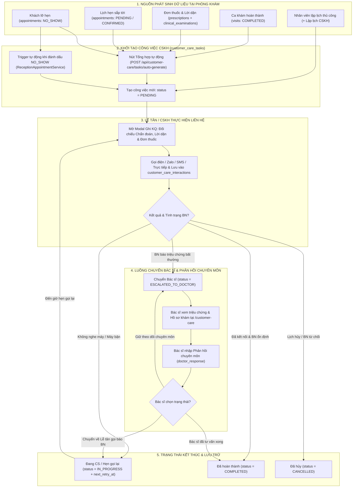
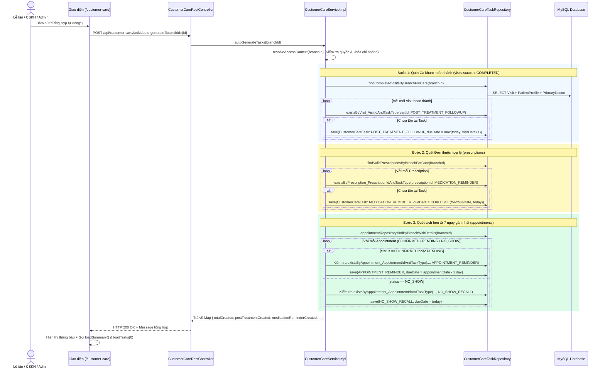
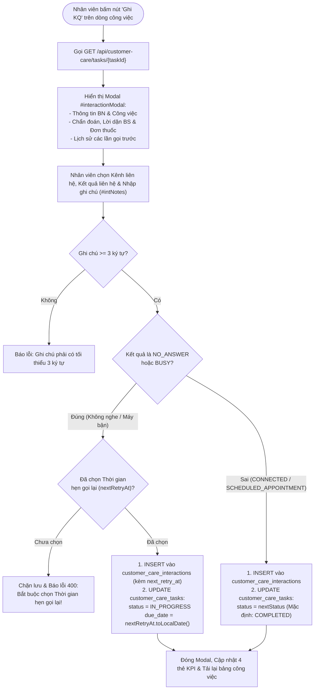
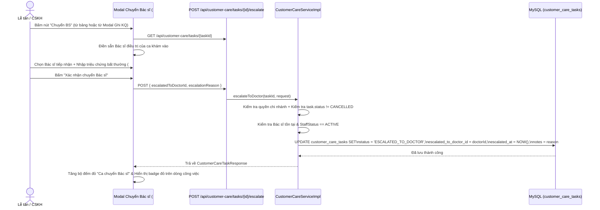
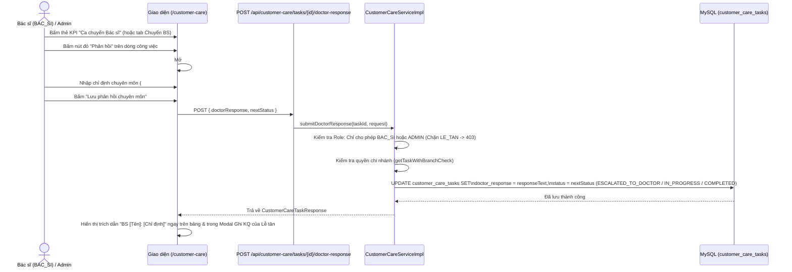

# BÁO CÁO PHÂN TÍCH NGHIỆP VỤ, KIẾN TRÚC KỸ THUẬT VÀ KỊCH BẢN BẢO VỆ MODULE CHĂM SÓC KHÁCH HÀNG (CV-DCMS)

> **Tài liệu phục vụ bảo vệ Đồ án Tốt nghiệp (SEP490_G26 – Hệ thống Quản lý Phòng khám Nha khoa Cường Việt CV-DCMS)**  
> **Vai trò thực hiện:** Business Analyst (BA) · Senior Java Spring Boot Developer · Software QA/Tester  
> **Nguyên tắc thực hiện:** 100% nội dung trong báo cáo này được đối chiếu và trích xuất trực tiếp từ source code thực tế của dự án (Frontend Thymeleaf/JS, Backend Controller/Service/Repository, Entity/Enum và Database MySQL). Tuyệt đối không suy đoán hay mô tả tính năng ảo.

---

## MỤC LỤC TỔNG QUAN (21 PHẦN THEO YÊU CẦU CHUẨN)

1. [Giới thiệu mục đích chức năng Chăm sóc khách hàng](#1-giới-thiệu-mục-đích-chức-năng-chăm-sóc-khách-hàng)
2. [Các vai trò (Role) tham gia và cơ chế phân quyền đa tầng](#2-các-vai-trò-role-tham-gia-và-cơ-chế-phân-quyền-đa-tầng)
3. [Truy tìm nguồn phát sinh dữ liệu Chăm sóc khách hàng (Giải đáp 10 câu hỏi cốt lõi)](#3-truy-tìm-nguồn-phát-sinh-dữ-liệu-chăm-sóc-khách-hàng-giải-đáp-10-câu-hỏi-cốt-lõi)
4. [Các Module và Trang giao diện liên quan trong hệ thống](#4-các-module-và-trang-giao-diện-liên-quan-trong-hệ-thống)
5. [Luồng nghiệp vụ Chăm sóc khách hàng tổng thể (End-to-End Workflow)](#5-luồng-nghiệp-vụ-chăm-sóc-khách-hàng-tổng-thể-end-to-end-workflow)
6. [Phân tích chuyên sâu nút "Tổng hợp tự động" (`autoGenerateTasks`)](#6-phân-tích-chuyên-sâu-nút-tổng-hợp-tự-động-autogeneratetasks)
7. [Các kịch bản "Tổng hợp tự động" (8 kịch bản thực tế)](#7-các-kịch-bản-tổng-hợp-tự-động-8-kịch-bản-thực-tế)
8. [Phân tích chuyên sâu chức năng "Ghi nhận chăm sóc" (`Ghi KQ` / `recordInteraction`)](#8-phân-tích-chuyên-sâu-chức-năng-ghi-nhận-chăm-sóc-ghi-kq--recordinteraction)
9. [Các kịch bản "Ghi nhận chăm sóc" (10 kịch bản thực tế)](#9-các-kịch-bản-ghi-nhận-chăm-sóc-10-kịch-bản-thực-tế)
10. [Phân tích chuyên sâu chức năng "Chuyển đến Bác sĩ" (`Chuyển BS` / `escalateToDoctor`)](#10-phân-tích-chuyên-sâu-chức-năng-chuyển-đến-bác-sĩ-chuyển-bs--escalatetodoctor)
11. [Các kịch bản "Chuyển đến Bác sĩ" (9 kịch bản thực tế)](#11-các-kịch-bản-chuyển-đến-bác-sĩ-9-kịch-bản-thực-tế)
12. [Phân tích chuyên sâu chức năng "Bác sĩ tiếp nhận và phản hồi" (`Phản hồi` / `submitDoctorResponse`)](#12-phân-tích-chuyên-sâu-chức-năng-bác-sĩ-tiếp-nhận-và-phản-hồi-phản-hồi--submitdoctorresponse)
13. [Các kịch bản Phản hồi của Bác sĩ (Kịch bản A đến Kịch bản G)](#13-các-kịch-bản-phản-hồi-của-bác-sĩ-kịch-bản-a-đến-kịch-bản-g)
14. [Vòng đời trạng thái nghiệp vụ (`CustomerCareTaskStatus`) và quy tắc chuyển đổi](#14-vòng-đời-trạng-thái-nghiệp-vụ-customercaretaskstatus-và-quy-tắc-chuyển-đổi)
15. [Hệ thống Sơ đồ Mermaid chuẩn hóa (1 sơ đồ tổng thể + 4 sơ đồ chi tiết)](#15-hệ-thống-sơ-đồ-mermaid-chuẩn-hóa-1-sơ-đồ-tổng-thể--4-sơ-đồ-chi-tiết)
16. [Bảng truy vết URL và Trang giao diện thực tế](#16-bảng-truy-vết-url-và-trang-giao-diện-thực-tế)
17. [Bảng truy vết Kỹ thuật: Frontend – Backend – Database](#17-bảng-truy-vết-kỹ-thuật-frontend--backend--database)
18. [Đánh giá tính hợp lý của luồng hiện tại (Giải đáp 17 câu hỏi BA/QA)](#18-đánh-giá-tính-hợp-lý-của-luồng-hiện-tại-giải-đáp-17-câu-hỏi-baqa)
19. [Các lỗi tiềm ẩn và hạn chế kỹ thuật phát hiện từ Source Code](#19-các-lỗi-tiềm-ẩn-và-hạn-chế-kỹ-thuật-phát-hiện-từ-source-code)
20. [Đề xuất cải tiến và phân loại mức độ ưu tiên (Nhóm A, B, C)](#20-đề-xuất-cải-tiến-và-phân-loại-mức-độ-ưu-tiên-nhóm-a-b-c)
21. [Kết luận, Lời thoại trình bày với Giảng viên & Kịch bản Demo + 16 Câu hỏi Bảo vệ](#21-kết-luận-lời-thoại-trình-bày-với-giảng-viên--kịch-bản-demo--16-câu-hỏi-bảo-vệ)

---

## 1. Giới thiệu mục đích chức năng Chăm sóc khách hàng

Trong nghiệp vụ vận hành phòng khám nha khoa (như nhổ răng khôn, cấy ghép Implant, điều trị tủy, chỉnh nha mắc cài, lắp răng sứ Labo), quá trình điều trị không kết thúc ngay khi bệnh nhân rời ghế nha khoa. Chức năng **Quản lý Chăm sóc Khách hàng (FT44 / UC-26)** trong dự án **CV-DCMS** được thiết kế nhằm giải quyết 5 bài toán cốt lõi sau:

1. **Theo dõi hậu phẫu & tuân thủ điều trị sau khám (`POST_TREATMENT_FOLLOWUP`, `MEDICATION_REMINDER`):**
   - Chủ động gọi điện/nhắn Zalo/SMS hỏi thăm tình trạng sưng, đau, chảy máu sau thủ thuật dựa trên **Chẩn đoán lâm sàng (`diagnoses`)**, **Lời dặn sau điều trị (`clinical_examinations.treatment_instructions`)** và **Đơn thuốc (`prescriptions`)** của Bác sĩ.
2. **Nhắc lịch hẹn sắp tới & Thu hồi khách lỡ hẹn (`APPOINTMENT_REMINDER`, `NO_SHOW_RECALL`):**
   - Nhắc bệnh nhân trước ngày hẹn 1 ngày để giảm tỷ lệ bỏ hẹn; đồng thời tự động sinh công việc gọi lại (`NO_SHOW_RECALL`) khi bệnh nhân không đến khám theo lịch (`NO_SHOW`).
3. **Chăm sóc mở rộng theo đặc thù nha khoa (`INSTALLMENT_REMINDER`, `NO_SERVICE_FOLLOWUP`, `FEEDBACK_COMPLAINT`):**
   - Nhắc đóng tiền trả góp niềng răng/Implant theo đợt, tư vấn lại cho khách hàng đã khám nhưng chưa chốt làm dịch vụ, và tiếp nhận/xử lý phản ánh chất lượng dịch vụ.
4. **Cầu nối xử lý biến chứng lâm sàng giữa Lễ tân/CSKH và Bác sĩ (`ESCALATED_TO_DOCTOR`):**
   - Khi bệnh nhân phản ánh triệu chứng bất thường (chảy máu ổ răng không cầm, dị ứng kháng sinh, đau nhức dữ dội), nhân viên Lễ tân/CSKH không tự ý tư vấn chuyên môn mà thực hiện **Chuyển Bác sĩ (`escalateToDoctor`)** ngay trên hệ thống để Bác sĩ điều trị đưa ra **Phản hồi chuyên môn (`doctorResponse`)**.
5. **Lưu vết lịch sử tương tác đa kênh bất biến (`customer_care_interactions`):**
   - Mọi cuộc gọi (thành công, máy bận, không nghe máy, hẹn gọi lại lúc mấy giờ, ai gọi) đều được lưu thành dòng lịch sử độc lập theo thời gian thực (Timeline), hiển thị đồng bộ ở cả màn hình Lễ tân (`/customer-care`) và màn hình Hồ sơ khám của Bác sĩ (`/doctor/examination/{visitId}/diagnoses#tab-customer-care`).

---

## 2. Các vai trò (Role) tham gia và cơ chế phân quyền đa tầng

Hệ thống kiểm soát quyền truy cập vào module Chăm sóc khách hàng ở cả 3 lớp: **Sidebar (`sidebar-unified.html`)**, **Page Controller (`CustomerCarePageController.java`)** và **REST API + Service (`CustomerCareServiceImpl.java`)**.

### 2.1. Bảng phân quyền chi tiết theo Role thực tế trong Source Code

| Vai trò (Role Code) | Truy cập `/customer-care` | Phạm vi Cơ sở (`branchId`) | Quyền Tổng hợp tự động & Lập lịch | Quyền Ghi KQ (`recordInteraction`) | Quyền Chuyển BS (`escalate`) | Quyền Nhập Phản hồi BS (`doctor-response`) |
| :--- | :---: | :--- | :---: | :---: | :---: | :---: |
| **`ADMIN`** | Được phép | **Toàn hệ thống** (chuyển đổi mọi chi nhánh trên dropdown `#branchId`) | Có | Có | Có | **Có** |
| **`LE_TAN`** (Lễ tân / CSKH) | Được phép | **Chỉ cơ sở được phân công** (`staff_branch_assignments` / `users.branch_id`) | Có (trong cơ sở của mình) | Có (trong cơ sở của mình) | Có (trong cơ sở của mình) | **Bị chặn (`403 FORBIDDEN`)** + Ẩn nút trên UI |
| **`BAC_SI`** (Bác sĩ) | Được phép | **Chỉ cơ sở được phân công** | Có (trong cơ sở của mình) | Có (tại `/customer-care` và ngay trong tab Hồ sơ khám) | Có | **Có** (Chức năng chuyên biệt của Bác sĩ) |
| **`QUAN_LY_KHO`, `KE_TOAN`, `KY_THUAT_VIEN`, `BENH_NHAN`** | **Bị chặn** (`redirect:/access-denied` hoặc `403`) | Không có quyền | Không | Không | Không | Không |

### 2.2. Bằng chứng kỹ thuật trong Source Code
- **Tại `CustomerCarePageController.java` (dòng 35–85):**
  - Hàm `hasCustomerCareAccess(session, user)` kiểm tra `sessionRole` và DB roles: chỉ cho phép `ADMIN`, `LE_TAN`, `BAC_SI` hoặc tài khoản có permission `CUSTOMER_CARE_ACCESS`. Nếu không thỏa mãn -> trả về `redirect:/access-denied`.
- **Tại `CustomerCareServiceImpl.java`:**
  - Hàm `resolveAccessContext(Long requestedBranchId)` (dòng 248–317): Nếu không phải `ADMIN`, hệ thống truy vấn `staffBranchAssignmentRepository.findActiveBranchIdsByUserId(...)` để khóa cứng dữ liệu theo cơ sở của nhân viên. Nếu cố tình truyền `branchId` của cơ sở khác qua API -> ném ngoại lệ `ResponseStatusException(HttpStatus.FORBIDDEN, "Bạn không có quyền truy cập dữ liệu Chăm sóc khách hàng của chi nhánh này.")`.
  - Hàm `submitDoctorResponse(...)` (dòng 1072–1083): Kiểm tra tường minh:
    ```java
    if (!ctx.isAdmin && !"BAC_SI".equalsIgnoreCase(ctx.careRole)) {
        throw new ResponseStatusException(HttpStatus.FORBIDDEN,
            "Chỉ Bác sĩ hoặc Quản trị viên mới có quyền nhập phản hồi chuyên môn cho ca chăm sóc khách hàng.");
    }
    ```

---

## 3. Truy tìm nguồn phát sinh dữ liệu Chăm sóc khách hàng (Giải đáp 10 câu hỏi cốt lõi)

Đây là phần quan trọng nhất để giải thích với giảng viên: **"Dữ liệu trong bảng `customer_care_tasks` từ đâu mà có?"**. Dưới đây là câu trả lời chính xác tuyệt đối dựa trên truy vết toàn bộ nơi gọi `customerCareTaskRepository.save(...)` trong toàn dự án.

### Giải đáp 10 câu hỏi truy vết nguồn dữ liệu:

#### Câu 1: Bệnh nhân được đưa vào danh sách chăm sóc khách hàng từ đâu?
Trong source code hiện tại, một bản ghi công việc chăm sóc (`CustomerCareTask` – bảng `customer_care_tasks`) được sinh ra từ **4 nguồn thực tế** sau:
1. **Nguồn 1 – Tự động sinh tức thì khi Lễ tân đánh dấu lịch hẹn là "Không đến (`NO_SHOW`)"** tại module Quản lý lịch hẹn (`ReceptionAppointmentService.java` dòng 535–548).
2. **Nguồn 2 – Nhân viên bấm nút `"Tổng hợp tự động"` (`#autoGenerateBtn`)** trên màn hình `/customer-care` (`CustomerCareServiceImpl.autoGenerateTasks` dòng 815–942), hệ thống quét 3 bảng:
   - Bảng `visits` (Ca khám đã hoàn thành `status = COMPLETED`) -> sinh task `POST_TREATMENT_FOLLOWUP`.
   - Bảng `prescriptions` (Đơn thuốc hợp lệ có kê thuốc) -> sinh task `MEDICATION_REMINDER`.
   - Bảng `appointments` (Lịch hẹn `CONFIRMED`/`PENDING` -> sinh task `APPOINTMENT_REMINDER`; Lịch hẹn `NO_SHOW` -> sinh task `NO_SHOW_RECALL`).
3. **Nguồn 3 – Nhân viên chủ động bấm nút `"+ Lập lịch CSKH"` (`#openCreateTaskBtn`)** trên màn hình `/customer-care` (`CustomerCareServiceImpl.createTask` dòng 659–714) để tạo lịch chăm sóc thủ công cho bất kỳ bệnh nhân nào trong hồ sơ.
4. **Nguồn 4 – Bác sĩ (hoặc nhân viên) bấm nút `"+ Ghi nhận cuộc gọi / CSKH"` ngay trong Hồ sơ khám bệnh** (`/doctor/examination/{visitId}/diagnoses` -> tab Chăm sóc khách hàng -> gọi API `POST /api/customer-care/visits/{visitId}/interactions` -> `CustomerCareServiceImpl.recordVisitInteraction` dòng 1347–1394). Nếu ca khám đó chưa có công việc CSKH nào đang mở, hệ thống **tự động khởi tạo mới** một `CustomerCareTask` loại `POST_TREATMENT_FOLLOWUP` (trạng thái `IN_PROGRESS`) gắn với `visitId` rồi lưu ngay lịch sử cuộc gọi.

---

#### Câu 2: Có phải tất cả bệnh nhân đều tự động xuất hiện trong danh sách CSKH không?
- **KHÔNG.**
- Bảng chính hiển thị tại `/customer-care` lấy dữ liệu từ bảng `customer_care_tasks` (không phải query trực tiếp từ bảng `patient_profiles`).
- Do đó, một bệnh nhân mới chỉ có hồ sơ trong `patient_profiles` sẽ **chưa** xuất hiện ngay trên bảng công việc CSKH cho đến khi họ phát sinh công việc từ 1 trong 4 nguồn nêu ở Câu 1. (Tuy nhiên, tên của tất cả bệnh nhân đều xuất hiện trong dropdown chọn bệnh nhân khi bấm `"+ Lập lịch CSKH"` hoặc ở tab `"Lịch sử BN"` nhờ API `GET /api/customer-care/lookups`).

---

#### Câu 3: Bệnh nhân đã đặt lịch nhưng chưa đến khám có xuất hiện không?
- **CÓ**, thông qua 2 trường hợp cụ thể:
  1. **Trường hợp lịch hẹn đang chờ khám (`PENDING` hoặc `CONFIRMED`):** Khi nhân viên bấm nút **"Tổng hợp tự động"**, hệ thống quét toàn bộ lịch hẹn có trạng thái `CONFIRMED` hoặc `PENDING` tại chi nhánh (`CustomerCareServiceImpl.java` dòng 892–914) và tự động tạo công việc `APPOINTMENT_REMINDER` (Nhắc lịch hẹn sắp tới) với hạn hoàn thành `dueDate = appointmentDate.minusDays(1)` (trước ngày hẹn 1 ngày).
  2. **Trường hợp đến ngày hẹn mà bệnh nhân không tới và bị đánh dấu `NO_SHOW`:** Ngay khoảnh khắc Lễ tân chuyển trạng thái lịch hẹn sang `NO_SHOW` tại `ReceptionAppointmentService.java` (dòng 535–548), hệ thống **tự động tạo ngay lập tức** một bản ghi `CustomerCareTask` loại `NO_SHOW_RECALL` (Liên hệ lại lịch hẹn lỡ) với `dueDate = LocalDate.now()` và `status = PENDING` mà không cần đợi bấm "Tổng hợp tự động".

---

#### Câu 4: Bệnh nhân mới tiếp đón (Check-in) nhưng chưa khám xong có xuất hiện không?
- **Chưa tự động xuất hiện trong nhóm "Chăm sóc sau điều trị".**
- Lý do kỹ thuật: Câu truy vấn `findCompletedVisitsByBranchForCare(branchId)` trong `CustomerCareTaskRepository.java` (dòng 248–259) chỉ lọc các ca khám có `v.status = com.cvdcms.entity.enums.VisitStatus.COMPLETED`. Khi bệnh nhân mới tiếp đón (`WAITING`) hoặc đang khám (`IN_EXAM`, `IN_TREATMENT`, `WAITING_PAYMENT`), nút "Tổng hợp tự động" sẽ bỏ qua chưa tạo task hậu phẫu.
- **Ngoại lệ duy nhất:** Nếu Bác sĩ đang khám ca đó mà bấm nút `"+ Ghi nhận cuộc gọi / CSKH"` trong tab CSKH của ca khám, hoặc Lễ tân bấm `"+ Lập lịch CSKH"` thủ công (ví dụ chọn nhóm `NO_SERVICE_FOLLOWUP` - Chăm sóc KH chưa làm dịch vụ), thì bệnh nhân sẽ xuất hiện ngay.

---

#### Câu 5: Bệnh nhân đang trong quá trình điều trị (nhiều buổi / đang khám) có xuất hiện không?
- Nếu bệnh nhân có **buổi khám trước đã `COMPLETED`** hoặc có **đơn thuốc (`Prescription`)** hoặc có **lịch hẹn tái khám (`Appointment` ở trạng thái `PENDING`/`CONFIRMED`)**, họ sẽ xuất hiện tương ứng ở các nhóm: `POST_TREATMENT_FOLLOWUP`, `MEDICATION_REMINDER`, `APPOINTMENT_REMINDER`.
- Ngoài ra, đối với bệnh nhân đang điều trị trả góp nhiều đợt (ví dụ niềng răng/Implant), Lễ tân có thể lập lịch nhóm `INSTALLMENT_REMINDER` (Nhắc thanh toán trả góp).

---

#### Câu 6: Bệnh nhân đã hoàn thành khám / điều trị (`VisitStatus.COMPLETED`) được đưa vào danh sách bằng cách nào?
- Khi ca khám chuyển sang `VisitStatus.COMPLETED`, nhân viên CSKH/Lễ tân vào `/customer-care` bấm nút **"Tổng hợp tự động"**.
- Hàm `autoGenerateTasks` (`CustomerCareServiceImpl.java` dòng 832–862) gọi `taskRepository.findCompletedVisitsByBranchForCare(branchId)` lấy các ca `COMPLETED`, kiểm tra chống trùng bằng `existsByVisit_VisitIdAndTaskType(v.getVisitId(), CustomerCareTaskType.POST_TREATMENT_FOLLOWUP)`.
- Nếu chưa có, hệ thống tạo task mới với:
  - `taskType = POST_TREATMENT_FOLLOWUP`
  - `dueDate = max(LocalDate.now(), visitDate.plusDays(1))` (Hỏi thăm sau điều trị 1 ngày)
  - `assignedStaff` = Nhân viên đang thực hiện hoặc Bác sĩ chính của ca khám (`v.getPrimaryDoctor()`)
  - `notes` = Tự động trích xuất từ `clinical_examinations.treatment_instructions` (Lời dặn sau điều trị của Bác sĩ) hoặc `v.getNotes()`.

---

#### Câu 7: Đơn thuốc (`prescriptions`), hướng dẫn điều trị (`treatment_instructions`), lịch tái khám (`appointments` / `followup_date`) ảnh hưởng như thế nào đến dữ liệu chăm sóc?
1. **Đơn thuốc (`Prescription`):**
   - Trong `autoGenerateTasks` (dòng 864–889), hệ thống quét `findValidPrescriptionsByBranchForCare(branchId)` để tạo công việc `MEDICATION_REMINDER` (Nhắc dùng thuốc theo đơn).
   - Ngày hạn gọi (`dueDate`) được ưu tiên lấy từ `p.getFollowupDate()` (ngày hẹn tái khám ghi trên đơn thuốc); nếu đơn thuốc không ghi `followupDate` thì lấy `LocalDate.now()`.
   - Nội dung ghi chú (`notes`) tự động ghép: Mã đơn thuốc (`prescriptionCode`) + Chẩn đoán (`diagnosis`) + Lời dặn dùng thuốc (`advice`).
2. **Hướng dẫn điều trị (`ClinicalExamination.treatmentInstructions`):**
   - Được hàm `enrichClinicalExaminationInfo` (`CustomerCareServiceImpl.java` dòng 1775–1838) truy vấn trực tiếp từ bảng `clinical_examinations` và `diagnoses` theo `visitId`, hiển thị thành **khối màu xanh nổi bật ("Lời dặn: ...")** ngay trên bảng danh sách CSKH và trong Modal Ghi kết quả liên hệ, giúp nhân viên CSKH đọc đúng lời dặn của Bác sĩ khi gọi cho bệnh nhân.
3. **Lịch hẹn (`Appointment`):**
   - Có đồng bộ trạng thái tự động 2 chiều giữa Module Lịch hẹn và Module CSKH:
     - Khi bệnh nhân hoặc Lễ tân **hủy lịch hẹn (`CANCELLED`)** tại `PortalAppointmentService.java` (dòng 222–255) hoặc `ReceptionAppointmentService.java` (dòng 513–516, 595–600): Hệ thống tự động tìm các task `APPOINTMENT_REMINDER` đang `PENDING`/`IN_PROGRESS` của lịch hẹn đó và chuyển sang `CANCELLED` (để Lễ tân không gọi nhắc nhầm lịch đã hủy).
     - Khi Lễ tân **xác nhận lại lịch hẹn** (`ReceptionAppointmentService.java` dòng 399–402): Các task nhắc hẹn bị hủy trước đó được mở lại về `PENDING`.

---

#### Câu 8: Dữ liệu chăm sóc được tạo tự động khi lưu khám hay tạo khi bấm nút "Tổng hợp tự động"?
- **Kết hợp cả hai theo từng sự kiện nghiệp vụ:**
  - **Sự kiện Lỡ hẹn (`NO_SHOW`)** và **Hủy hẹn (`CANCELLED`)**: Tự động kích hoạt **ngay lập tức (Real-time Trigger)** trong `ReceptionAppointmentService` và `PortalAppointmentService`.
  - **Sự kiện Bác sĩ ghi nhật ký cuộc gọi tại màn hình khám**: Tự động tạo task **ngay lập tức** khi Bác sĩ bấm lưu trong `recordVisitInteraction`.
  - **Sự kiện Ca khám hoàn thành (`COMPLETED`), Đơn thuốc mới (`Prescription`), và Nhắc lịch hẹn sắp tới (`APPOINTMENT_REMINDER`)**: Được quét và khởi tạo hàng loạt khi nhân viên bấm nút **"Tổng hợp tự động"** (`POST /api/customer-care/tasks/auto-generate`).

---

#### Câu 9: Có những loại công việc chăm sóc nào (Nhắc lịch hẹn, hỏi thăm sau điều trị, nhắc uống thuốc, tái khám, khách lỡ hẹn...)?
Trong Database (`CustomerCareTaskType.java`), cột `task_type` là `ENUM` gồm **4 giá trị gốc**, nhưng ở tầng Nghiệp vụ (`CustomerCareServiceImpl.java` dòng 72–88 & 1711–1748), hệ thống mở rộng thành **7 phân nhóm CSKH (`careGroup`)** thông qua cơ chế gắn tag tiền tố (`[TRA_GOP]`, `[KHONG_DICH_VU]`, `[PHAN_ANH]`) vào cột `notes`:

| STT | Mã Phân nhóm (`careGroup`) | Giá trị lưu ở cột `task_type` (DB) | Tiền tố nhận diện trong `notes` | Nhãn hiển thị trên Giao diện |
| :-: | :--- | :--- | :---: | :--- |
| 1 | `POST_TREATMENT_FOLLOWUP` | `POST_TREATMENT_FOLLOWUP` | *(Không dùng)* | **Chăm sóc sau điều trị** |
| 2 | `MEDICATION_REMINDER` | `MEDICATION_REMINDER` | *(Không dùng)* | **Nhắc dùng thuốc (Sau ĐT)** |
| 3 | `APPOINTMENT_REMINDER` | `APPOINTMENT_REMINDER` | *(Không dùng)* | **Nhắc lịch hẹn** |
| 4 | `NO_SHOW_RECALL` | `NO_SHOW_RECALL` | *(Không dùng)* | **Lịch hẹn lỡ (Gọi lại)** |
| 5 | `INSTALLMENT_REMINDER` | `APPOINTMENT_REMINDER` | `[TRA_GOP] ` | **Nhắc thanh toán trả góp** |
| 6 | `NO_SERVICE_FOLLOWUP` | `NO_SHOW_RECALL` | `[KHONG_DICH_VU] ` | **Chăm sóc KH chưa làm dịch vụ** |
| 7 | `FEEDBACK_COMPLAINT` | `POST_TREATMENT_FOLLOWUP` | `[PHAN_ANH] ` | **Phản ánh / Khiếu nại** |

---

#### Câu 10: Bảng dữ liệu chính đang lưu danh sách chăm sóc khách hàng là bảng nào trong Database?
Hệ thống sử dụng **2 bảng chính** có quan hệ `1 - N` chặt chẽ và tham chiếu khóa ngoại tới 6 bảng liên quan:
1. **Bảng cha: `customer_care_tasks`** (Entity `CustomerCareTask.java`):
   - Lưu danh sách đầu việc chăm sóc khách hàng.
   - Các cột chính: `task_id` (PK), `task_code` (Unique, VD: `CSKH...`), `profile_id` (FK -> `patient_profiles`), `branch_id` (FK -> `branches`), `task_type` (ENUM), `visit_id` (FK -> `visits`), `appointment_id` (FK -> `appointments`), `prescription_id` (FK -> `prescriptions`), `assigned_staff_id` (FK -> `staff_profiles`), `escalated_to_doctor_id` (FK -> `staff_profiles`), `escalated_at`, `due_date`, `status` (ENUM), `notes` (TEXT), `doctor_response` (TEXT).
2. **Bảng con (Lịch sử tương tác): `customer_care_interactions`** (Entity `CustomerCareInteraction.java`):
   - Lưu toàn bộ lịch sử từng lần gọi điện / nhắn Zalo / SMS / gặp trực tiếp của mỗi task.
   - Các cột chính: `interaction_id` (PK), `task_id` (FK -> `customer_care_tasks`), `profile_id` (FK -> `patient_profiles`), `staff_id` (FK -> `staff_profiles` – người thực hiện cuộc gọi), `channel` (ENUM: `PHONE_CALL`, `ZALO`, `SMS`, `IN_PERSON`), `contact_result` (ENUM: `CONNECTED`, `BUSY`, `NO_ANSWER`, `SCHEDULED_APPOINTMENT`), `notes` (TEXT), `next_retry_at` (DATETIME), `created_at` (DATETIME).

---

## 4. Các Module và Trang giao diện liên quan trong hệ thống

Nghiệp vụ Chăm sóc khách hàng không đứng cô lập mà liên kết xuyên suốt **8 màn hình / module** trong hệ thống CV-DCMS:

1. **Module Đặt lịch trực tuyến của Bệnh nhân (`/portal/appointments` – `PortalAppointmentService.java`):**
   - Nơi bệnh nhân đặt lịch hẹn (`PENDING`) hoặc hủy lịch hẹn (`CANCELLED` -> tự động hủy task `APPOINTMENT_REMINDER`).
2. **Module Quản lý Lịch hẹn & Tiếp đón của Lễ tân (`/reception/appointments` – `ReceptionAppointmentService.java`):**
   - Lễ tân xác nhận lịch (`CONFIRMED`), check-in bệnh nhân (`CHECKED_IN` -> tự động đóng task `APPOINTMENT_REMINDER`), hoặc đánh dấu khách không đến (`NO_SHOW` -> **tự động sinh task `NO_SHOW_RECALL`**).
3. **Module Khám trong ngày của Bác sĩ (`/doctor/daily-visits` – `DiagnosisController.java`):**
   - Hiển thị danh sách ca khám trong ngày theo chi nhánh; từ đây Bác sĩ mở hồ sơ khám của bệnh nhân.
4. **Module Khám lâm sàng, Chẩn đoán, Đơn thuốc & Lời dặn (`/doctor/examination/{visitId}/diagnoses` – `DiagnosisController.java`):**
   - Bác sĩ nhập **Chẩn đoán (`diagnoses`)**, **Lời dặn sau điều trị (`clinical_examinations.treatment_instructions`)**, **Kê đơn thuốc (`prescriptions`, `prescription_items`)** và hoàn thành ca khám (`VisitStatus.COMPLETED`). Đây chính là nguồn dữ liệu lâm sàng cung cấp cho CSKH.
5. **Tab "Chăm sóc khách hàng" ngay trong Hồ sơ khám của Bác sĩ (`doctor/fragments/patient-care-tab.html`):**
   - Nhúng trực tiếp tại `/doctor/examination/{visitId}/diagnoses#tab-customer-care`. Bác sĩ xem được toàn bộ các lần Lễ tân đã gọi hỏi thăm bệnh nhân và có nút **`+ Ghi nhận cuộc gọi / CSKH`** để Bác sĩ trực tiếp ghi nhật ký gọi thăm bệnh nhân.
6. **Menu Nhắc hẹn tái khám của Bác sĩ (`/doctor/recalls` và `/doctor/re-examinations` – `DiagnosisController.java` dòng 154–163):**
   - Đã được hợp nhất và tự động chuyển hướng (`redirect:/customer-care`) về trung tâm Quản lý Chăm sóc Khách hàng chung để đồng bộ 100% dữ liệu giữa Bác sĩ và Lễ tân.
7. **Module Quản lý Hồ sơ Bệnh nhân (`/reception/patients/{id}` và `/doctor/patient-records/{id}`):**
   - Cung cấp thông tin hành chính (`patient_profiles`: Họ tên, Mã BN, SĐT, Ngày sinh, Địa chỉ) và danh sách lịch sử ca khám.
8. **Trung tâm Quản lý Chăm sóc Khách hàng (`/customer-care` – `templates/customer-care/list.html` + `static/js/customer-care.js`):**
   - Giao diện trung tâm gồm 4 thẻ KPI tổng quan, thanh tìm kiếm + 6 Quick Tabs phân nhóm + Bộ lọc nâng cao, Bảng dữ liệu thông minh (hỗ trợ tùy chỉnh ẩn/hiện/kéo thả cột và thanh thao tác nổi khi hover), Panel Timeline Lịch sử BN và 4 Modal nghiệp vụ.

---

## 5. Luồng nghiệp vụ Chăm sóc khách hàng tổng thể (End-to-End Workflow)

Luồng hoạt động khép kín từ lúc bệnh nhân tương tác với phòng khám đến khi hoàn tất chăm sóc diễn ra qua **6 giai đoạn chuẩn**:

- **Giai đoạn 1 (Phát sinh dữ liệu gốc tại Phòng khám):**
  - Bệnh nhân đặt lịch hẹn (`appointments`) hoặc đến khám, được Bác sĩ chẩn đoán (`diagnoses`), ghi lời dặn hậu phẫu (`clinical_examinations`), kê đơn thuốc (`prescriptions`) và kết thúc ca khám (`visits.status = COMPLETED`).
- **Giai đoạn 2 (Khởi tạo Công việc CSKH – `PENDING`):**
  - Lễ tân/CSKH vào `/customer-care` bấm **"Tổng hợp tự động"** (hoặc hệ thống tự bắt sự kiện `NO_SHOW`, hoặc nhân viên bấm **"+ Lập lịch CSKH"**). Các đầu việc mới được lưu vào `customer_care_tasks` với trạng thái `PENDING` (Chờ liên hệ).
- **Giai đoạn 3 (Lễ tân/CSKH Thực hiện Liên hệ & Ghi nhận kết quả):**
  - Nhân viên lọc danh sách **"Hôm nay / Quá hạn"**, bấm nút **`Ghi KQ`** trên từng dòng.
  - Trên Modal, nhân viên đọc kỹ **Chẩn đoán, Lời dặn điều trị và Đơn thuốc** của Bác sĩ, gọi điện/nhắn Zalo cho bệnh nhân và ghi nhận kết quả vào bảng `customer_care_interactions`.
- **Giai đoạn 4 (Xử lý rẽ nhánh sau cuộc gọi):**
  - **Nhánh 4A – Liên hệ thành công, bệnh nhân ổn định (`CONNECTED` / `SCHEDULED_APPOINTMENT`):** Công việc chuyển sang `COMPLETED` (Đã hoàn thành).
  - **Nhánh 4B – Bệnh nhân không nghe máy hoặc máy bận (`NO_ANSWER` / `BUSY`):** Hệ thống bắt buộc nhập **Thời gian hẹn gọi lại (`next_retry_at`)**, chuyển trạng thái công việc sang `IN_PROGRESS` (Đang CS / Hẹn gọi lại) và cập nhật `due_date` theo ngày gọi lại.
  - **Nhánh 4C – Bệnh nhân báo triệu chứng bất thường (Sưng đau nhiều, chảy máu, dị ứng thuốc):** Nhân viên bấm **`Chuyển BS`** (`escalateToDoctor`), chọn Bác sĩ phụ trách và nhập mô tả triệu chứng. Công việc chuyển sang trạng thái `ESCALATED_TO_DOCTOR` (Chuyển Bác sĩ) và nổi cảnh báo đỏ trên thẻ KPI **"Ca chuyển Bác sĩ"**.
- **Giai đoạn 5 (Bác sĩ Tiếp nhận & Phản hồi chuyên môn):**
  - Bác sĩ đăng nhập vào `/customer-care`, bấm vào thẻ KPI **"Ca chuyển Bác sĩ"** (hoặc lọc tab `Chuyển BS`), bấm nút **`Phản hồi`** màu đỏ, xem hồ sơ khám + triệu chứng bệnh nhân báo, nhập **Chỉ định/Hướng xử lý chuyên môn (`doctor_response`)** và chọn trạng thái tiếp theo (`IN_PROGRESS` để Lễ tân gọi báo lại cho bệnh nhân, hoặc `COMPLETED` nếu Bác sĩ đã trực tiếp xử lý xong).
- **Giai đoạn 6 (Đóng ca & Lưu trữ Hồ sơ Timeline):**
  - Lễ tân gọi thông báo chỉ định của Bác sĩ cho bệnh nhân (nếu ở trạng thái `IN_PROGRESS`), ghi nhận lần gọi cuối và chốt trạng thái `COMPLETED`. Toàn bộ lịch sử được lưu vĩnh viễn trong Timeline bệnh nhân.

---

## 6. Phân tích chuyên sâu nút "Tổng hợp tự động" (`autoGenerateTasks`)

### 6.1. Mục đích của nút "Tổng hợp tự động"
- Nút **"Tổng hợp tự động"** (`id="autoGenerateBtn"` tại `list.html` dòng 412–414) giúp nhân viên Lễ tân / CSKH **không phải rà soát thủ công từng ca khám, từng đơn thuốc hay từng lịch hẹn trong ngày** để nhập tay từng đầu việc gọi điện. Chỉ với 1 cú click, hệ thống tự động quét toàn bộ dữ liệu phát sinh tại chi nhánh đang chọn và lập danh sách công việc CSKH đầy đủ.

### 6.2. Nút này lấy dữ liệu từ đâu?
Khi bấm nút, hàm JS `handleAutoGenerateTasks()` (`customer-care.js` dòng 1016–1033) gửi request `POST /api/customer-care/tasks/auto-generate?branchId={branchId}` tới `CustomerCareRestController.autoGenerateTasks(...)` -> gọi `CustomerCareServiceImpl.autoGenerateTasks(Long branchId)` (dòng 815–942). Hàm này quét chính xác **3 nguồn dữ liệu trong Database thuộc chi nhánh `branchId`**:

1. **Nguồn 1 – Các ca khám đã hoàn thành (`visits`):**
   - Query: `taskRepository.findCompletedVisitsByBranchForCare(branchId)` (`CustomerCareTaskRepository.java` dòng 248–259) lấy các `Visit` có `v.branch.branchId = :branchId` và `v.status = VisitStatus.COMPLETED`.
   - Sinh loại công việc: `POST_TREATMENT_FOLLOWUP` (Chăm sóc sau điều trị).
   - Công thức tính `dueDate`: `max(LocalDate.now(), visitDate.plusDays(1))` (Tức là hạn gọi hỏi thăm là 1 ngày sau ngày hoàn thành khám; nếu ca khám hoàn thành từ các ngày trước thì đặt hạn là hôm nay `today`).
   - Nội dung `notes`: Tự động lấy từ `ClinicalExamination.treatmentInstructions` (nếu có) hoặc `Visit.notes`, ghép thành chuỗi: `"Hỏi thăm sức khỏe & hướng dẫn chăm sóc sau điều trị ca khám " + visitCode + " — Lời dặn BS: ..."`.

2. **Nguồn 2 – Các đơn thuốc hợp lệ (`prescriptions`):**
   - Query: `taskRepository.findValidPrescriptionsByBranchForCare(branchId)` (`CustomerCareTaskRepository.java` dòng 261–274) lấy các `Prescription` có liên kết `Visit` và `PatientProfile` tại chi nhánh đó.
   - Sinh loại công việc: `MEDICATION_REMINDER` (Nhắc dùng thuốc theo đơn).
   - Công thức tính `dueDate`: `p.getFollowupDate() != null ? p.getFollowupDate() : LocalDate.now()`.
   - Nội dung `notes`: Ghép mã đơn `prescriptionCode` + chẩn đoán `p.getDiagnosis()` + lời dặn `p.getAdvice()`.

3. **Nguồn 3 – Các lịch hẹn (`appointments`):**
   - Query: `appointmentRepository.findByBranchWithDetails(branchId)`.
   - Chỉ xử lý các lịch hẹn có `appointmentDate != null` và `appointmentDate >= today.minusDays(7)` (trong vòng 7 ngày gần nhất trở đi):
     - **Nếu trạng thái lịch hẹn là `CONFIRMED` hoặc `PENDING`:** Sinh công việc `APPOINTMENT_REMINDER` với `dueDate = a.getAppointmentDate().minusDays(1)` (nhắc trước 1 ngày).
     - **Nếu trạng thái lịch hẹn là `NO_SHOW`:** Sinh công việc `NO_SHOW_RECALL` với `dueDate = today` (gọi lại ngay trong ngày).

### 6.3. Công nghệ xử lý bên dưới: Thuật toán Backend hay AI?
- **Khẳng định chính xác 100% từ Source Code:** Chức năng "Tổng hợp tự động" sử dụng **Thuật toán truy vấn JPQL/SQL kết hợp Tập luật nghiệp vụ (Deterministic Rule-based Aggregation) ở tầng Backend Service (`CustomerCareServiceImpl.java`)**, **KHÔNG sử dụng AI / LLM**.
- **Vì sao thiết kế bằng Rule-based Backend là đúng đắn trong y tế?**
  - Trong quản lý y tế – nha khoa, việc lập lịch gọi hậu phẫu và nhắc uống thuốc đòi hỏi **độ chính xác tuyệt đối (100% deterministic)**, không được phép bỏ sót bệnh nhân và không được phép "ảo giác" (hallucinate) lời dặn hay liều thuốc.
  - Toàn bộ công việc tạo ra được lưu **trực tiếp (`INSERT`) vào bảng `customer_care_tasks`** trong MySQL (thông qua `@Transactional` và `taskRepository.save(t)`), trả về thống kê chi tiết số lượng từng loại tạo mới (`postTreatmentCreated`, `medicationReminderCreated`, `appointmentReminderCreated`, `noShowRecallCreated`, `totalCreated`).

### 6.4. Cơ chế chống trùng lặp khi bấm "Tổng hợp tự động" nhiều lần
Hệ thống kiểm tra chống trùng bằng **3 hàm `EXISTS` ở tầng Repository** trước khi `save`:
1. `taskRepository.existsByVisit_VisitIdAndTaskType(v.getVisitId(), CustomerCareTaskType.POST_TREATMENT_FOLLOWUP)` (dòng 836)
2. `taskRepository.existsByPrescription_PrescriptionIdAndTaskType(p.getPrescriptionId(), CustomerCareTaskType.MEDICATION_REMINDER)` (dòng 868)
3. `taskRepository.existsByAppointment_AppointmentIdAndTaskType(a.getAppointmentId(), CustomerCareTaskType.APPOINTMENT_REMINDER / NO_SHOW_RECALL)` (dòng 896 & 916)

-> Nhờ cơ chế này, dù nhân viên bấm nút "Tổng hợp tự động" 10 lần liên tiếp, các ca khám/đơn thuốc/lịch hẹn đã từng được tạo task sẽ **bị bỏ qua**, tuyệt đối không sinh bản ghi trùng và không ghi đè lên các ghi chú hay kết quả liên hệ đã có.

---

## 7. Các kịch bản "Tổng hợp tự động" (8 kịch bản thực tế)

| Kịch bản | Tình huống thực tế | Cách hệ thống xử lý trong `autoGenerateTasks` | Kết quả hiển thị trên Giao diện |
| :--- | :--- | :--- | :--- |
| **Kịch bản 1** | **Có bệnh nhân mới hoàn thành khám (`VisitStatus.COMPLETED`), chưa có trong danh sách CSKH** | Tìm thấy `Visit` trong `findCompletedVisitsByBranchForCare`, kiểm tra `existsByVisit_VisitIdAndTaskType` trả về `false` -> Tạo mới `CustomerCareTask` (`POST_TREATMENT_FOLLOWUP`, `status = PENDING`). | Hiển thị thông báo xanh: *"Đã tự động tổng hợp X công việc CSKH mới (Hậu phẫu: ..., Nhắc thuốc: ...)"*. Dòng công việc mới xuất hiện ngay đầu bảng. |
| **Kịch bản 2** | **Có nhiều bệnh nhân từ các nguồn khác nhau (1 ca vừa khám xong, 1 đơn thuốc mới kê, 1 lịch hẹn ngày mai, 1 khách lỡ hẹn `NO_SHOW`)** | Quét tuần tự cả 3 vòng lặp (`completedVisits`, `prescriptions`, `appointments`), phân loại tự động vào đúng 4 `taskType` tương ứng với `dueDate` riêng biệt cho từng loại. | Tạo đồng thời cả 4 nhóm công việc, tự động tăng số đếm trên các thẻ KPI và các Badge phân nhóm (`Sau điều trị`, `Nhắc hẹn`, `Hẹn lỡ`). |
| **Kịch bản 3** | **Bấm "Tổng hợp tự động" lần thứ 2 liên tiếp khi không có dữ liệu mới phát sinh** | Cả 3 hàm `existsBy...AndTaskType` đều trả về `true` cho mọi bản ghi đã quét -> biến đếm `totalCreated = 0`. | Hiển thị thông báo màu xanh dương (`info`): *"Tất cả ca khám hoàn thành, đơn thuốc và lịch hẹn tại chi nhánh đều đã có lịch CSKH (không phát sinh công việc mới)."* |
| **Kịch bản 4** | **Một bệnh nhân đã có trong danh sách CSKH và đã được Lễ tân ghi nhận kết quả (`IN_PROGRESS` hoặc `COMPLETED`)** | Do bản ghi `customer_care_tasks` gắn với `visitId` / `prescriptionId` / `appointmentId` đó đã tồn tại trong DB, hàm `existsBy...` trả về `true` -> Hệ thống giữ nguyên bản ghi cũ. | Dữ liệu ghi chú, lịch sử cuộc gọi (`customer_care_interactions`) và trạng thái hiện tại của bệnh nhân được **bảo toàn nguyên vẹn 100%**, không bị reset về `PENDING`. |
| **Kịch bản 5** | **Một bệnh nhân có nhiều lần khám khác nhau (VD: Tháng trước khám lấy cao răng `Visit #101`, hôm nay hoàn thành nhổ răng khôn `Visit #205`)** | Khóa kiểm tra chống trùng dựa trên **`visitId` + `taskType`** (chứ không khóa theo `profileId`). Vì `Visit #101` đã có task nhưng `Visit #205` chưa có task -> Hệ thống tạo task mới cho `Visit #205`. | Bệnh nhân có thêm 1 công việc CSKH mới gắn riêng với mã ca khám `Visit #205`, đồng thời vẫn giữ nguyên lịch sử của `Visit #101`. |
| **Kịch bản 6** | **Một bệnh nhân vừa hoàn thành ca khám (`Visit #205`) VÀ có kê đơn thuốc (`Prescription #88`) trong cùng ca khám đó** | Vòng lặp 1 kiểm tra theo `visitId` (`POST_TREATMENT_FOLLOWUP`), vòng lặp 2 kiểm tra theo `prescriptionId` (`MEDICATION_REMINDER`). Cả 2 đều hợp lệ và khác `taskType`. | Hệ thống tạo 2 đầu việc bổ trợ nhau cho bệnh nhân: 1 việc *"Chăm sóc sau điều trị"* và 1 việc *"Nhắc dùng thuốc (Sau ĐT)"*. |
| **Kịch bản 7** | **Không có bất kỳ dữ liệu mới nào tại chi nhánh (chi nhánh mới hoặc chưa có ca hoàn thành)** | Các danh sách truy vấn trả về rỗng hoặc đã tồn tại hết -> `totalCreated = 0`. | Không báo lỗi, hiển thị thông báo `info` rõ ràng, bảng giữ nguyên trạng thái hiện tại. |
| **Kịch bản 8** | **Tài khoản Lễ tân/Bác sĩ thuộc Cơ sở 2 (`CN02`) cố tình gửi request tổng hợp cho Cơ sở 1 (`CN01`)** | Hàm `resolveAccessContext(branchId)` phát hiện `branchId` không nằm trong `allowedBranchIds` của nhân viên -> Ném lỗi `403 FORBIDDEN`. | Hệ thống chặn thao tác và hiển thị cảnh báo đỏ: *"Bạn không có quyền truy cập dữ liệu Chăm sóc khách hàng của chi nhánh này."* |

---

## 8. Phân tích chuyên sâu chức năng "Ghi nhận chăm sóc" (`Ghi KQ` / `recordInteraction`)

### 8.1. Cách mở và luồng giao diện thực tế
- Trên mỗi dòng công việc tại `/customer-care`, khi nhân viên bấm nút **`Ghi KQ`** (`data-record-interaction="{taskId}"`), hàm JS `openInteractionModal(taskId)` (`customer-care.js` dòng 1122–1173) gọi API `GET /api/customer-care/tasks/{taskId}` để tải toàn bộ thông tin chi tiết mới nhất và mở Modal `#interactionModal` (**"Chi tiết công việc & Ghi kết quả liên hệ"** – `list.html` dòng 801–892).
- **Điểm đắt giá trên giao diện Modal `#interactionModal`:**
  1. **Khối thông tin định danh (`#interactionTaskMeta`):** Hiển thị Mã CV, Tên & Mã BN, SĐT, Phân nhóm, Hạn hoàn thành, Trạng thái, Ca khám/Đơn thuốc/Lịch hẹn liên kết.
  2. **Khối Dữ liệu Khám lâm sàng, Chẩn đoán & Lời dặn điều trị (`#interactionExaminationBox`):** Hiển thị trực tiếp Lý do khám, Danh sách Chẩn đoán ICD-10 (`diagnoses`), Khung nổi bật **Lời dặn / Hướng dẫn chăm sóc sau điều trị (`treatmentInstructions`)**, Danh sách từng loại thuốc kèm liều dùng (`prescriptionItems`) và nút **"Xem Hồ sơ Khám & Lời dặn"** mở thẳng sang trang khám.
  3. **Khối Phản hồi chuyên môn của Bác sĩ (`#interactionDoctorAlert`):** Nếu ca này từng chuyển Bác sĩ, hiển thị rõ nội dung triệu chứng và chỉ định phản hồi của Bác sĩ.
  4. **Danh sách Timeline các lần liên hệ trước đó (`#taskInteractionsList`):** Hiển thị toàn bộ lịch sử các lần gọi trước của công việc này.

### 8.2. Danh sách các trường nhập liệu thực tế trong Form (`#interactionForm`)

| Tên trường trên Giao diện | ID DOM (`list.html`) | Thuộc tính DTO (`CustomerCareInteractionCreateRequest.java`) | Kiểu dữ liệu & Giá trị cho phép | Bắt buộc? |
| :--- | :--- | :--- | :--- | :---: |
| **Kênh liên hệ** | `#intChannel` | `channel` (`InteractionChannel`) | `PHONE_CALL` (Gọi điện thoại)<br>`ZALO` (Nhắn tin Zalo)<br>`SMS` (Tin nhắn SMS)<br>`IN_PERSON` (Gặp trực tiếp tại PK) | **Bắt buộc (`*`)** |
| **Kết quả liên hệ** | `#intContactResult` | `contactResult` (`ContactResult`) | `CONNECTED` (Đã kết nối thành công)<br>`BUSY` (Máy bận - Cần hẹn gọi lại)<br>`NO_ANSWER` (Không bắt máy - Cần hẹn gọi lại)<br>`SCHEDULED_APPOINTMENT` (Đã đặt / đổi lịch hẹn) | **Bắt buộc (`*`)** |
| **Thời gian hẹn gọi lại** | `#intNextRetryAt` | `nextRetryAt` (`LocalDateTime`) | Chọn ngày giờ (`datetime-local`). Tự động gợi ý `+2 giờ` kể từ hiện tại khi chọn `BUSY` hoặc `NO_ANSWER`. | **Bắt buộc có điều kiện** (Khi `contactResult` là `NO_ANSWER` hoặc `BUSY`) |
| **Cập nhật trạng thái công việc** | `#intNextStatus` | `nextStatus` (`CustomerCareTaskStatus`) | `COMPLETED` (Đã hoàn thành)<br>`IN_PROGRESS` (Đang chăm sóc / Chờ gọi lại)<br>`CANCELLED` (Hủy công việc) | **Bắt buộc (`*`)** (Tự động chuyển sang `IN_PROGRESS` nếu `BUSY`/`NO_ANSWER`, hoặc `COMPLETED` nếu `CONNECTED`) |
| **Nội dung trao đổi / Ghi chú kết quả liên hệ** | `#intNotes` | `notes` (`String`) | `textarea`, tối thiểu `3` ký tự, tối đa `2000` ký tự. | **Bắt buộc (`*`)** |

### 8.3. Cách Backend lưu dữ liệu khi bấm "Lưu kết quả liên hệ"
Khi bấm nút **Lưu kết quả liên hệ** (`#saveInteractionBtn`), Frontend gửi `POST /api/customer-care/tasks/{taskId}/interactions` -> `CustomerCareServiceImpl.recordInteraction(...)` (dòng 949–1026). Hệ thống thực hiện trong cùng 1 Transaction (`@Transactional`):
1. **Thêm mới (`INSERT`) một bản ghi lịch sử vào bảng `customer_care_interactions`:**
   - Không bao giờ ghi đè lần gọi cũ. Nếu 1 công việc gọi 3 lần (Lần 1 máy bận, Lần 2 không nghe máy, Lần 3 nghe máy), bảng `customer_care_interactions` sẽ lưu đủ **3 dòng độc lập** kèm dấu thời gian `created_at` và nhân viên gọi `staff_id`.
2. **Cập nhật (`UPDATE`) trạng thái trên bảng cha `customer_care_tasks`:**
   - Nếu `contactResult == NO_ANSWER || BUSY`:
     - Kiểm tra bắt buộc `nextRetryAt != null` (nếu thiếu -> ném lỗi `400 BAD_REQUEST`).
     - Chuyển `task.status = CustomerCareTaskStatus.IN_PROGRESS`.
     - Cập nhật `task.dueDate = nextRetryAt.toLocalDate()` để công việc xuất hiện đúng ngày cần gọi lại.
   - Nếu `contactResult == CONNECTED || SCHEDULED_APPOINTMENT`:
     - Cập nhật `task.status` theo `nextStatus` (mặc định là `COMPLETED`).

---

## 9. Các kịch bản "Ghi nhận chăm sóc" (10 kịch bản thực tế)

| STT | Kịch bản | Thao tác của Nhân viên | Xử lý tại Frontend & Backend | Kết quả sau khi lưu |
| :-: | :--- | :--- | :--- | :--- |
| **1** | **Gọi điện thành công, bệnh nhân ổn định sau điều trị** | Chọn Kênh: `Gọi điện thoại`, Kết quả: `Đã kết nối thành công`, Trạng thái: `Đã hoàn thành`, Nhập ghi chú: *"Bệnh nhân đã hết chảy máu, uống thuốc đúng đơn, ăn uống bình thường"*. | Thêm 1 dòng vào `customer_care_interactions` (`CONNECTED`). Cập nhật `customer_care_tasks.status = COMPLETED`. | Công việc đổi sang badge xanh **Đã hoàn thành**, thẻ KPI *"Đã hoàn thành CSKH"* tăng thêm 1, cột *"Tương tác gần nhất"* hiện *"Gọi điện - Đã kết nối (1 lần)"*. |
| **2** | **Gọi điện nhưng bệnh nhân không nghe máy (`NO_ANSWER`) hoặc máy bận (`BUSY`)** | Chọn Kết quả: `Không bắt máy (Cần hẹn gọi lại)`. | Ngay khi chọn, hàm JS `updateRetryFieldRequirement()` tự động đổi nhãn Thời gian hẹn gọi lại thành **`* Bắt buộc`**, tự động điền giờ gợi ý sau 2 tiếng, và tự động chuyển dropdown Trạng thái sang `IN_PROGRESS`. Khi lưu, Backend cập nhật `task.status = IN_PROGRESS` và `task.dueDate = nextRetryAt.toLocalDate()`. | Công việc mang trạng thái **Đang CS / Hẹn gọi lại**, cột Hạn hiển thị thẻ vàng **`Gọi lại: dd/MM/yyyy HH:mm`**. |
| **3** | **Chọn "Không bắt máy" nhưng cố tình xóa trống ô "Thời gian hẹn gọi lại" rồi bấm Lưu** | Xóa trắng `#intNextRetryAt` và bấm Lưu. | Frontend chặn tại chỗ (dòng 1214) báo lỗi vàng; nếu gọi thẳng qua API, Backend chặn tại dòng 966 (`CustomerCareServiceImpl.java`) trả về `400 Bad Request`: *"Khi kết quả liên hệ là Không bắt máy hoặc Máy bận, bắt buộc phải chọn Thời gian hẹn gọi lại (next_retry_at)."* | Ngăn chặn triệt để việc nhân viên quên hẹn giờ gọi lại dẫn đến bỏ rơi bệnh nhân. |
| **4** | **Bệnh nhân phản hồi còn đau nhẹ trong phạm vi bình thường, cần gọi lại kiểm tra vào ngày mai** | Chọn Kết quả: `Đã kết nối thành công`, nhưng đổi dropdown **Cập nhật trạng thái công việc** sang `Đang chăm sóc / Chờ gọi lại (IN_PROGRESS)`, chọn giờ hẹn gọi lại ngày mai và nhập ghi chú. | Backend nhận `nextStatus = IN_PROGRESS` (dòng 1007) -> giữ công việc ở trạng thái `IN_PROGRESS` thay vì đóng `COMPLETED`, đồng thời lưu `nextRetryAt` vào dòng interaction. | Công việc vẫn nằm trong danh sách cần theo dõi tiếp vào ngày mai, lịch sử ghi nhận đầy đủ cuộc gọi hôm nay. |
| **5** | **Bệnh nhân phản hồi triệu chứng bất thường nghiêm trọng ngay trong lúc đang mở Modal Ghi KQ** | Nhân viên đang mở Modal `Ghi KQ`, nghe bệnh nhân báo chảy máu nhiều / sưng to -> Bấm nút đỏ **`Chuyển Bác sĩ hỗ trợ chuyên môn`** (`#switchToEscalateFromIntBtn`) ngay góc trái dưới của Modal `Ghi KQ`. | Sự kiện JS (dòng 1582–1586) tự động đóng `#interactionModal` và mở ngay `#escalateModal` của đúng `taskId` đó, điền sẵn Bác sĩ điều trị của ca khám. | Chuyển mượt mà sang luồng Chuyển Bác sĩ chỉ với 1 cú click. |
| **6** | **Bệnh nhân đồng ý đặt lịch tái khám mới qua cuộc gọi (`SCHEDULED_APPOINTMENT`)** | Chọn Kết quả: `Đã đặt / đổi lịch hẹn`, nhập ghi chú thời gian bệnh nhân muốn hẹn và bấm Lưu. | Lưu interaction với `contactResult = SCHEDULED_APPOINTMENT`, cập nhật trạng thái công việc sang `COMPLETED`. | Cột tương tác gần nhất hiển thị badge xanh dương **`Đã hẹn lịch`**, hoàn tất công việc nhắc tái khám. |
| **7** | **Bệnh nhân từ chối hoặc yêu cầu hủy lịch chăm sóc** | Chọn Cập nhật trạng thái công việc: `Hủy công việc (CANCELLED)`, nhập lý do vào ô ghi chú và bấm Lưu. | Lưu lịch sử cuộc gọi vào `customer_care_interactions` để làm bằng chứng, đồng thời chuyển `task.status = CANCELLED`. | Công việc chuyển sang trạng thái **Đã hủy**, không còn báo quá hạn trên thẻ KPI. |
| **8** | **Một công việc được gọi nhiều lần (Lần 1: Máy bận -> Lần 2: Không nghe máy -> Lần 3: Đã kết nối)** | Nhân viên bấm `Ghi KQ` ở 3 thời điểm khác nhau cho cùng 1 `taskId`. | Bảng `customer_care_interactions` có 3 bản ghi gắn cùng `task_id`. Hàm `enrichInteractionStats` (dòng 1632–1668) đếm `interactionCount = 3` và lấy bản ghi mới nhất làm `lastContactResult`. | Trên bảng hiển thị **"(3 lần)"**; khi mở Modal `Ghi KQ` hoặc tab `Lịch sử BN`, cả 3 lần gọi hiển thị theo thứ tự thời gian từ mới nhất đến cũ nhất. |
| **9** | **Bỏ trống ô "Nội dung trao đổi / Ghi chú" hoặc nhập dưới 3 ký tự** | Nhập `"ok"` (2 ký tự) hoặc để trống `#intNotes` rồi bấm Lưu. | Cả Frontend (dòng 1208) và Backend (`validateInteractionRequest` dòng 1236: `notes.length() < 3`) đều chặn và báo lỗi: *"Nội dung ghi chú kết quả liên hệ phải có tối thiểu 3 ký tự."* | Đảm bảo chất lượng dữ liệu nhật ký CSKH, không cho phép lưu nội dung rỗng. |
| **10** | **Bác sĩ trực tiếp ghi nhận cuộc gọi ngay tại Hồ sơ khám (`/doctor/examination/{visitId}/diagnoses`)** | Trong tab **"Chăm sóc khách hàng"** của ca khám, Bác sĩ bấm **`+ Ghi nhận cuộc gọi / CSKH`**, chọn nút gợi ý nhanh (VD: *"🩹 Ổ răng cầm máu tốt"*) và bấm Lưu. | Gửi `POST /api/customer-care/visits/{visitId}/interactions` -> Tự động tìm hoặc tạo `CustomerCareTask` cho ca khám và lưu `CustomerCareInteraction`. | Nhật ký cuộc gọi hiển thị ngay trong Hồ sơ bệnh án của Bác sĩ VÀ đồng bộ tức thì sang màn hình `/customer-care` của Lễ tân. |

---

## 10. Phân tích chuyên sâu chức năng "Chuyển đến Bác sĩ" (`Chuyển BS` / `escalateToDoctor`)

### 10.1. Khi nào sử dụng và Ai được thực hiện?
- **Khi nào sử dụng:** Khi nhân viên Lễ tân / CSKH liên hệ với bệnh nhân (hoặc bệnh nhân gọi đến phòng khám) phản ánh các vấn đề vượt quá thẩm quyền tư vấn của Lễ tân:
  - Triệu chứng bất thường sau thủ thuật: chảy máu ổ răng kéo dài, sưng nề vùng má/nướu tăng dần, sốt, đau nhức không giảm dù đã uống thuốc.
  - Phản ứng phụ với đơn thuốc: nổi mề đay, đau dạ dày, buồn nôn sau khi uống kháng sinh/giảm đau.
  - Bệnh nhân thắc mắc chuyên sâu về phác đồ điều trị hoặc muốn đổi loại thuốc/kháng sinh.
- **Ai được thực hiện:** `LE_TAN`, `BAC_SI`, `ADMIN` (thuộc chi nhánh của công việc đó).

### 10.2. Đối chiếu quy trình 9 bước thực tế trong Source Code
Khi nhân viên bấm nút **`Chuyển BS`** (`data-escalate-task="{taskId}"` trên bảng hoặc nút chuyển nhanh từ Modal Ghi KQ):

1. **Bước 1 (Mở Modal & Nạp thông tin lâm sàng):**
   - Hàm `openEscalateModal(taskId)` (`customer-care.js` dòng 1249–1272) gọi `GET /api/customer-care/tasks/{taskId}` và hiển thị tóm tắt ca bệnh vào `#escTaskSummary` (Mã CV, Họ tên & SĐT bệnh nhân, Mã ca khám, Mã đơn thuốc, Chẩn đoán, Lời dặn điều trị).
2. **Bước 2 (Tự động gợi ý đúng Bác sĩ điều trị của ca khám):**
   - Tại dòng 1260–1266 của `customer-care.js`: Dropdown `#escDoctorId` (**"Chọn Bác sĩ tiếp nhận xử lý chuyên môn"**) tự động ưu tiên chọn sẵn:
     - `t.escalatedToDoctorId` (nếu đã từng chuyển BS), hoặc
     - `t.doctorId` (**chính là Bác sĩ điều trị chính `primaryDoctor` của ca khám/đơn thuốc/lịch hẹn đó**), hoặc
     - Bác sĩ đầu tiên trong danh sách bác sĩ đang hoạt động tại chi nhánh.
3. **Bước 3 (Nhập triệu chứng bất thường / lý do chuyển):**
   - Nhân viên nhập mô tả chi tiết vào ô `#escReason` (`textarea`, bắt buộc từ `5` đến `2000` ký tự).
4. **Bước 4 (Gửi API & Kiểm tra phân quyền tại Backend):**
   - Gửi `POST /api/customer-care/tasks/{taskId}/escalate` với payload `{ escalatedToDoctorId, escalationReason }` tới `CustomerCareServiceImpl.escalateToDoctor(...)` (dòng 1033–1069).
5. **Bước 5 (Validate trạng thái và Bác sĩ tiếp nhận tại Backend):**
   - Nếu công việc đang ở trạng thái `CANCELLED` -> chặn ngay với lỗi `400 Bad Request`: *"Không thể chuyển Bác sĩ đối với công việc đã bị hủy."* (dòng 1043–1045).
   - Kiểm tra `escalatedToDoctorId` có tồn tại trong `staff_profiles` và có `status == StaffStatus.ACTIVE` hay không (dòng 1047–1053).
6. **Bước 6 (Cập nhật Database bảng `customer_care_tasks`):**
   - Gán `task.setEscalatedToDoctor(doctor)` (`escalated_to_doctor_id`).
   - Gán `task.setEscalatedAt(LocalDateTime.now())` (`escalated_at`).
   - Chuyển trạng thái `task.setStatus(CustomerCareTaskStatus.ESCALATED_TO_DOCTOR)`.
   - Cập nhật `task.setNotes(reason)` (Lưu ý kỹ thuật: сохраняет tiền tố nhóm mở rộng nếu có thông qua `applyExtendedCareGroupNotePrefix`).

---

## 11. Các kịch bản "Chuyển đến Bác sĩ" (9 kịch bản thực tế)

| STT | Kịch bản | Đầu vào & Thao tác | Xử lý của Hệ thống | Kết quả đầu ra |
| :-: | :--- | :--- | :--- | :--- |
| **1** | **Bệnh nhân báo đau nhiều / sưng to / chảy máu sau nhổ răng khôn** | Lễ tân bấm `Chuyển BS`, hệ thống tự chọn sẵn Bác sĩ đã nhổ răng cho bệnh nhân, Lễ tân nhập: *"Bệnh nhân báo rỉ máu ổ răng số 38 từ tối qua chưa cầm, đau nhức nhiều"* -> Bấm Xác nhận. | Lưu `status = ESCALATED_TO_DOCTOR`, `escalated_to_doctor_id`, `escalated_at = now()`. | Trạng thái đổi sang badge đỏ **`Chuyển Bác sĩ`**, cột Chẩn đoán & Lời dặn hiện cảnh báo đỏ: **`Chờ Bác sĩ [Tên BS] phản hồi`**, thẻ KPI **"Ca chuyển Bác sĩ"** tăng lên +1. |
| **2** | **Bệnh nhân báo dị ứng thuốc / muốn đổi thuốc kháng sinh trong đơn** | Lễ tân bấm `Chuyển BS` trên công việc `MEDICATION_REMINDER`, nhập triệu chứng nổi mẩn ngứa sau khi uống thuốc. | Chuyển công việc kèm liên kết mã đơn thuốc (`prescriptionCode`) và danh sách thuốc đã kê sang cho Bác sĩ. | Bác sĩ mở lên thấy ngay danh sách thuốc bệnh nhân đang uống để chỉ định ngưng thuốc hoặc đổi thuốc. |
| **3** | **Nhân viên không chọn Bác sĩ tiếp nhận** | Để trống dropdown `#escDoctorId` rồi bấm Xác nhận. | Frontend chặn báo lỗi vàng; Backend chặn tại `validateEscalateRequest` (dòng 1244): *"Vui lòng chọn Bác sĩ tiếp nhận xử lý chuyên môn."* | Không cho phép chuyển ca vô chủ (không có Bác sĩ nhận). |
| **4** | **Nhân viên không nhập lý do hoặc nhập quá ngắn (< 5 ký tự)** | Nhập `"đau"` (3 ký tự) vào `#escReason` rồi bấm Xác nhận. | Frontend (dòng 1284) & Backend (dòng 1248) cùng chặn, báo lỗi: *"Vui lòng nhập mô tả triệu chứng / lý do chuyển Bác sĩ (tối thiểu 5 ký tự)."* | Bắt buộc nhân viên mô tả rõ triệu chứng lâm sàng để Bác sĩ có đủ thông tin ra quyết định. |
| **5** | **Chuyển tiếp một ca đã ở trạng thái `ESCALATED_TO_DOCTOR` sang cho Bác sĩ khác (do Bác sĩ chính nghỉ trực)** | Bấm `Chuyển BS` lại trên ca đang `ESCALATED_TO_DOCTOR`, chọn Bác sĩ mới từ dropdown `#escDoctorId` và cập nhật lý do. | Backend cho phép cập nhật lại `escalatedToDoctor` mới và làm mới thời gian `escalatedAt = LocalDateTime.now()`. | Ca bệnh được bàn giao sang Bác sĩ trực thay thế ngay lập tức. |
| **6** | **Cố tình chuyển Bác sĩ đối với một công việc đã bị hủy (`CANCELLED`)** | Gọi thao tác `Chuyển BS` trên task có `status = CANCELLED`. | Backend chặn tại dòng 1043 (`CustomerCareServiceImpl.java`) với lỗi `400 Bad Request`: *"Không thể chuyển Bác sĩ đối với công việc đã bị hủy."* | Đảm bảo tính toàn vẹn trạng thái nghiệp vụ. |
| **7** | **Chuyển lại Bác sĩ đối với một công việc đã `COMPLETED` (bệnh nhân ổn định buổi sáng nhưng buổi tối bất ngờ đau lại)** | Nhân viên bấm `Chuyển BS` trên công việc đã `COMPLETED`, nhập triệu chứng phát sinh mới. | Vì `status != CANCELLED`, Backend cho phép mở lại luồng chuyên môn bằng cách chuyển trạng thái từ `COMPLETED` sang `ESCALATED_TO_DOCTOR`. | Ca bệnh lập tức xuất hiện lại trong danh sách **"Ca chuyển Bác sĩ"** để Bác sĩ xử lý khẩn cấp. |
| **8** | **Chọn một Bác sĩ đã nghỉ việc (`INACTIVE`) qua API** | Gửi request API với `escalatedToDoctorId` của nhân sự có `status != ACTIVE`. | Backend kiểm tra `doctor.getStatus() != StaffStatus.ACTIVE` (dòng 1050) -> Ném lỗi `400 Bad Request`: *"Không thể chuyển ca CSKH cho nhân sự đã ngưng hoạt động."* | Ngăn chặn việc chuyển ca cấp cứu cho bác sĩ đã nghỉ việc. |
| **9** | **Chuyển nhanh từ bên trong Modal Ghi kết quả liên hệ (`#interactionModal`)** | Nhân viên đang mở Modal `Ghi KQ`, bấm nút `"Chuyển Bác sĩ hỗ trợ chuyên môn"` (`#switchToEscalateFromIntBtn`). | Tự động đóng Modal `Ghi KQ` và bật Modal `Chuyển BS` với đầy đủ thông tin của ca bệnh đang xem. | Rút ngắn thao tác cho nhân viên lễ tân khi đang nghe điện thoại của bệnh nhân. |


---

## 12. Phân tích chuyên sâu chức năng "Bác sĩ tiếp nhận và phản hồi" (`Phản hồi` / `submitDoctorResponse`)

Dưới đây là câu trả lời chi tiết cho **12 câu hỏi kiểm tra thực tế từ Source Code** về luồng Bác sĩ tiếp nhận và xử lý ca CSKH:

1. **Bác sĩ nhìn thấy các ca được chuyển ở màn hình nào?**
   - Bác sĩ nhìn thấy trực tiếp tại **2 nơi**:
     - **Nơi 1 (Trung tâm `/customer-care`):** Khi Bác sĩ đăng nhập và vào menu **Chăm sóc khách hàng (`/customer-care`)** (hoặc vào `/doctor/recalls` / `/doctor/re-examinations` sẽ tự động redirect về `/customer-care`), thẻ KPI số 3 màu đỏ **"Ca chuyển Bác sĩ"** (`#kpiCardEscalated`) và Tab nhanh **`Chuyển BS`** (`data-tab="ESCALATED"`) hiển thị số lượng và danh sách các ca đang chờ Bác sĩ xử lý.
     - **Nơi 2 (Ngay trong Hồ sơ Khám lâm sàng `/doctor/examination/{visitId}/diagnoses#tab-customer-care`):** Cột bên trái *"Nhắc việc chăm sóc"* hiển thị thẻ công việc với badge đỏ **`Chờ BS phản hồi`** (`ESCALATED_TO_DOCTOR`).
2. **Có thông báo (Notification铃/Chuông) riêng không hay chỉ hiển thị trong danh sách?**
   - Thực tế trong code hiện tại: Hệ thống **chưa bắn thông báo đẩy (WebSocket/Toast chuông thông báo toàn cục)** lên thanh Header cho Bác sĩ, mà hiển thị nổi bật thông qua **Thẻ KPI màu đỏ "Ca chuyển Bác sĩ" (`#statEscalatedTasks`)** và **Badge đếm màu đỏ trên tab `Chuyển BS` (`#badge_ESCALATED`)** tại trang `/customer-care`.
3. **Bác sĩ có xem được lịch sử các lần Lễ tân đã gọi trước đó không?**
   - **CÓ, xem được đầy đủ 100%.** Bác sĩ có thể bấm nút **`Ghi KQ`** (để xem mục *"Lịch sử tương tác của công việc này"*), bấm nút **`Lịch sử`** (để mở Timeline toàn bộ các lần gọi của bệnh nhân), hoặc xem ngay bảng *"Lịch sử liên hệ & Phản hồi của bệnh nhân"* trong tab CSKH của Hồ sơ khám.
4. **Bác sĩ có xem được Chẩn đoán, Đơn thuốc, Lời dặn của ca khám liên quan không?**
   - **CÓ.** Ngay khi Bác sĩ bấm nút **`Phản hồi`** màu đỏ (`data-doctor-response="{taskId}"`), Modal `#doctorResponseModal` (`customer-care.js` dòng 1310–1333) hiển thị:
     - Mã CV, Họ tên & SĐT bệnh nhân.
     - Bác sĩ phụ trách & Thời điểm chuyển (`escalatedAt`).
     - **Chẩn đoán ca khám (`diagnosisSummary`)** và **Lời dặn hiện tại (`treatmentInstructions`)**.
     - Link **"Mở hồ sơ khám & lời dặn"** (`/doctor/examination/{visitId}/diagnoses#tab-instructions`) để nhảy thẳng sang bệnh án điện tử nếu cần xem ảnh X-quang/ảnh lâm sàng.
     - Khung đóng viền nổi bật: **Triệu chứng / Vấn đề bệnh nhân báo (`t.notes`)**.
5. **Bác sĩ nhập phản hồi chuyên môn ở đâu?**
   - Tại ô `textarea` **`#docResponseText`** (*"Chỉ định / Hướng xử lý chuyên môn của Bác sĩ"*, bắt buộc từ `5` đến `2000` ký tự) trong Modal `#doctorResponseModal` (`list.html` dòng 939–978).
6. **Nút **`Phản hồi`** màu đỏ hiển thị với những Role nào?**
   - Tại `customer-care.js` dòng 858 & 890:
     ```javascript
     (t.status === "ESCALATED_TO_DOCTOR" || t.escalatedToDoctorId) && (state.careRole === "BAC_SI" || state.careRole === "ADMIN")
     ```
   - Như vậy, nút **`Phản hồi`** chỉ hiển thị đối với **`BAC_SI`** và **`ADMIN`** khi công việc đang ở trạng thái `ESCALATED_TO_DOCTOR` (hoặc đã gắn `escalatedToDoctorId`). Tài khoản **`LE_TAN` hoàn toàn không nhìn thấy nút này** và nếu gọi API trực tiếp sẽ bị chặn `403 FORBIDDEN`.
7. **Bác sĩ có những lựa chọn trạng thái nào sau khi nhập phản hồi?**
   - Dropdown `#docNextStatus` (*"Trạng thái công việc sau khi Bác sĩ phản hồi"*, `list.html` dòng 962–966) cung cấp **3 lựa chọn nghiệp vụ chuẩn xác**:
     1. `ESCALATED_TO_DOCTOR`: *Giữ ở danh sách Chuyển Bác sĩ (Đã có phản hồi)* — Dùng khi Bác sĩ mới ghi chú hướng xử lý tạm thời và vẫn muốn theo dõi sát ca này trong tab Chuyển BS.
     2. `IN_PROGRESS`: *Chuyển về Đang chăm sóc để Lễ tân/CSKH gọi báo bệnh nhân* — Dùng khi Bác sĩ đã ra chỉ định (VD: đổi thuốc, dặn cắn gạc) và bàn giao ngược lại cho Lễ tân gọi điện thông báo cho bệnh nhân.
     3. `COMPLETED`: *Đánh dấu Đã hoàn thành xử lý* — Dùng khi Bác sĩ đã trực tiếp gọi điện tư vấn xong cho bệnh nhân và kết thúc ca chăm sóc.
8. **Khi Bác sĩ lưu phản hồi, dữ liệu lưu vào bảng nào, cột nào?**
   - Hàm `CustomerCareServiceImpl.submitDoctorResponse` (dòng 1072–1121) lưu trực tiếp vào bảng **`customer_care_tasks`**:
     - Cột `doctor_response` = Nội dung chỉ định của Bác sĩ (`responseText`).
     - Cột `status` = Trạng thái Bác sĩ chọn (`ESCALATED_TO_DOCTOR`, `IN_PROGRESS`, hoặc `COMPLETED`).
     - Cột `escalated_to_doctor_id` = Nếu trước đó chưa gán hoặc Bác sĩ đang đăng nhập là người trực tiếp phản hồi, tự động cập nhật `StaffProfile` của Bác sĩ đó.
     - Cột `escalated_at` = Nếu chưa có thì gán `LocalDateTime.now()`.
9. **Bác sĩ có thể tự tạo lịch hẹn tái khám mới ngay trong Modal Phản hồi không?**
   - Trong Modal `#doctorResponseModal` hiện chỉ lưu chỉ định chữ (`doctorResponse`) và chuyển trạng thái. Nếu muốn đặt lịch tái khám mới trên hệ thống, Bác sĩ (hoặc Lễ tân sau khi đọc chỉ định của Bác sĩ) sẽ mở Hồ sơ khám (`/doctor/examination/{visitId}/diagnoses` -> Tab Tái khám FT18) hoặc trang Quản lý lịch hẹn (`/reception/appointments`) để tạo lịch hẹn.
10. **Bác sĩ có thể trực tiếp gọi điện và ghi nhận cuộc gọi với bệnh nhân không?**
    - **CÓ.** Bác sĩ có thể bấm nút **`Ghi KQ`** tại `/customer-care` hoặc bấm nút **`+ Ghi nhận cuộc gọi / CSKH`** ngay trong tab Chăm sóc khách hàng của Hồ sơ khám (`/doctor/examination/{visitId}/diagnoses#tab-customer-care`).
11. **Sau khi Bác sĩ phản hồi, Lễ tân/CSKH nhìn thấy phản hồi đó như thế nào?**
    - Ngay trên bảng danh sách `/customer-care`, ở cột **"Chẩn đoán & Lời dặn"**, dòng chữ cảnh báo đỏ *"Chờ Bác sĩ phản hồi"* lập tức biến mất và thay bằng khung trích dẫn nổi bật (`.doc-reply-snippet`): **`BS [Tên Bác sĩ]: [Nội dung chỉ định]`**.
    - Khi Lễ tân mở Modal **`Ghi KQ`** để gọi lại cho bệnh nhân, khung `#interactionDoctorAlert` hiển thị rõ toàn bộ chỉ định của Bác sĩ để Lễ tân đọc cho bệnh nhân nghe.
12. **Một Bác sĩ ở Cơ sở 1 (`CN01`) có phản hồi được ca bệnh của Cơ sở 2 (`CN02`) không?**
    - **KHÔNG.** Hàm `getTaskWithBranchCheck(taskId, ctx)` (dòng 1126–1135) kiểm tra `branchId` của công việc có nằm trong `ctx.allowedBranchIds` của Bác sĩ hay không. Nếu khác cơ sở -> chặn ngay với lỗi `403 FORBIDDEN`.

---

## 13. Các kịch bản Phản hồi của Bác sĩ (Kịch bản A đến Kịch bản G)

| Kịch bản | Tình huống nghiệp vụ | Thao tác của Bác sĩ | Xử lý Backend & Hiển thị trên Hệ thống |
| :--- | :--- | :--- | :--- |
| **Kịch bản A** | **Bác sĩ hướng dẫn xử lý tại nhà và giao Lễ tân gọi báo lại cho bệnh nhân** | Bác sĩ mở Modal `Phản hồi`, nhập: *"Dặn bệnh nhân cắn chặt gạc vô trùng tại vị trí răng 38 trong 30 phút, không súc miệng nước muối đặc, chườm đá ngoài má"* và chọn trạng thái: **`Chuyển về Đang chăm sóc để Lễ tân/CSKH gọi báo bệnh nhân (IN_PROGRESS)`**. | `customer_care_tasks.doctor_response` được lưu; `status` chuyển về `IN_PROGRESS`. Lễ tân thấy chỉ định của Bác sĩ trên bảng, gọi báo bệnh nhân rồi bấm `Ghi KQ` -> chốt `COMPLETED`. |
| **Kịch bản B** | **Bác sĩ chỉ định ngưng thuốc hiện tại và yêu cầu bệnh nhân quay lại phòng khám kiểm tra** | Bác sĩ nhập: *"Ngưng ngay kháng sinh Amoxicillin do nghi dị ứng. Đổi sang uống Paracetamol 500mg khi đau và hẹn bệnh nhân 14h chiều nay qua phòng khám kiểm tra trực tiếp"*, chọn **`IN_PROGRESS`**. | Lễ tân đọc chỉ định trong `#interactionDoctorAlert`, gọi ngay cho bệnh nhân dặn ngưng thuốc và xếp lịch hẹn chiều nay. |
| **Kịch bản C** | **Bác sĩ tự gọi điện tư vấn trực tiếp cho bệnh nhân và đóng ca luôn** | Bác sĩ gọi điện trực tiếp cho bệnh nhân, sau đó bấm `Phản hồi`, nhập nội dung đã tư vấn và chọn trạng thái: **`Đánh dấu Đã hoàn thành xử lý (COMPLETED)`**. | `doctor_response` được lưu và `status` chuyển thẳng sang `COMPLETED`. Ca bệnh hoàn tất ngay lập tức. |
| **Kịch bản D** | **Bác sĩ nhập phản hồi ban đầu nhưng vẫn muốn giữ ca trong danh sách "Chuyển Bác sĩ" để theo dõi tiếp** | Bác sĩ nhập chỉ định và giữ nguyên lựa chọn mặc định: **`Giữ ở danh sách Chuyển Bác sĩ (Đã có phản hồi) (ESCALATED_TO_DOCTOR)`**. | `status` vẫn là `ESCALATED_TO_DOCTOR`, nhưng cột Chẩn đoán & Lời dặn đã hiển thị nội dung **`BS [Tên]: ...`** thay vì chữ *"Chờ Bác sĩ phản hồi"*. Ở thẻ KPI số 3, bộ đếm phụ hiển thị rõ *"X chờ phản hồi · Y BS đã phản hồi"*. |
| **Kịch bản E** | **Bác sĩ cập nhật/sửa lại nội dung phản hồi chuyên môn đã lưu trước đó** | Bác sĩ bấm lại nút `Phản hồi` trên ca đã có `doctorResponse`, sửa nội dung chỉ định và bấm Lưu. | Modal tự động nạp lại `t.doctorResponse` cũ vào ô `#docResponseText` để Bác sĩ chỉnh sửa và cập nhật vào DB. |
| **Kịch bản F** | **Nhân viên Lễ tân (`LE_TAN`) cố tình gọi API `POST /api/customer-care/tasks/{id}/doctor-response`** | Lễ tân dùng Postman/DevTools gửi request nhập phản hồi Bác sĩ. | Backend chặn tại dòng 1077 (`CustomerCareServiceImpl.java`) với lỗi `403 FORBIDDEN`: *"Chỉ Bác sĩ hoặc Quản trị viên mới có quyền nhập phản hồi chuyên môn cho ca chăm sóc khách hàng."* |
| **Kịch bản G** | **Bác sĩ bấm Lưu phản hồi nhưng để trống hoặc nhập dưới 5 ký tự** | Nhập `"ok"` (2 ký tự) vào `#docResponseText`. | Cả Frontend (dòng 1341) và Backend (`validateDoctorResponseRequest` dòng 1256) đều chặn và báo lỗi: *"Vui lòng nhập nội dung phản hồi / chỉ định chuyên môn của Bác sĩ (tối thiểu 5 ký tự)."* |

---

## 14. Vòng đời trạng thái nghiệp vụ (`CustomerCareTaskStatus`) và quy tắc chuyển đổi

Trong `CustomerCareTaskStatus.java`, một công việc chăm sóc khách hàng có **5 trạng thái chuẩn**:

| Mã Trạng thái (Enum DB) | Nhãn hiển thị UI | Màu sắc Badge | Ý nghĩa nghiệp vụ |
| :--- | :--- | :---: | :--- |
| **`PENDING`** | **Chờ liên hệ** | Vàng cam (`status-pending`) | Công việc mới được tạo (tự động hoặc thủ công), chưa có lần liên hệ nào hoặc đang chờ nhân viên gọi. |
| **`IN_PROGRESS`** | **Đang CS / Hẹn gọi lại** | Xanh dương (`status-progress`) | Đã gọi nhưng bệnh nhân không nghe máy (`NO_ANSWER`), máy bận (`BUSY`), hoặc cần theo dõi gọi lại lần tiếp theo, hoặc Bác sĩ vừa phản hồi xong và chuyển về cho Lễ tân gọi báo bệnh nhân. |
| **`ESCALATED_TO_DOCTOR`** | **Chuyển Bác sĩ** | Đỏ (`status-escalated`) | Bệnh nhân có triệu chứng bất thường / cần tư vấn chuyên môn, đang bàn giao cho Bác sĩ xử lý. |
| **`COMPLETED`** | **Đã hoàn thành** | Xanh lá (`status-completed`) | Đã liên hệ thành công, bệnh nhân ổn định hoặc đã đặt lịch tái khám / xử lý xong. |
| **`CANCELLED`** | **Đã hủy** | Xám (`status-cancelled`) | Công việc bị hủy (do lịch hẹn gốc bị hủy/đã check-in, hoặc bệnh nhân từ chối/sai thông tin). |

### Quy tắc chuyển đổi trạng thái thực tế trong Code:
- `PENDING` ➔ `IN_PROGRESS`: Khi ghi nhận tương tác có kết quả `NO_ANSWER`, `BUSY`, hoặc chọn `nextStatus = IN_PROGRESS`.
- `PENDING` / `IN_PROGRESS` ➔ `COMPLETED`: Khi ghi nhận tương tác có kết quả `CONNECTED` hoặc `SCHEDULED_APPOINTMENT` với `nextStatus = COMPLETED`.
- `PENDING` / `IN_PROGRESS` / `COMPLETED` ➔ `ESCALATED_TO_DOCTOR`: Khi thực hiện chức năng **Chuyển Bác sĩ (`escalateToDoctor`)** (Chỉ chặn nếu trạng thái đang là `CANCELLED`).
- `ESCALATED_TO_DOCTOR` ➔ `IN_PROGRESS` hoặc `COMPLETED` hoặc giữ `ESCALATED_TO_DOCTOR`: Khi Bác sĩ thực hiện **Lưu phản hồi chuyên môn (`submitDoctorResponse`)**.
- `PENDING` / `IN_PROGRESS` ➔ `CANCELLED`: Khi nhân viên chọn trạng thái `Hủy công việc` trong Modal `Ghi KQ` / Modal `Sửa`, hoặc tự động khi lịch hẹn gốc bị hủy (`PortalAppointmentService`, `ReceptionAppointmentService`).

---

## 15. Hệ thống Sơ đồ Mermaid chuẩn hóa (1 sơ đồ tổng thể + 4 sơ đồ chi tiết)

### 15.1. Sơ đồ 1: Luồng tổng thể Nghiệp vụ Chăm sóc Khách hàng (End-to-End Architecture)



---

### 15.2. Sơ đồ 2: Luồng chi tiết chức năng "Tổng hợp tự động" (`autoGenerateTasks`)



---

### 15.3. Sơ đồ 3: Luồng chi tiết chức năng "Ghi nhận chăm sóc" (`recordInteraction`)



---

### 15.4. Sơ đồ 4: Luồng chi tiết chức năng "Chuyển đến Bác sĩ" (`escalateToDoctor`)



---

### 15.5. Sơ đồ 5: Luồng chi tiết chức năng "Bác sĩ tiếp nhận và phản hồi" (`submitDoctorResponse`)



---

## 16. Bảng truy vết URL và Trang giao diện thực tế

| STT | URL thực tế | Controller & Method xử lý | File Template Thymeleaf / Fragment | Mục đích & Vai trò trong luồng CSKH |
| :-: | :--- | :--- | :--- | :--- |
| 1 | `GET /customer-care` | `CustomerCarePageController.customerCarePage()` | `templates/customer-care/list.html`<br>+ `static/js/customer-care.js` | **Trang trung tâm Quản lý Chăm sóc Khách hàng** cho `ADMIN`, `LE_TAN`, `BAC_SI`. |
| 2 | `GET /doctor/recalls`<br>`GET /doctor/re-examinations` | `DiagnosisController.recallsView()` (dòng 154–163) | `redirect:/customer-care` | Chuyển hướng tự động từ menu Nhắc hẹn tái khám của Bác sĩ về trung tâm `/customer-care` để đồng bộ dữ liệu. |
| 3 | `GET /doctor/examination/{visitId}/diagnoses` | `DiagnosisController.examinationDiagnoses()` (dòng 318–530) | `templates/doctor/diagnoses.html`<br>+ `templates/doctor/fragments/patient-care-tab.html` | **Hồ sơ khám lâm sàng của Bác sĩ:** Nơi Bác sĩ nhập Chẩn đoán, Lời dặn, Đơn thuốc và xem/ghi nhận trực tiếp nhật ký CSKH ở tab `#tab-customer-care`. |
| 4 | `GET /doctor/daily-visits` | `DiagnosisController.dailyVisits()` (dòng 105–152) | `templates/doctor/daily-visits.html` | Danh sách khám trong ngày của Bác sĩ; nơi hoàn thành ca khám (`COMPLETED`) tạo nguồn dữ liệu cho CSKH. |
| 5 | `GET /reception/appointments` | `ReceptionAppointmentController` | `templates/reception/appointments.html` | Quản lý lịch hẹn Lễ tân: Đánh dấu `NO_SHOW` (tự động tạo task `NO_SHOW_RECALL`) hoặc hủy/check-in lịch hẹn. |
| 6 | `GET /portal/appointments` | `PortalAppointmentController` | `templates/portal/appointments.html` | Cổng bệnh nhân đặt lịch hẹn trực tuyến (`PENDING`) hoặc hủy lịch hẹn (`CANCELLED`). |

---

## 17. Bảng truy vết Kỹ thuật: Frontend – Backend – Database

| Thao tác trên Giao diện | Sự kiện JS (`customer-care.js`) | REST API Endpoint (`CustomerCareRestController`) | Hàm xử lý tại Service (`CustomerCareServiceImpl`) | Bảng & Cột tác động trong Database |
| :--- | :--- | :--- | :--- | :--- |
| **1. Tải danh sách Chi nhánh, Bác sĩ, NV, Bệnh nhân** | `loadLookups()` | `GET /api/customer-care/lookups?branchId={id}` | `getLookups(branchId)` (dòng 349) | Đọc `branches`, `staff_profiles`, `patient_profiles`, `visits`, `prescriptions`, `appointments`. |
| **2. Tải 4 thẻ KPI & Số đếm các Tab phân nhóm** | `loadSummary()` | `GET /api/customer-care/summary?branchId={id}` | `getSummary(branchId)` (dòng 480) | Đếm trên `customer_care_tasks` theo `branch_id`, `status`, `due_date`, `task_type` và tag tiền tố trong `notes`. |
| **3. Tìm kiếm, Lọc nâng cao & Phân trang bảng CSKH** | `loadTasks(page)` | `GET /api/customer-care/tasks` | `searchTasks(...)` (dòng 540) | Truy vấn `customer_care_tasks` kết hợp `enrichInteractionStats` (`customer_care_interactions`) và `enrichClinicalExaminationInfo` (`clinical_examinations`, `diagnoses`, `prescription_items`). |
| **4. Xem chi tiết 1 công việc CSKH** | `openInteractionModal(id)` / `openEscalateModal(id)` | `GET /api/customer-care/tasks/{taskId}` | `getTaskDetail(taskId)` (dòng 646) | Đọc `customer_care_tasks` + danh sách `customer_care_interactions` + hồ sơ khám lâm sàng liên kết. |
| **5. Xem tóm tắt Chẩn đoán & Lời dặn khi chọn Ca khám** | `previewSelectedVisitExamination(visitId)` | `GET /api/customer-care/visits/{visitId}/examination-summary` | `getVisitExaminationSummary(visitId)` (dòng 1300) | Đọc `visits`, `clinical_examinations`, `diagnoses`, `prescriptions`, `prescription_items`. |
| **6. Bấm nút "+ Lập lịch CSKH" (Tạo mới)** | `submitTaskForm()` | `POST /api/customer-care/tasks` | `createTask(request)` (dòng 659) | Kiểm tra chống trùng `assertNoActiveDuplicateTask` -> `INSERT INTO customer_care_tasks`. |
| **7. Bấm nút "Sửa" công việc CSKH** | `submitTaskForm()` (có `editId`) | `PUT /api/customer-care/tasks/{taskId}` | `updateTask(taskId, request)` (dòng 769) | `UPDATE customer_care_tasks` (hạn gọi, nhân viên phụ trách, phân nhóm, ghi chú, trạng thái). |
| **8. Bấm nút "Tổng hợp tự động"** | `handleAutoGenerateTasks()` | `POST /api/customer-care/tasks/auto-generate?branchId={id}` | `autoGenerateTasks(branchId)` (dòng 815) | Quét `visits`, `prescriptions`, `appointments` -> Kiểm tra `EXISTS` -> `INSERT INTO customer_care_tasks`. |
| **9. Bấm nút "Ghi KQ" -> Lưu kết quả liên hệ** | `submitInteractionForm()` | `POST /api/customer-care/tasks/{taskId}/interactions` | `recordInteraction(taskId, request)` (dòng 949) | `INSERT INTO customer_care_interactions` + `UPDATE customer_care_tasks` (`status`, `due_date`). |
| **10. Bác sĩ bấm "+ Ghi nhận cuộc gọi / CSKH" tại Hồ sơ khám** | `submitDoctorCareInteraction()` (`patient-care-tab.html`) | `POST /api/customer-care/visits/{visitId}/interactions` | `recordVisitInteraction(visitId, request)` (dòng 1347) | Tìm/Tạo `customer_care_tasks` cho `visitId` + `INSERT INTO customer_care_interactions`. |
| **11. Bấm nút "Chuyển BS" -> Xác nhận chuyển** | `submitEscalateForm()` | `POST /api/customer-care/tasks/{taskId}/escalate` | `escalateToDoctor(taskId, request)` (dòng 1033) | `UPDATE customer_care_tasks SET status='ESCALATED_TO_DOCTOR', escalated_to_doctor_id=..., escalated_at=NOW(), notes=...`. |
| **12. Bác sĩ bấm nút "Phản hồi" -> Lưu phản hồi** | `submitDoctorResponseForm()` | `POST /api/customer-care/tasks/{taskId}/doctor-response` | `submitDoctorResponse(taskId, request)` (dòng 1072) | Kiểm tra Role (`BAC_SI`/`ADMIN`) -> `UPDATE customer_care_tasks SET doctor_response=..., status=...`. |
| **13. Xem tab "Lịch sử BN" (Timeline bệnh nhân)** | `loadPatientHistory(profileId)` | `GET /api/customer-care/patients/{profileId}/history` | `getPatientHistory(profileId)` (dòng 1138) | Đọc `patient_profiles` + toàn bộ `customer_care_interactions` + toàn bộ `customer_care_tasks` của bệnh nhân. |

---

## 18. Đánh giá tính hợp lý của luồng hiện tại (Giải đáp 17 câu hỏi BA/QA)

| STT | Câu hỏi đánh giá nghiệp vụ & kỹ thuật | Kết luận từ Source Code | Giải thích chi tiết |
| :-: | :--- | :---: | :--- |
| 1 | Nguồn phát sinh dữ liệu CSKH có hợp lý và sát thực tế phòng khám nha khoa không? | **Rất hợp lý** | Bám sát 3 trụ cột nha khoa: Hậu phẫu sau ca khám hoàn thành (`Visit`), Nhắc uống thuốc theo toa (`Prescription`) và Nhắc hẹn / Gọi lại khách lỡ hẹn (`Appointment`). |
| 2 | Có bị sót bệnh nhân cần chăm sóc không? | **Không bị sót** | Nhờ sự kết hợp giữa Trigger tự động khi `NO_SHOW`, nút "Tổng hợp tự động" quét toàn chi nhánh và nút "+ Lập lịch CSKH" thủ công cho các trường hợp đặc biệt. |
| 3 | Cơ chế "Tổng hợp tự động" có an toàn khi bấm nhiều lần không? | **An toàn 100%** | Kiểm tra `existsByVisit_VisitIdAndTaskType`, `existsByPrescription_PrescriptionIdAndTaskType`, `existsByAppointment_AppointmentIdAndTaskType` trước khi tạo mới. |
| 4 | Lịch sử các lần liên hệ (`Ghi KQ`) có bị ghi đè mất lần gọi cũ không? | **Không bao giờ mất** | Mỗi lần bấm Lưu sẽ `INSERT` một dòng mới vào bảng `customer_care_interactions`, lưu trọn vẹn Timeline từ lần gọi đầu tiên đến lần cuối. |
| 5 | Ràng buộc khi bệnh nhân "Không nghe máy" / "Máy bận" có chặt chẽ không? | **Rất chặt chẽ** | Cả Frontend và Backend đều bắt buộc nhập `nextRetryAt` (Thời gian hẹn gọi lại) và tự động đẩy trạng thái sang `IN_PROGRESS` kèm cập nhật `due_date`. |
| 6 | Nhân viên CSKH có đủ thông tin lâm sàng để nói chuyện với bệnh nhân không? | **Đầy đủ & Trực quan** | Hiển thị trực tiếp Chẩn đoán ICD-10, Lời dặn sau điều trị của Bác sĩ và danh sách từng loại thuốc trong đơn ngay trên bảng và trong Modal `Ghi KQ`. |
| 7 | Luồng "Chuyển Bác sĩ" (`escalate`) có chọn đúng Bác sĩ điều trị của bệnh nhân không? | **Có (Tự động gợi ý)** | Hàm `openEscalateModal` tự động lấy `t.doctorId` (Bác sĩ điều trị chính của ca khám/đơn thuốc) điền sẵn vào dropdown `#escDoctorId`. |
| 8 | Phân quyền giữa Lễ tân (`LE_TAN`) và Bác sĩ (`BAC_SI`) trong luồng Phản hồi chuyên môn có nghiêm ngặt không? | **Nghiêm ngặt 2 lớp** | Ẩn nút `Phản hồi` với Lễ tân ở Frontend và chặn cứng `403 FORBIDDEN` tại `CustomerCareServiceImpl.submitDoctorResponse` ở Backend. |
| 9 | Phân quyền cô lập dữ liệu theo Cơ sở (`branchId`) có đồng bộ giữa Admin, Lễ tân và Bác sĩ không? | **Đồng bộ 100%** | `ADMIN` xem và lọc được mọi cơ sở; `LE_TAN` và `BAC_SI` chỉ xem và thao tác được trên cơ sở được phân công (`resolveAccessContext`). |
| 10 | Sau khi Bác sĩ phản hồi, luồng công việc có quay trở lại cho Lễ tân gọi báo bệnh nhân được không? | **Có** | Bác sĩ chỉ cần chọn trạng thái *"Chuyển về Đang chăm sóc để Lễ tân/CSKH gọi báo bệnh nhân (`IN_PROGRESS`)"* trong Modal Phản hồi. |
| 11 | Giữa màn hình Hồ sơ khám của Bác sĩ (`/doctor/examination/...`) và màn hình `/customer-care` của Lễ tân có đồng bộ dữ liệu không? | **Đồng bộ thời gian thực** | Cùng đọc và ghi trên 2 bảng `customer_care_tasks` và `customer_care_interactions`. |
| 12 | Khi lịch hẹn bị hủy bởi bệnh nhân hoặc Lễ tân, công việc nhắc hẹn có tự động hủy theo không? | **Có (Tự động)** | `PortalAppointmentService` và `ReceptionAppointmentService` tự động chuyển các task `APPOINTMENT_REMINDER` liên quan sang `CANCELLED`. |
| 13 | Khi tạo lịch CSKH thủ công (`+ Lập lịch CSKH`), có chống tạo trùng công việc đang mở không? | **Có** | Hàm `assertNoActiveDuplicateTask` (dòng 716–766) chặn tạo trùng công việc đang mở (`PENDING`, `IN_PROGRESS`, `ESCALATED_TO_DOCTOR`) cùng `visitId`, `prescriptionId`, `appointmentId` hoặc cùng bệnh nhân + phân nhóm + ngày hạn. |
| 14 | Giao diện bảng danh sách CSKH có đáp ứng tốt khi dữ liệu nhiều cột không? | **Rất tốt** | Hỗ trợ cuộn ngang mượt mà, thanh nút thao tác nổi bám mép phải khi di chuột (`dv-floating-actions-bar`), và Drawer tùy chỉnh ẩn/hiện/kéo thả cột lưu vào `localStorage`. |
| 15 | Việc mở rộng 7 phân nhóm CSKH trên nền tảng 4 giá trị ENUM của Database được xử lý như thế nào? | **Linh hoạt & Tương thích ngược** | Sử dụng cơ chế gắn tiền tố (`[TRA_GOP]`, `[KHONG_DICH_VU]`, `[PHAN_ANH]`) trong `notes` và tự động bóc tách (`stripCareGroupPrefix`) khi trả về DTO hiển thị. |
| 16 | Tìm kiếm từ khóa (`keyword`) hỗ trợ tìm theo những thông tin nào? | **Đa tiêu chí (7 trường)** | Query JPQL `searchTasks` hỗ trợ tìm theo: Mã CV (`taskCode`), Ghi chú (`notes`), Phản hồi BS (`doctorResponse`), Họ tên BN (`fullName`), Mã BN (`patientCode`), SĐT (`phoneNumber`), và Mã ca khám (`visitCode`). |
| 17 | Luồng hiện tại đã đủ hoàn chỉnh để trình bày và bảo vệ Đồ án Tốt nghiệp chưa? | **Hoàn toàn đủ & Vượt kỳ vọng** | Đáp ứng trọn vẹn vòng đời CRM nha khoa khép kín từ Lâm sàng -> CSKH -> Chuyển Bác sĩ -> Phản hồi -> Lưu vết Timeline. |

---

## 19. Các lỗi tiềm ẩn và hạn chế kỹ thuật phát hiện từ Source Code

Để bài báo cáo mang tính phản biện chuyên sâu của một Senior Developer / QA trước hội đồng chấm đồ án, dưới đây là **5 điểm hạn chế nhỏ thực tế trong code hiện tại** (cùng cách giải thích nếu giảng viên hỏi):

1. **Khi bấm "Chuyển Bác sĩ" (`escalateToDoctor`), lý do chuyển (`escalationReason`) đang ghi đè lên cột `task.notes`:**
   - *Vị trí code:* `CustomerCareServiceImpl.java` dòng 1061 (`task.setNotes(applyExtendedCareGroupNotePrefix(careGroup, reason))`).
   - *Hiện tượng:* Khi Modal `Chuyển BS` mở lên (`customer-care.js` dòng 1267), ô `#escReason` được điền sẵn nội dung `t.notes` ban đầu. Nếu nhân viên xóa hẳn nội dung cũ để viết triệu chứng mới, cột `notes` của task sẽ lưu triệu chứng mới thay cho câu ghi chú ban đầu. (Tuy nhiên, các lần gọi trước đó trong `customer_care_interactions` vẫn giữ nguyên không mất).
2. **Chưa lưu lịch sử nhiều lần Bác sĩ phản hồi thành bảng riêng (Đang lưu trên cột `doctor_response` của bảng `customer_care_tasks`):**
   - *Vị trí code:* `CustomerCareTask.java` dòng 81 (`private String doctorResponse`).
   - *Hiện tượng:* Khác với các cuộc gọi của Lễ tân được lưu thành nhiều dòng trong `customer_care_interactions`, phản hồi chuyên môn của Bác sĩ được lưu trực tiếp vào cột `doctor_response` trên bảng `customer_care_tasks`. Nếu Bác sĩ phản hồi lần 2, nội dung mới sẽ cập nhật đè lên nội dung phản hồi lần 1.
3. **Nút "Tổng hợp tự động" chạy theo cơ chế On-Demand (Nhân viên bấm nút) thay vì Cronjob chạy ngầm (`@Scheduled`):**
   - *Vị trí code:* `CustomerCareRestController.autoGenerateTasks`.
   - *Hiện tượng:* Nhân viên CSKH đầu ca làm việc sẽ bấm nút "Tổng hợp tự động" (mất khoảng 0.5 giây) để gom công việc mới. Cách làm này thực tế lại **rất thuận lợi khi Demo bảo vệ đồ án** vì giảng viên có thể nhìn thấy trực tiếp khoảnh khắc bấm nút và số lượng công việc nhảy lên tức thì.
4. **Chọn kết quả `"Đã đặt / đổi lịch hẹn"` (`SCHEDULED_APPOINTMENT`) trong Modal Ghi KQ chỉ đánh dấu trạng thái chứ không tự động tạo bản ghi trong bảng `appointments`:**
   - *Vị trí code:* `list.html` dòng 828 đã có dòng hướng dẫn rất rõ: *"Nếu bệnh nhân muốn đổi/đặt lịch hẹn mới, vui lòng chọn kết quả 'Đã đặt/đổi lịch hẹn' hoặc chuyển sang chức năng Quản lý lịch hẹn."*
5. **Chưa tích hợp tổng đài VoIP (Stringee/FPT) hoặc Zalo ZNS tự động gửi tin nhắn thật:**
   - Hệ thống đóng vai trò là phần mềm quản lý CRM/EMR nội bộ để nhân viên thực hiện cuộc gọi (hỗ trợ link `tel:` trên SĐT) và ghi nhận nhật ký tương tác.

---

## 20. Đề xuất cải tiến và phân loại mức độ ưu tiên (Nhóm A, B, C)

Nếu hội đồng hỏi hướng phát triển tiếp theo của module Chăm sóc khách hàng, bạn có thể trình bày 3 nhóm đề xuất rất rõ ràng sau:

### Nhóm A – Cải tiến nhỏ, giá trị cao (Có thể bổ sung nhanh nếu cần)
1. **Nối chuỗi ghi chú khi Chuyển Bác sĩ:** Khi `escalateToDoctor`, thay vì ghi đè `task.notes`, có thể nối thêm `[Chuyển BS - dd/MM HH:mm]: {escalationReason}` vào sau ghi chú gốc để giữ cả lời dặn ban đầu lẫn triệu chứng phát sinh.
2. **Tự động lưu 1 dòng vào `customer_care_interactions` khi Bác sĩ bấm Lưu phản hồi:** Giúp hành động phản hồi của Bác sĩ cũng xuất hiện như một mốc sự kiện (Event) trên cột Timeline Lịch sử tương tác của bệnh nhân.

### Nhóm B – Nâng cấp trải nghiệm vận hành (Giai đoạn mở rộng)
1. **Bổ sung `@Scheduled(cron = "0 0 7 * * *")`:** Tự động chạy `autoGenerateTasks` cho toàn bộ chi nhánh vào 07:00 sáng mỗi ngày, song song với việc giữ nút "Tổng hợp tự động" trên giao diện.
2. **Tích hợp thông báo thời gian thực (WebSocket / Badge chuông trên Header):** Khi Lễ tân bấm `Chuyển BS`, bắn thông báo đẩy ngay lên góc màn hình của Bác sĩ được chọn.
3. **Tích hợp nút "Đặt lịch hẹn nhanh" ngay trong Modal Ghi KQ:** Cho phép tạo thẳng bản ghi `Appointment` mới khi chọn kết quả `SCHEDULED_APPOINTMENT`.

### Nhóm C – Chưa cần thiết trong phạm vi Đồ án hiện tại
1. Tích hợp cổng thanh toán / tổng đài VoIP ghi âm cuộc gọi tự động hoặc gửi Zalo ZNS thương mại (do yêu cầu đăng ký doanh nghiệp và chi phí dịch vụ bên thứ 3).

---

## 21. Kết luận, Lời thoại trình bày với Giảng viên & Kịch bản Demo + 16 Câu hỏi Bảo vệ

### 21.1. Lời thoại trình bày chuẩn với Giảng viên cho từng chức năng (Đọc/Trình bày trực tiếp khi Demo)

#### 🎤 Lời thoại 1: Giới thiệu tổng quan & Nguồn dữ liệu Chăm sóc khách hàng
> *"Thưa thầy/cô, em xin trình bày phân hệ **Quản lý Chăm sóc Khách hàng (FT44)** của hệ thống nha khoa CV-DCMS. Điểm đặc biệt của phân hệ này là dữ liệu chăm sóc không tách rời mà **liên thông trực tiếp từ dữ liệu lâm sàng của Bác sĩ và dữ liệu lịch hẹn của Lễ tân**. Cụ thể, danh sách công việc CSKH trên màn hình được sinh ra từ 4 nguồn thực tế:  
> **Thứ nhất**, khi Lễ tân đánh dấu một lịch hẹn là Khách không đến (`NO_SHOW`), hệ thống tự động sinh ngay đầu việc gọi lại (`NO_SHOW_RECALL`).  
> **Thứ hai**, khi nhân viên bấm nút **Tổng hợp tự động**, hệ thống quét toàn bộ các ca khám đã hoàn thành (`COMPLETED`), các đơn thuốc mới kê và các lịch hẹn sắp tới tại cơ sở để tạo công việc hỏi thăm hậu phẫu, nhắc uống thuốc và nhắc lịch hẹn.  
> **Thứ ba**, nhân viên có thể lập lịch thủ công qua nút **+ Lập lịch CSKH** cho 7 nhóm nghiệp vụ nha khoa (bao gồm cả nhắc trả góp niềng răng/Implant và tiếp nhận phản ánh).  
> **Thứ tư**, Bác sĩ có thể ghi nhận cuộc gọi trực tiếp ngay trong Hồ sơ khám bệnh của bệnh nhân."*

#### 🎤 Lời thoại 2: Giải thích nút "Tổng hợp tự động"
> *"Thưa thầy/cô, khi em bấm nút **Tổng hợp tự động** ở góc phải phía trên, hệ thống gọi API xuống tầng Service (`CustomerCareServiceImpl.autoGenerateTasks`). Ở đây bọn em sử dụng **thuật toán quét dữ liệu theo tập luật nghiệp vụ chuẩn xác (Rule-based Backend)** chứ không dùng AI sinh tự do, nhằm đảm bảo không bỏ sót bất kỳ bệnh nhân nào và trích xuất chính xác 100% Chẩn đoán cũng như Lời dặn sau điều trị của Bác sĩ. Đặc biệt, hệ thống kiểm tra khóa chống trùng theo từng Mã ca khám (`visitId`), Mã đơn thuốc (`prescriptionId`) và Mã lịch hẹn (`appointmentId`), nên dù nhân viên bấm nút này nhiều lần cũng không bao giờ tạo trùng công việc hay làm mất kết quả đã ghi nhận trước đó."*

#### 🎤 Lời thoại 3: Giải thích chức năng "Ghi nhận kết quả liên hệ (`Ghi KQ`)"
> *"Khi nhân viên CSKH bấm nút **Ghi KQ** trên một dòng công việc, hệ thống mở ra Modal chi tiết. Tại đây, nhân viên nhìn thấy ngay **Chẩn đoán lâm sàng, Lời dặn sau điều trị của Bác sĩ và chi tiết từng loại thuốc trong đơn** mà không cần phải chuyển trang. Khi lưu kết quả cuộc gọi, hệ thống lưu thành một bản ghi mới trong bảng lịch sử `customer_care_interactions` để giữ trọn vẹn Timeline nhiều lần gọi. Nếu bệnh nhân **Không nghe máy** hoặc **Máy bận**, hệ thống bắt buộc nhân viên phải chọn **Thời gian hẹn gọi lại (`next_retry_at`)** và tự động chuyển trạng thái công việc sang **Đang chăm sóc / Hẹn gọi lại (`IN_PROGRESS`)** để theo dõi tiếp."*

#### 🎤 Lời thoại 4: Giải thích luồng "Chuyển Bác sĩ (`Chuyển BS`)" & "Bác sĩ Phản hồi (`Phản hồi`)"
> *"Trong nha khoa, nếu bệnh nhân sau nhổ răng khôn hoặc tiểu phẫu Implant báo triệu chứng bất thường như chảy máu kéo dài hay dị ứng kháng sinh, nhân viên Lễ tân không được tự ý chỉ định thuốc mà sẽ bấm nút **Chuyển BS**. Hệ thống tự động gợi ý đúng Bác sĩ đã điều trị ca khám đó. Sau khi xác nhận, công việc chuyển sang trạng thái **Chuyển Bác sĩ (`ESCALATED_TO_DOCTOR`)** và nổi cảnh báo đỏ trên thẻ KPI số 3.  
> Lúc này, chỉ có tài khoản **Bác sĩ** (hoặc Admin) mới nhìn thấy nút **Phản hồi** màu đỏ (Lễ tân bị ẩn nút và bị chặn quyền `403` ở Backend). Bác sĩ bấm vào sẽ xem được triệu chứng bệnh nhân báo kèm link mở thẳng Hồ sơ khám, sau đó nhập **Chỉ định xử lý chuyên môn** và có thể chuyển trạng thái về lại **Đang chăm sóc (`IN_PROGRESS`)** để Lễ tân gọi điện thông báo chỉ định của Bác sĩ cho bệnh nhân."*

---

### 21.2. Kịch bản Demo từng bước trước Giảng viên (Mất 4 – 5 phút, mượt mà 100%)

- **Bước 1 (Demo Tổng quan & Phân quyền theo Cơ sở – 30 giây):**
  1. Đăng nhập tài khoản **Lễ tân** (hoặc **Admin**), mở menu **Chăm sóc khách hàng (`/customer-care`)**.
  2. Chỉ vào 4 thẻ KPI phía trên (*Tổng công việc, Hôm nay/Quá hạn, Ca chuyển Bác sĩ, Đã hoàn thành*) và các Quick Tabs phân nhóm.
  3. Bấm nút **Tổng hợp tự động** -> Chỉ vào thông báo kết quả ở góc trên để chứng minh cơ chế quét tự động và chống trùng.
- **Bước 2 (Demo Ghi nhận chăm sóc – Kịch bản Không nghe máy & Hẹn gọi lại – 1 phút):**
  1. Chọn 1 công việc đang ở trạng thái **Chờ liên hệ**, bấm nút **`Ghi KQ`**.
  2. Chỉ cho giảng viên thấy khung màu xanh dương hiển thị **Chẩn đoán, Lời dặn của Bác sĩ và Đơn thuốc** ngay trong Modal.
  3. Chọn Kết quả liên hệ = **`Không bắt máy (Cần hẹn gọi lại)`** -> Chỉ cho giảng viên thấy ô **Thời gian hẹn gọi lại** tự động chuyển sang bắt buộc (`*`) và gợi ý giờ gọi lại, trạng thái tự nhảy sang **`Đang chăm sóc / Chờ gọi lại`**.
  4. Nhập ghi chú: *"Gọi lần 1 bệnh nhân chưa nghe máy, hẹn gọi lại sau 2 tiếng"* -> Bấm **Lưu kết quả liên hệ**.
  5. Chỉ vào dòng công việc trên bảng: Trạng thái đã đổi sang **`Đang CS / Hẹn gọi lại`** kèm nhãn vàng **`Gọi lại: ...`** và cột Tương tác hiện **`(1 lần)`**.
- **Bước 3 (Demo Bệnh nhân báo biến chứng -> Lễ tân Chuyển Bác sĩ – 1 phút):**
  1. Bấm lại nút **`Ghi KQ`** trên công việc vừa rồi -> Chỉ cho giảng viên thấy Lần gọi 1 đã nằm trong phần **Lịch sử tương tác của công việc này** ở cuối Modal.
  2. Giả sử lần gọi 2 bệnh nhân bắt máy nhưng báo đau nhức và rỉ máu ổ răng -> Bấm nút **`Chuyển Bác sĩ hỗ trợ chuyên môn`** ngay góc trái dưới Modal (hoặc nút **`Chuyển BS`** trên dòng).
  3. Chỉ cho giảng viên thấy hệ thống đã tự chọn sẵn **Bác sĩ điều trị**, nhập triệu chứng: *"Bệnh nhân báo rỉ máu ổ răng và đau nhức nhiều sau khi hết thuốc tê, nhờ Bác sĩ cho hướng xử lý"* -> Bấm **Xác nhận chuyển Bác sĩ**.
  4. Chỉ vào thẻ KPI số 3 (**Ca chuyển Bác sĩ**) đã tăng số đếm đỏ và dòng công việc hiển thị **`Chờ Bác sĩ ... phản hồi`**. (Nếu đang đăng nhập bằng tài khoản Lễ tân, chỉ rõ cho giảng viên thấy Lễ tân **không có nút Phản hồi**).
- **Bước 4 (Demo Bác sĩ tiếp nhận, nhập Phản hồi chuyên môn & Lễ tân chốt hoàn thành – 1.5 phút):**
  1. Chuyển sang phiên đăng nhập của **Bác sĩ** (hoặc Admin), vào `/customer-care`, bấm vào thẻ KPI đỏ **Ca chuyển Bác sĩ**.
  2. Bấm nút đỏ **`Phản hồi`** trên dòng công việc vừa chuyển.
  3. Nhập chỉ định của Bác sĩ: *"Dặn bệnh nhân cắn chặt gạc vô trùng tại ổ răng trong 30 phút, chườm lạnh ngoài má, uống thêm 1 viên Paracetamol 500mg. Nếu sáng mai còn rỉ máu thì qua phòng khám kiểm tra lại"*.
  4. Chọn trạng thái sau phản hồi: **`Chuyển về Đang chăm sóc để Lễ tân/CSKH gọi báo bệnh nhân`** -> Bấm **Lưu phản hồi chuyên môn**.
  5. Chỉ vào cột **Chẩn đoán & Lời dặn** trên bảng: Đã hiển thị rõ trích dẫn **`BS [Tên]: Dặn bệnh nhân cắn chặt gạc...`**.
  6. Bấm **`Ghi KQ`**, nhập ghi chú: *"Đã gọi thông báo đúng chỉ định của Bác sĩ, bệnh nhân đã cắn gạc và cầm máu ổn định"*, chọn trạng thái **`Đã hoàn thành`** -> Bấm **Lưu kết quả liên hệ**.
  7. Cuối cùng, bấm nút **`Lịch sử`** trên dòng đó để mở màn hình **Timeline Lịch sử chăm sóc bệnh nhân** cho giảng viên xem toàn bộ chuỗi tương tác từ đầu đến cuối.

---

### 21.3. Bộ 16 Câu hỏi & Câu trả lời Bảo vệ trước Giảng viên (Q&A Defense)

1. **Hỏi: Danh sách bệnh nhân trong màn hình Chăm sóc khách hàng lấy từ bảng nào? Có phải cứ tạo hồ sơ bệnh nhân là hiện lên đây không?**
   - **Đáp:** Dạ không ạ. Bảng trên màn hình `/customer-care` lấy từ bảng `customer_care_tasks`. Bệnh nhân mới tạo hồ sơ (`patient_profiles`) chưa có sự kiện lâm sàng sẽ chưa tự hiện lên bảng công việc, mà chỉ khi phát sinh từ 1 trong 4 nguồn: (1) Ca khám hoàn thành/Đơn thuốc/Lịch hẹn được quét qua nút *Tổng hợp tự động*, (2) Lịch hẹn bị đánh dấu *Không đến (`NO_SHOW`)* tự động sinh việc, (3) Nhân viên bấm *+ Lập lịch CSKH* thủ công, hoặc (4) Bác sĩ ghi nhận cuộc gọi trực tiếp trong hồ sơ khám.
2. **Hỏi: Nút "Tổng hợp tự động" có dùng AI không? Cơ chế hoạt động thực sự của nó là gì?**
   - **Đáp:** Dạ nút này không dùng AI mà sử dụng **thuật toán quét dữ liệu theo tập luật nghiệp vụ (Deterministic Rule-based) ở tầng Backend (`CustomerCareServiceImpl.autoGenerateTasks`)**. Hệ thống truy vấn các ca khám có `status = COMPLETED`, các đơn thuốc hợp lệ và các lịch hẹn trong vòng 7 ngày tại chi nhánh đó để tạo ra 4 loại công việc tương ứng (`POST_TREATMENT_FOLLOWUP`, `MEDICATION_REMINDER`, `APPOINTMENT_REMINDER`, `NO_SHOW_RECALL`) và lưu trực tiếp vào bảng `customer_care_tasks`.
3. **Hỏi: Nếu nhân viên bấm nút "Tổng hợp tự động" 5 lần liên tiếp thì có bị sinh ra 5 dòng công việc trùng nhau cho cùng 1 ca khám không?**
   - **Đáp:** Dạ hoàn toàn không bị trùng ạ. Trước khi lưu mỗi công việc, Backend gọi các hàm `existsByVisit_VisitIdAndTaskType`, `existsByPrescription_PrescriptionIdAndTaskType` và `existsByAppointment_AppointmentIdAndTaskType`. Nếu ca khám, đơn thuốc hoặc lịch hẹn đó đã từng được tạo công việc rồi thì hệ thống sẽ bỏ qua, giữ nguyên trạng thái và lịch sử đã ghi nhận.
4. **Hỏi: Nếu 1 bệnh nhân tháng trước đến khám lấy cao răng, tháng này đến nhổ răng khôn thì cơ chế chống trùng có chặn nhầm ca khám mới của bệnh nhân đó không?**
   - **Đáp:** Dạ không bị chặn nhầm ạ, vì khóa chống trùng của hệ thống kiểm tra theo **`visitId` (Mã ca khám) + `taskType`** chứ không chặn theo `profileId` (Mã bệnh nhân). Do đó ca khám mới có `visitId` mới sẽ được tạo công việc chăm sóc mới bình thường.
5. **Hỏi: Khi nhân viên bấm "Ghi KQ" nhiều lần cho cùng 1 công việc (ví dụ gọi lần 1 máy bận, lần 2 không nghe, lần 3 mới nghe máy), dữ liệu lưu như thế nào?**
   - **Đáp:** Dạ hệ thống thiết kế quan hệ `1 - N` giữa bảng `customer_care_tasks` (1 công việc) và bảng `customer_care_interactions` (N lần liên hệ). Mỗi lần bấm Lưu kết quả liên hệ, hệ thống `INSERT` một dòng mới vào `customer_care_interactions` kèm thời gian và người gọi, đồng thời cập nhật trạng thái mới nhất lên bảng `customer_care_tasks`. Nhờ vậy toàn bộ lịch sử 3 lần gọi đều được giữ nguyên trên Timeline.
6. **Hỏi: Làm sao hệ thống ngăn chặn việc nhân viên chọn kết quả là "Không bắt máy" nhưng lại quên không hẹn giờ gọi lại?**
   - **Đáp:** Dạ bọn em kiểm soát ở cả 2 đầu Frontend và Backend. Ở Frontend (`customer-care.js`), khi chọn `NO_ANSWER` hoặc `BUSY`, ô *Thời gian hẹn gọi lại (`nextRetryAt`)* lập tức chuyển thành `required`, tự động gợi ý giờ gọi lại sau 2 tiếng và đẩy trạng thái sang `IN_PROGRESS`. Ở Backend (`CustomerCareServiceImpl.recordInteraction`), nếu `contactResult` là `NO_ANSWER` hoặc `BUSY` mà `nextRetryAt == null`, hệ thống ném ngoại lệ `400 Bad Request` và từ chối lưu.
7. **Hỏi: Khi nhân viên CSKH gọi hỏi thăm bệnh nhân sau điều trị, làm sao họ biết bệnh nhân vừa làm thủ thuật gì, bác sĩ dặn gì và kê thuốc gì?**
   - **Đáp:** Dạ trong hàm `enrichClinicalExaminationInfo`, hệ thống đã join và lấy trực tiếp dữ liệu từ bảng `clinical_examinations`, `diagnoses` và `prescription_items` theo `visitId` của công việc. Nhờ đó, ngay trên bảng danh sách và bên trong Modal `Ghi KQ`, nhân viên nhìn thấy rõ **Chẩn đoán ICD-10, Lời dặn sau điều trị của Bác sĩ và danh sách từng thuốc kèm liều dùng**, đồng thời có nút bấm mở thẳng sang Hồ sơ khám lâm sàng.
8. **Hỏi: Tại sao trong bảng `customer_care_tasks` cột `task_type` chỉ có 4 giá trị ENUM mà trên giao diện lại lọc và tạo được tới 7 phân nhóm CSKH?**
   - **Đáp:** Dạ để đảm bảo tương thích với ràng buộc ENUM của MySQL (`POST_TREATMENT_FOLLOWUP`, `MEDICATION_REMINDER`, `APPOINTMENT_REMINDER`, `NO_SHOW_RECALL`) mà vẫn đáp ứng đủ 7 nghiệp vụ nha khoa thực tế, bọn em đã thiết kế cơ chế ánh xạ thông minh ở tầng Service: 3 nhóm mở rộng (`INSTALLMENT_REMINDER` - Nhắc trả góp, `NO_SERVICE_FOLLOWUP` - Chưa làm dịch vụ, `FEEDBACK_COMPLAINT` - Phản ánh/Khiếu nại) được gắn tag định danh (`[TRA_GOP]`, `[KHONG_DICH_VU]`, `[PHAN_ANH]`) ở đầu cột `notes` khi lưu và tự động bóc tách ra thành `careGroup` riêng khi truy vấn và thống kê.
9. **Hỏi: Khi nào sử dụng nút "Chuyển BS"? Hệ thống làm sao biết phải chuyển cho Bác sĩ nào?**
   - **Đáp:** Dạ nút *Chuyển BS* dùng khi bệnh nhân phản ánh triệu chứng bất thường sau thủ thuật (sưng to, chảy máu kéo dài, dị ứng thuốc) vượt quá phạm vi tư vấn của Lễ tân. Khi mở Modal *Chuyển BS*, hệ thống tự động lấy `doctorId` (chính là Bác sĩ điều trị chính `primaryDoctor` của ca khám/đơn thuốc liên kết) để chọn sẵn trong dropdown Bác sĩ tiếp nhận.
10. **Hỏi: Nhân viên Lễ tân có thể tự bấm vào nút "Phản hồi" để giả danh Bác sĩ nhập chỉ định chuyên môn được không?**
    - **Đáp:** Dạ tuyệt đối không được ạ. Ở Frontend, nút *Phản hồi* chỉ được render khi `state.careRole === "BAC_SI" || state.careRole === "ADMIN"`. Ở Backend, hàm `submitDoctorResponse` kiểm tra trực tiếp Role từ Database; nếu tài khoản là `LE_TAN` cố tình gửi request API sẽ bị chặn ngay lập tức với mã lỗi `403 FORBIDDEN`.
11. **Hỏi: Sau khi Bác sĩ nhập phản hồi chuyên môn xong, có những hướng xử lý trạng thái nào?**
    - **Đáp:** Dạ Bác sĩ có 3 lựa chọn trạng thái rất linh hoạt:
      1. Chuyển về `IN_PROGRESS` (*Đang chăm sóc*) để bàn giao lại cho Lễ tân gọi điện thông báo chỉ định của Bác sĩ cho bệnh nhân.
      2. Chuyển thẳng sang `COMPLETED` (*Đã hoàn thành*) nếu Bác sĩ đã trực tiếp gọi tư vấn xong cho bệnh nhân.
      3. Giữ ở `ESCALATED_TO_DOCTOR` (*Giữ ở danh sách Chuyển Bác sĩ - Đã có phản hồi*) nếu Bác sĩ muốn tiếp tục theo dõi sát ca biến chứng đó.
12. **Hỏi: Lễ tân ở Cơ sở 1 có xem hoặc sửa được công việc chăm sóc khách hàng của Cơ sở 2 không?**
    - **Đáp:** Dạ không ạ. Hàm `resolveAccessContext` trong `CustomerCareServiceImpl` kiểm tra bảng phân công nhân sự (`staff_branch_assignments` và `users.branch_id`). Chỉ có `ADMIN` mới được chọn xem tất cả chi nhánh, còn `LE_TAN` và `BAC_SI` bị khóa cứng ở chi nhánh mình đang công tác. Mọi truy cập trái phép sang `branchId` khác đều bị chặn `403 FORBIDDEN`.
13. **Hỏi: Nếu bệnh nhân đã đặt lịch hẹn và hệ thống đã tạo công việc "Nhắc lịch hẹn (`APPOINTMENT_REMINDER`)", nhưng sau đó bệnh nhân tự hủy lịch hẹn trên Cổng bệnh nhân thì sao?**
    - **Đáp:** Dạ trong `PortalAppointmentService` (và cả `ReceptionAppointmentService`), ngay khi lịch hẹn chuyển sang trạng thái `CANCELLED` hoặc khi bệnh nhân đã `CHECKED_IN`, hệ thống tự động tìm các công việc `APPOINTMENT_REMINDER` đang mở của lịch hẹn đó và chuyển trạng thái sang `CANCELLED` (hoặc `COMPLETED` khi check-in) để nhân viên CSKH không gọi nhắc nhầm lịch hẹn đã hủy.
14. **Hỏi: Bác sĩ đang ngồi ở màn hình Khám bệnh (`/doctor/examination/{visitId}/diagnoses`) có xem được lịch sử CSKH của bệnh nhân đang khám không?**
    - **Đáp:** Dạ có ạ. Ngay trong màn hình Khám bệnh của Bác sĩ có tab **Chăm sóc khách hàng (`patient-care-tab.html`)**. Tại đây Bác sĩ xem được toàn bộ danh sách công việc CSKH và bảng lịch sử từng cuộc gọi của bệnh nhân đó, đồng thời Bác sĩ có nút **`+ Ghi nhận cuộc gọi / CSKH`** để lưu trực tiếp nhật ký tương tác ngay tại màn hình khám.
15. **Hỏi: Khi nhân viên tạo lịch CSKH thủ công (`+ Lập lịch CSKH`), nếu họ chọn trùng một ca khám đang được chăm sóc dở thì hệ thống xử lý thế nào?**
    - **Đáp:** Dạ hàm `assertNoActiveDuplicateTask` ở Backend sẽ kiểm tra xem ca khám (`visitId`), đơn thuốc (`prescriptionId`), lịch hẹn (`appointmentId`) hoặc cặp *(Bệnh nhân + Phân nhóm + Ngày hạn)* đó đã có công việc nào đang mở (`PENDING`, `IN_PROGRESS`, `ESCALATED_TO_DOCTOR`) hay chưa. Nếu đã có, hệ thống chặn lại và báo lỗi rõ mã công việc đang tồn tại để nhân viên cập nhật trực tiếp trên công việc đó thay vì tạo trùng.
16. **Hỏi: Điểm hạn chế hiện tại của module Chăm sóc khách hàng này là gì và hướng cải tiến của nhóm trong tương lai?**
    - **Đáp:** Dạ hiện tại bọn em nhận thấy 2 điểm có thể nâng cấp thêm: Thứ nhất là khi Chuyển Bác sĩ, lý do chuyển đang cập nhật vào cột `notes` của bảng `customer_care_tasks` (hướng cải tiến là nối chuỗi lịch sử hoặc tách cột `escalation_reason` riêng để giữ nguyên cả lời dặn gốc). Thứ hai là bổ sung thêm tiến trình chạy ngầm `@Scheduled` vào 7h sáng hằng ngày song song với nút *Tổng hợp tự động* và tích hợp thông báo chuông Real-time (WebSocket) cho Bác sĩ khi có ca chuyển cấp cứu.
