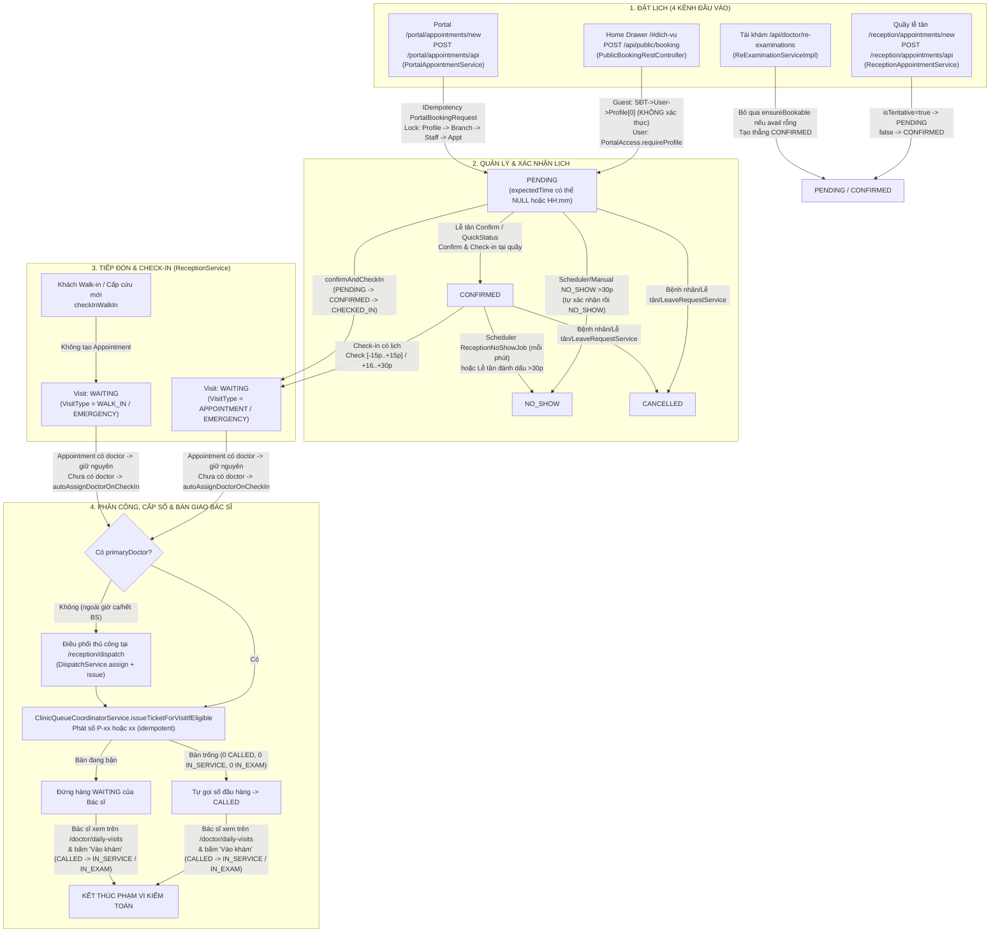

# CV-DCMS – BÁO CÁO KIỂM TOÁN TOÀN DIỆN LOGIC ĐẶT LỊCH VÀ TIẾP ĐÓN BỆNH NHÂN

- **Ngày kiểm toán:** 20/11/2026
- **Nhánh hiện tại:** `hieudx-test`
- **Phạm vi:** **Đặt lịch → Quản lý lịch hẹn → Xác nhận lịch → Bệnh nhân đến phòng khám → Tiếp đón → Check-in → Phân loại ưu tiên → Xếp hàng chờ → Bàn giao cho bác sĩ.**
- **Giới hạn phạm vi (Mục IX):** Báo cáo **không kiểm toán** quy trình khám lâm sàng, chẩn đoán, điều trị, kê đơn, chụp X-quang, đọc `WAITING_RESULT` sau khám, hoàn thành khám, thanh toán, hóa đơn hay quyết toán. Mọi điểm chạm liên quan đến `VisitStatus.WAITING_PAYMENT` / `VisitStatus.WAITING_RESULT` / `Visit.actualEndTime` chỉ được ghi nhận tại giao điểm trực tiếp ảnh hưởng tới slot đặt lịch, kiểm tra trùng ca hoặc thứ tự hàng đợi tiếp đón.
- **Trạng thái thực thi mã nguồn:** Chỉ đọc, phân tích và lập báo cáo; **không sửa code, không sửa test, không chạy migration lên DB thật**.

---

## 1. SƠ ĐỒ LUỒNG ĐẶT LỊCH VÀ TIẾP ĐÓN HIỆN TẠI

### 1.1. Luồng tổng thể từ Đặt lịch đến Bàn giao cho bác sĩ



### 1.2. Đánh giá 7 câu hỏi cốt lõi (Mục I)

| # | Câu hỏi đánh giá | Kết luận ngắn gọn | Tham chiếu chi tiết |
|---|---|---|---|
| 1 | Logic đặt lịch hiện tại đã hợp lý chưa? | **Chưa hoàn chỉnh.** Đã có kiểm tra ca trực, nghỉ phép, cùng buổi xuyên chi nhánh cho Portal/Drawer/Quầy, nhưng tồn tại lỗ hổng nghiêm trọng ở nhánh **Guest đặt theo SĐT** (`PublicBookingRestController`), **luồng Tái khám** (`ReExaminationServiceImpl`) và xử lý giờ **Linh hoạt (`null`)**. | Mục 5, 6 |
| 2 | Có thể đặt trùng lịch hoặc chiếm nhiều slot không? | **Có thể.** (a) Ở mức dịch vụ, `AppointmentSlotService.DEFAULT_CONCURRENT_ARRIVALS_PER_DOCTOR = 3` cho phép **tối đa 3 lịch trùng đúng 1 khung giờ của 1 bác sĩ**. (b) Guest biết SĐT người khác có thể đặt chiếm buổi khám của người đó. (c) Khi lịch là `CONFIRMED` + `expectedTime = null` ("Linh hoạt"), không chiếm bất kỳ khoảng thời gian nào trong `lockAndValidateDoctorSlot`. (d) `ReExaminationServiceImpl` bỏ qua `ensureBookable`. (e) Bảng `appointments` **không có ràng buộc UNIQUE ở DB** chống trùng `(profile_id, appointment_date, preferred_session)`. | Mục 6 (#1, #2, #6, #13) |
| 3 | Việc chọn bác sĩ, cơ sở và giờ hẹn đã hợp lý chưa? | **Hợp lý ở khung chính, còn lỗ hổng biên.** Portal & Home Drawer đã đồng bộ chi nhánh ưa thích, giờ làm việc, ca trực + nghỉ phép của bác sĩ. Tuy nhiên: (a) Lễ tân tạo lịch linh hoạt với `expectedTime = 18:30` khi `session == ANY/null` bị gán nhầm thành `AFTERNOON` (`ReceptionAppointmentService:391`). (b) Không có xử lý điều phối thay thế khi bác sĩ nghỉ đột xuất (hệ thống **tự hủy hàng loạt lịch** trong `LeaveRequestService`). | Mục 6 (#7, #13) |
| 4 | Quy trình tiếp đón của lễ tân có xử lý đủ các trường hợp thực tế không? | **Còn thiếu nhiều kịch bản thực tế.** Thiếu luồng xử lý bệnh nhân **đến sớm >15 phút** (đang bị phạt thành `LATE_BOOKING` Tier 4), chưa hỗ trợ đổi bác sĩ trực tiếp tại bước check-in khi bác sĩ đặt lịch nghỉ đột xuất/vắng mặt, Walk-in không kiểm tra giờ đóng cửa chi nhánh, nút `priority` tại quầy không có tác dụng xếp hạng. | Mục 6 (#4, #7, #9), Mục 7, Mục 9 |
| 5 | Thứ tự ưu tiên hàng đợi có chính xác và thống nhất không? | **Không thống nhất.** Có tới **4 bộ quy tắc sắp xếp khác nhau** giữa `ClinicQueueCoordinatorService`, `DispatchService`, `ReceptionService` và `VisitRepository`. `WAITING_RESULT` đang chen vào hàng đợi tiếp đón **trên cả Đặt lịch đúng giờ (Tier 2)** ở 3/4 màn hình; bệnh nhân đặt lịch **đến sớm >15p** bị đẩy xuống **Tier 4 (sau Walk-in)**. | Mục 6 (#4, #8) |
| 6 | Có rủi ro khi nhiều bệnh nhân đặt lịch hoặc nhiều lễ tân tiếp đón đồng thời không? | **Có nhiều rủi ro.** Dù có `PESSIMISTIC_WRITE`, thứ tự khóa giữa các module không đồng nhất (đặc biệt `LeaveRequestService` và `DoctorPatientRestController.openOrCreateVisitForPatient` có nguy cơ **AB-BA deadlock**), `ReceptionNoShowJob` không có khóa phân tán multi-node, bảng `visits` không có `UNIQUE(appointment_id)` ở tầng DB, và 2 lễ tân gán cùng một `DentalChair` cho 2 lượt `WAITING` vẫn lọt qua vòng `DispatchService.assign`. | Mục 8 |
| 7 | Còn thiếu nghiệp vụ nào cần bổ sung để vận hành phòng khám tốt hơn? | Cần bổ sung ngay quy định rõ với đến sớm >15p, đổi bác sĩ/dời lịch thay vì auto-cancel khi bác sĩ nghỉ đột xuất, quy trình chuyển cơ sở trước check-in, giới hạn/chính sách đặt lại sau `NO_SHOW`/hủy sát giờ, xác thực OTP cho Guest khi trùng SĐT, và xử lý ca phòng khám quá tải. | Mục 7, Mục 9 |

---

## 2. DANH SÁCH TRẠNG THÁI `Appointment` VÀ QUY TẮC CHUYỂN TRẠNG THÁI

### 2.1. Tập trạng thái hiện có

Dựa trên `AppointmentStatus` (sử dụng tại `Appointment.java`, `AppointmentLifecycleServiceImpl.java:115-136`, `ReceptionTransitionPolicy.java:14-18`):
1. `PENDING`: Lịch hẹn mới từ khách hàng (Home Drawer / Portal) hoặc lịch tạm từ quầy (`isTentative = true`), hoặc lịch `CONFIRMED` vừa được **bệnh nhân** đổi lịch online.
2. `CONFIRMED`: Lịch hẹn đã được lễ tân xác nhận (hoặc lễ tân/tái khám tạo trực tiếp).
3. `CHECKED_IN`: Bệnh nhân đã hoàn tất thủ tục check-in tại quầy và đã sinh lượt khám `Visit`.
4. `COMPLETED`: Trạng thái kết thúc sau khi `Visit` hoàn thành (do luồng kết thúc khám cập nhật qua `AppointmentLifecycleServiceImpl.completeByVisit`, ngoài phạm vi kiểm toán chi tiết).
5. `CANCELLED`: Lịch hẹn bị hủy (trạng thái kết thúc).
6. `NO_SHOW`: Lịch hẹn quá 30 phút so với `expectedTime` hoặc hết ca mà bệnh nhân không đến (trạng thái kết thúc).

### 2.2. Ma trận chuyển trạng thái thực tế trong code

| Từ trạng thái | Sang trạng thái | Action / Method thực thi | Ai được gọi trong code | Lưu `AppointmentHistory`? | Lỗ hổng / Ghi chú kiểm toán |
|---|---|---|---|---|---|
| `PENDING` | `CONFIRMED` | `ReceptionAppointmentService.confirm` / `quickStatus(CONFIRMED)` / `ReceptionService.confirmAndCheckIn` / `ReceptionAppointmentService.markNoShow` | Lễ tân (`APPOINTMENT_MANAGE` / `RECEPTION_CHECKIN`), Job hệ thống | Có (`CONFIRM`) | **Lễ tân tạo lịch** (`create`, `isTentative=false`) và **Bác sĩ/CSKH tạo tái khám** (`ReExaminationServiceImpl:162`) tạo thẳng ở `CONFIRMED`, bỏ qua bước `PENDING -> CONFIRMED`. |
| `PENDING` | `PENDING` | `PortalAppointmentService.reschedule` / `ReceptionAppointmentService.update` | Bệnh nhân sở hữu profile / Lễ tân | Có (`RESCHEDULE` / `UPDATE`) | Giới hạn 3 lần đổi lịch chỉ áp dụng cho Portal (`PortalAppointmentService:280`); quầy lễ tân không bị giới hạn 3 lần. |
| `PENDING` | `CHECKED_IN` | Bị chặn tại `Appointment.validateTransitions` (`@PreUpdate`), `AppointmentLifecycleServiceImpl:124`, `ReceptionTransitionPolicy:16`, `quickStatus:496` | **Không cho phép nhảy cóc** | — | Khi bệnh nhân có lịch `PENDING` tới thẳng quầy, lễ tân phải dùng **`confirmAndCheckIn`** để chạy tuần tự `PENDING -> CONFIRMED -> CHECKED_IN` (đã có bằng chứng trong code). |
| `PENDING` | `CANCELLED` | `PortalAppointmentService.cancel`, `ReceptionAppointmentService.cancel`/`quickStatus`, **`LeaveRequestService.approveLeaveRequest`** | Bệnh nhân, Lễ tân, Admin duyệt nghỉ phép | Portal/Lễ tân: Có<br/>`LeaveRequestService`: **KHÔNG** | `LeaveRequestService:342-362` gọi `app.setStatus(CANCELLED)` trực tiếp, bỏ qua `AppointmentLifecycleService`, bỏ qua khóa bi quan, **không ghi `AppointmentHistory`** và không hủy `APPOINTMENT_REMINDER` task. |
| `PENDING` | `NO_SHOW` | `ReceptionAppointmentService.markNoShow` (bước trung gian tự CONFIRM rồi NO_SHOW: dòng `651-656`); `quickStatus` **KHÔNG cho phép** (vì `MARK_NO_SHOW` chỉ cho phép `CONFIRMED -> NO_SHOW`) | Scheduler `ReceptionNoShowJob` | Có (`CONFIRM` + `NO_SHOW`) | Trực tiếp `quickStatus(NO_SHOW)` trên `PENDING` bị từ chối với lỗi 409 (`line 486`). Chỉ job tự động mới tự động nâng `PENDING -> CONFIRMED -> NO_SHOW`. |
| `CONFIRMED` | `PENDING` | `PortalAppointmentService.reschedule` (`line 308`) | Bệnh nhân tự đổi lịch trên Portal | Có (`RESCHEDULE`) | Khi bệnh nhân đổi giờ/ngày/bác sĩ của lịch đã `CONFIRMED`, lịch quay về `PENDING` chờ lễ tân xác nhận lại. Hợp lý. |
| `CONFIRMED` | `CONFIRMED` | `ReceptionAppointmentService.update` (`line 550`), `ReExaminationServiceImpl.rescheduleAppointment` | Lễ tân / Tái khám | Có / ReExam: không ghi `AppointmentHistory` | `ReExaminationServiceImpl.rescheduleAppointment` (`370-441`) sửa trực tiếp field, **không gọi `lifecycle` và không ghi `AppointmentHistory`**. |
| `CONFIRMED` | `CHECKED_IN` | `ReceptionService.checkInAppointment` / `confirmAndCheckIn` (`lines 167, 290`) | Lễ tân (`RECEPTION_CHECKIN`) | Có (`CHECK_IN`) | Kiểm tra đúng cửa sổ ngày hôm nay, ca chưa kết thúc, chưa quá 30 phút. |
| `CONFIRMED` | `CANCELLED` | `PortalAppointmentService.cancel`, `ReceptionAppointmentService.cancel`/`quickStatus`, `LeaveRequestService` | Bệnh nhân, Lễ tân, Admin | Có (trừ `LeaveRequestService`) | **`ensureModificationCutoff` (`AppointmentPolicyServiceImpl:341`) hoàn toàn rỗng** → bệnh nhân có thể hủy/đổi sát giờ hẹn 1 phút trước khi khám mà không bị chặn. |
| `CONFIRMED` | `NO_SHOW` | `ReceptionAppointmentService.quickStatus(NO_SHOW)` / `markNoShow` | Lễ tân (`APPOINTMENT_MANAGE`), Scheduler | Có (`NO_SHOW`) | Mốc cutoff dùng `now.isAfter(expected + 30m)` (`> 30p`). |
| `CHECKED_IN` | `CONFIRMED` | `ReceptionService.revertCheckIn` (`lines 329-390`) | Lễ tân (`RECEPTION_CHECKIN`) | Có (`REVERT_CHECK_IN`) | Hủy `Visit` (`CANCELLED` + xóa `appointmentId = null`), hủy `QueueTicket` (kể cả `CALLED`!), xóa `ReceptionCheckInKey`. |
| `CHECKED_IN` | `COMPLETED` | `AppointmentLifecycleServiceImpl.completeByVisit` (`quickStatus` bị chặn ở `line 501`) | Hệ thống (tự động từ luồng hoàn tất ca) | Có (`COMPLETE`) | Ngoài phạm vi kiểm toán khám/thanh toán. |
| `COMPLETED` / `CANCELLED` / `NO_SHOW` | Bất kỳ | Bị khóa tại `AppointmentLifecycleServiceImpl:115-136` & `ReceptionTransitionPolicy:18` | Không ai được phép | — | Đảm bảo tính bất biến lịch sử các trạng thái kết thúc (trừ `ReExaminationServiceImpl` không rõ có kiểm tra `NO_SHOW` trong `assertAppointmentMutable:467-470` hay không — `assertAppointmentMutable` chỉ chặn `COMPLETED, CHECKED_IN, CANCELLED`, **BỎ SÓT `NO_SHOW`**!). |

---

## 3. BẢNG ĐÁNH GIÁ CHI TIẾT TỪNG NGHIỆP VỤ

*Quy ước trạng thái theo chuẩn kiểm toán:*
- **Đã triển khai và có bằng chứng**: Có code vận hành đúng và có kiểm thử tự động chứng minh.
- **Đã triển khai nhưng chưa đủ kiểm thử**: Logic trong code hợp lý nhưng thiếu unit/integration test bao phủ hoặc test chỉ dùng mock.
- **Đang triển khai nhưng có lỗi**: Đã viết tính năng nhưng vi phạm quy tắc nghiệp vụ, sai biên, mất đồng bộ hoặc có lỗ hổng bảo mật/đồng thời.
- **Chưa triển khai**: Hoàn toàn chưa có cơ chế xử lý trong source code.
- **Cần quyết định nghiệp vụ trước khi sửa**: Quy chuẩn hiện tại mâu thuẫn hoặc chưa rõ chính sách phòng khám.

### 3.1. Nhóm II – Đặt lịch & Quản lý lịch hẹn

| Hạng mục kiểm tra | Trạng thái | Bằng chứng thực tế trong code & test |
|---|---|---|
| **II.1 Luồng đặt lịch 4 kênh (Home Drawer, Portal New, Portal List, Quầy lễ tân)** | Đang triển khai nhưng có lỗi | • Portal (`PortalAppointmentService.book:176-245`): dùng `PortalAccess.requireProfile`, `requestKey` idempotency, lock `Profile -> Branch -> Staff -> Appointment`, đồng bộ chi nhánh từ Home.<br/>• Home Drawer (`PublicBookingRestController:354-620`, `portal/home.html:2285-2395`): với user đã đăng nhập bắt `profileId` hợp lệ (`resolveVerifiedProfileForUser`); **NHƯNG nhánh Guest (chưa đăng nhập, `467-497`) tra theo SĐT và gán vào `existingProfiles.get(0)` mà không xác thực OTP/quyền sở hữu, không có `requestKey`.**<br/>• Quầy (`ReceptionAppointmentService:325-443`): hoạt động nhưng lỗi auto-detect `EVENING` khi `expectedTime > 12:00` (`line 391`) và cho `duration >= 15p` khác mức `5p` của `AppointmentSlotService`.<br/>• Tái khám (`ReExaminationServiceImpl:53-191`): bỏ qua `ensureBookable` và fallback sang kiểm tra yếu khi lịch bác sĩ rỗng. |
| **II.1 Đa dịch vụ trong 1 lịch hẹn** | Chưa triển khai | `Appointment.java` chỉ có duy nhất 1 khóa ngoại `@ManyToOne Service service` (`service_id`), không có bảng `appointment_services`. Cả Home Drawer & Portal cho phép `serviceId = null` (mặc định 30 phút). |
| **II.2 Hồ sơ bệnh nhân tài khoản gia đình** | Đã triển khai và có bằng chứng | `PortalPatientService` / `PortalAccess.requireProfile` (`53-63`) + `AccountPatientProfile` (`SELF`/`DEPENDENT`) kiểm tra quyền quản lý hồ sơ, từ chối `profileId` của tài khoản khác (404/403). `PublicBookingRestController.submitBooking` (`442-466`) bỏ qua `fullName`/`phoneNumber` nhập tay khi `loggedInPatient = true`. Chứng minh trong `AppointmentFlowRemediationTest` (`60-156`). |
| **II.2 Chống trùng lịch cùng buổi xuyên cơ sở** | Đã triển khai và có bằng chứng (có lỗ hổng ở tầng DB & Tái khám) | `AppointmentPolicyServiceImpl.findSameSessionConflict` (`217-291`) truy vấn `findOccupyingForPatientDayAcrossBranches` với `OCCUPYING = [PENDING, CONFIRMED, CHECKED_IN]` và bỏ qua lịch `CHECKED_IN` nếu `Visit` là `COMPLETED / CANCELLED / WAITING_PAYMENT`. **Tuy nhiên:** (1) Bảng `appointments` **không có DB constraint** chống trùng cùng buổi; (2) `AppointmentConflictDetectionServiceImpl:23` lại đưa cả `COMPLETED` vào `OCCUPYING` và không kiểm tra `WAITING_PAYMENT`, gây báo cảnh báo giả trên màn hình lễ tân (`ReceptionAppointmentService:770`). |
| **II.2 Chính sách đặt lại sau `CANCELLED` / `NO_SHOW`** | Cần quyết định nghiệp vụ trước khi sửa | `NO_SHOW` và `CANCELLED` không nằm trong `OCCUPYING` (`AppointmentPolicyServiceImpl:22-24`), nên bệnh nhân có thể đặt lại ngay lập tức không giới hạn số lần/khoảng chờ sau khi `NO_SHOW` hoặc hủy sát giờ. |
| **II.3 Chọn cơ sở, bác sĩ trực, nghỉ phép & tự phân bổ** | Đang triển khai nhưng có lỗi | • Cơ sở ngừng hoạt động, ngày nghỉ tuần, quá 90 ngày, vượt giờ đóng cửa chi nhánh: đã chặn ở `AppointmentPolicyServiceImpl.invalidSession` (`345-382`).<br/>• Bác sĩ không thuộc `StaffBranchAssignment` ACTIVE, không có `StaffSchedule` `SCHEDULED`, hoặc có `LeaveRequest` `APPROVED`: bị loại tại `eligibleDoctors` (`390-442`) và `getDoctorAvailability` (`185-211`).<br/>• **Tự phân bổ (`autoAssignDoctorForSlot`, `388-443`)**: sắp theo ít ca trùng khung giờ -> ít ca trong buổi -> `doctorId` tăng dần. **NHƯNG chỉ chạy khi `expectedTime != null`**; khi chọn "Linh hoạt trong ca" (`expectedTime == null`), `doctor` để `NULL`.<br/>• **Khi bác sĩ nghỉ đột xuất (`LeaveRequestService:318-386`)**: hệ thống **tự động `CANCELLED` toàn bộ lịch `PENDING/CONFIRMED`**, không đổi bác sĩ tự động, không khóa bản ghi `Appointment`, không ghi `AppointmentHistory`.<br/>• **Quyền gán bác sĩ thủ công (`PatientAccess:136-141`, `ReceptionAppointmentService:328, 517, 570`)**: Chỉ Admin hoặc người có quyền `CLINICAL_DISPATCH` mới được chỉ định/đổi bác sĩ ở quầy (nhưng chú ý lỗi leo thang quyền tại `ReceptionAccess:50-52` nếu nhân viên chưa gán chi nhánh). |
| **II.4 Mốc giờ hẹn dự kiến, Grace 15p & khả năng tiếp nhận** | Đang triển khai nhưng có lỗi | • Dropdown giao diện Home & Portal (`home.html`, `portal-appointments.js:454-463`) chỉ hiển thị 1 mốc giờ (`16:00`), đã bỏ hiển thị khoảng giờ và "còn X chỗ" (`AppointmentFlowRemediationTest:439-473`).<br/>• Hệ thống cho phép **nhiều bệnh nhân cùng đặt 1 mốc giờ (tối đa `maxConcurrentPerDoctorSlot = 3` trên cùng 1 bác sĩ)**, không xóa mốc giờ khi người đầu tiên đặt.<br/>• Phân biệt rạch ròi `Appointment.expectedTime` vs `Visit.checkInAt` vs `Visit.actualStartTime`.<br/>• **Lỗi/Rủi ro lớn:** (1) `DEFAULT_CONCURRENT_ARRIVALS_PER_DOCTOR = 3` khiến **1 bác sĩ có thể nhận 3 bệnh nhân cùng lúc `16:00-16:30`**; (2) Sau 15p grace (`16:16`), `resolveEffectiveInterval` (`AppointmentSlotService:754-758`) giải phóng khung giờ cho người mới **nhưng lịch cũ chưa `NO_SHOW` vẫn chiếm `doctorCapacity` (10) & `branchCapacity` (24)** tại `AppointmentPolicyServiceImpl`, và bệnh nhân đến muộn ở phút `16..30` **vẫn check-in được vào đúng bác sĩ đó** → gây xung đột ghế/bác sĩ thực tế; (3) Lịch "Linh hoạt (`expectedTime = null`)" trả về `null` ở `resolveEffectiveInterval` nên **không chiếm bất kỳ slot giờ nào** trong `lockAndValidateDoctorSlot`. |
| **II.5 Kiểm thử 8 mốc thời gian biên cho giờ hẹn `16:00`** | Đang triển khai nhưng có lỗi (ở mốc `15:44`) | Xem bảng phân tích 8 mốc chi tiết ngay dưới đây (Mục 3.2). |
| **II.5 Bảng chuyển trạng thái & idempotency lịch hẹn** | Đã triển khai nhưng chưa đủ kiểm thử (thiếu key ở Guest Drawer & ReExam) | Đã có `AppointmentLifecycleServiceImpl` + `@PreUpdate` tại `Appointment.java:138-144` + `AppointmentHistory`. Portal dùng `PortalBookingRequest`; Home Drawer `PublicBookingRestController` **chưa có `requestKey`**. |

### 3.2. Kiểm tra đối chiếu 8 mốc check-in thực tế cho giờ hẹn `16:00` (`clock` server)

Nguồn code kiểm chứng: `ReceptionService.evaluateGracePeriodAndRejectExpired` (`lines 658-670`), `ReceptionAppointmentService.isNoShowCutoffPassed` (`lines 659-668`), `ClinicQueueCoordinatorService` (`lines 125-158, 334-351`), `DispatchService` (`lines 623-636`), `DoctorPatientRestController` (`lines 945-957`), `VisitRepository` (`lines 245-253`).

| Giờ bệnh nhân check-in | Điều kiện đánh giá trong code (`expected = 16:00`) | Kết quả `isBookedAndOnTime` | Kết quả hành vi thực tế trong hệ thống | Khớp nghiệp vụ mong muốn? |
|---|---|---|---|---|
| **`15:44`** (sớm 16 phút) | `15:44.isBefore(16:00 - 15m [=15:45]) == true` | `false` | Check-in thành công, **`VisitType = APPOINTMENT` + `isBookedAndOnTime = false`** → Bị `ClinicQueueCoordinatorService`, `ReceptionService`, `DispatchService`, `DoctorPatientRestController` gắn nhãn **`LATE_BOOKING` ("Lịch hẹn đến trễ") và đẩy xuống Nhóm 4 (XẾP SAU CẢ WALK-IN!)**, dù bệnh nhân đến sớm! | **LỖI NGHIỆP VỤ (P0)** |
| **`15:45`** (biên -15p) | `!15:45.isBefore(15:45) && !15:45.isAfter(16:15)` | `true` | Vào **Nhóm 2 – Đặt lịch đúng giờ**, cấp số `P-xx`, `priorityScore = 75`. | Khớp |
| **`15:59`** (sớm 1p) | Trong `[15:45, 16:15]` | `true` | Vào **Nhóm 2 – Đặt lịch đúng giờ**, cấp số `P-xx`. | Khớp |
| **`16:00`** (đúng giờ) | Trong `[15:45, 16:15]` | `true` | Vào **Nhóm 2 – Đặt lịch đúng giờ**, cấp số `P-xx`. | Khớp |
| **`16:15`** (biên +15p) | `!16:15.isAfter(16:15)` (`16:15:00` hợp lệ; **lưu ý nếu giây thực là `16:15:01` sẽ tính `isAfter(16:15:00) == true` → tụt Nhóm 4!**) | `true` (tại `:00`) | Vào **Nhóm 2 – Đặt lịch đúng giờ**. Cần lưu ý độ chính xác theo giây (`LocalDateTime.now(clock)` mang cả giây). | Khớp (cần chú ý phần giây) |
| **`16:16`** (trễ 16p) | `16:16.isAfter(16:15)` và `!16:16.isAfter(16:30)` | `false` | Cho check-in, vào **Nhóm 4 – Đặt lịch đến trễ (`LATE_BOOKING`)**, đứng sau Walk-in. Tuy nhiên slot `[16:00, 16:30)` đã bị giải phóng từ `16:15:01`. | Khớp phân nhóm, xung đột slot nếu bác sĩ đã có khách mới |
| **`16:30`** (biên +30p) | `!16:30:00.isAfter(16:30:00)` | `false` | Cho check-in **Nhóm 4**; `ReceptionAppointmentService.isNoShowCutoffPassed` tại `16:30:00` trả `false` (chưa `NO_SHOW`). Tại `16:30:01` bị coi quá 30p. | Khớp (cần chuẩn hóa làm tròn phút hoặc quy định giây) |
| **`16:31`** (trễ 31p) | `16:31.isAfter(16:30)` | Reject (`409 CONFLICT`) | Từ chối check-in theo lịch cũ ("quá 30 phút, đủ điều kiện NO_SHOW"); `ReceptionNoShowJob` chuyển lịch sang `NO_SHOW`; lễ tân tạo Walk-in mới bình thường. | Khớp |

*(Lưu ý: `V114__doctor_specific_booking_and_priority_queue.sql:105` khi backfill dữ liệu cũ lại viết `v.check_in_at <= TIMESTAMP(...) + 15 MINUTE` mà thiếu chặn dưới `-15 MINUTE`, trái ngược với `ReceptionService.java:667-669`.)*

### 3.3. Nhóm III – Tiếp đón, Check-in, NO_SHOW, Hàng đợi & Bàn giao bác sĩ

| Hạng mục kiểm tra | Trạng thái | Bằng chứng thực tế trong code & test |
|---|---|---|
| **III.1 Tiếp đón có lịch hẹn** | Đang triển khai nhưng có lỗi | • Xem lịch trong ngày theo chi nhánh & tìm kiếm (`ReceptionCheckInAppointmentRepository:15-20`, `ReceptionProfileRepository:18-23`): tải toàn bộ lịch `PENDING/CONFIRMED/CHECKED_IN` trong ngày của chi nhánh và lọc client-side trên `check-in.html`.<br/>• Chặn trùng `Visit` cho cùng `appointmentId`: `ReceptionService:131-132` + `rejectActiveVisit` (`614-632`) + khóa `PatientProfile -> Branch -> Appointment` (`121-123`).<br/>• Chặn check-in lịch `CANCELLED`/`NO_SHOW`: `ReceptionTransitionPolicy:16`.<br/>• **Lỗi:** (1) Khi `appointment.getDoctor() != null`, `ReceptionService:177-182` gán thẳng bác sĩ mà **không kiểm tra bác sĩ hôm nay có ca trực, có nghỉ phép hay còn `ACTIVE` không**; (2) Nếu `PENDING` và dùng `confirmAndCheckIn`, `ensureBookable` lại chặn cứng nếu bác sĩ đã nghỉ phép thay vì cho đổi bác sĩ khi bệnh nhân đã có mặt; (3) `visits.appointment_id` **không có `UNIQUE` constraint ở DB**. |
| **III.2 Tiếp đón Walk-in** | Đang triển khai nhưng có lỗi | • Hỗ trợ tìm kiếm hồ sơ hiện có (`ReceptionProfileRepository:18-23`) để tránh trùng và luồng tạo hồ sơ mới.<br/>• Gán bác sĩ tự động (`autoAssignDoctorOnCheckIn`, `672-739`).<br/>• **Lỗi:** (1) **`checkInWalkIn` không kiểm tra giờ đóng cửa chi nhánh (`branch.closingTime`) và ngày làm việc**, khác với `checkInAppointment` (`line 150`); (2) **`autoAssignDoctorOnCheckIn` nuốt mọi exception (`try/catch ignored`)**, bỏ qua giới hạn `MAX_DOCTOR_QUEUE_LIMIT = 8` của `DispatchService`, và có thể để lại `visit.primaryDoctor = null` (chưa vào hàng đợi bác sĩ cho đến khi mở `/reception/dispatch`); (3) Tham số `priority = true` trên UI check-in chỉ ghi chuỗi `"[ƯU TIÊN]"` vào `visit.notes` (`445-447`), **không hề tăng hạng trong hàng đợi** (`ClinicQueueCoordinatorService` & `VisitRepository` đều bỏ qua!). |
| **III.3 Tiếp đón Cấp cứu (Emergency)** | Đang triển khai nhưng có lỗi | • Bệnh nhân hoàn toàn **không thể** tự gửi `VisitType.EMERGENCY` ở các API Portal/Public (`PortalAppointmentService`, `PublicBookingRestController` chỉ tạo `Appointment`, không tạo `Visit`).<br/>• Bắt buộc nhập triệu chứng/lý do >= 10 ký tự (`ReceptionService:162, 437`, `ClinicQueueCoordinatorService:481`, `DispatchService:466`).<br/>• Ghi audit log người báo + thời điểm + lý do (`ClinicQueueCoordinatorService:518-536`).<br/>• **Lỗ hổng:** (1) Mọi nhân viên có quyền `RECEPTION_CHECKIN` (check-in) hoặc chỉ `APPOINTMENT_VIEW` (`/reception/queue/*/EMERGENCY`, `FeaturePermissionInterceptor:137`) đều kích hoạt được `EMERGENCY` đẩy lên đầu hàng đợi (hạng 1); (2) **Chưa có nghiệp vụ Hủy/Hạ cấp trạng thái Cấp cứu** (`EMERGENCY -> WALK_IN/APPOINTMENT`) nếu lễ tân bấm nhầm; (3) `QueueWorkflowService.Action` chưa cho kiểm tra xác nhận lại cấp cứu. |
| **III.4 Quy tắc `NO_SHOW` & Scheduler** | Đang triển khai nhưng có lỗi | • `ReceptionNoShowJob` chạy mỗi phút (`cron = "0 * * * * *"`, `ReceptionNoShowJob.java:22`).<br/>• `markNoShow` (`ReceptionAppointmentService:642-696`) kiểm tra cutoff `> 30 phút` hoặc hết ca, khóa `Branch -> Appointment` rồi tái kiểm tra trạng thái (`line 649`), xử lý được cả `PENDING` và `CONFIRMED`, ghi `AppointmentHistory` và phát `AppointmentNoShowCareEvent` tạo `NO_SHOW_RECALL`.<br/>• **Thiếu sót:** Không có distributed lock (ShedLock / DB lock) khi chạy nhiều server instance cùng lúc → gây tranh chấp lock `Branch` hàng loạt mỗi phút. Ngoài ra trong giai đoạn `16..30 phút`, slot đã được `AppointmentSlotService` giải phóng nhưng `AppointmentPolicyServiceImpl` vẫn tính lịch này vào sức chứa chi nhánh/bác sĩ. |
| **III.5 Hàng đợi 4 cấp ưu tiên & Bàn giao cho bác sĩ** | Đang triển khai nhưng có lỗi nghiêm trọng | Xem chi tiết đối chiếu 5 màn hình tại Mục 3.4 dưới đây. |

### 3.4. Đối chiếu sự bất đồng bộ thứ tự hàng đợi & `WAITING_RESULT` trên 5 màn hình / API (Mục III.5 & VIII)

| Màn hình / API | File & dòng | Cách xử lý `WAITING_RESULT` | Tiêu chí phụ & Điểm sai lệch so với chuẩn 4 cấp (`1: Cấp cứu -> 2: Đúng giờ -> 3: Walk-in -> 4: Trễ giờ`, tie-break: `checkInAt`, `visitId`) |
|---|---|---|---|
| **1. Bộ điều phối trung tâm & Auto-call (`ClinicQueueCoordinatorService`)** | `ClinicQueueCoordinatorService.java:191-245` | **TRỘN vào hàng đợi & ĐẨY LÊN TRÊN NHÓM 2**: `Emergency (rank 1) -> WAITING_RESULT (wr=0) -> Đúng giờ (rank 2) -> Walk-in (rank 3) -> Trễ (rank 4)`. | Khi auto-call tìm bệnh nhân tiếp theo (`434-438`), hệ thống gọi `WAITING_RESULT` trước khách đặt lịch đúng giờ! Tie-break lại ưu tiên `priorityScore -> isPriority -> ticketNumber -> issuedAt/checkInAt` chứ không theo `checkInAt` thuần. Lại gắn nhãn khách đi sớm `15:44` là `LATE_BOOKING` (rank 4). |
| **2. Bảng Hàng chờ gọi số (`QueueWorkflowService.board`)** | `QueueWorkflowService.java:489-551` | Sắp theo `QueueStatus` (`CALLED -> WAITING -> PAUSED -> khác`), bên trong gọi `waitingQueueComparator()` của Coordinator → **`WAITING_RESULT` đứng trước Đúng giờ**. | Không đồng bộ tie-break với màn Tiếp đón hay Điều phối; nếu chưa có `ClinicQueueCoordinatorService` injected thì logic fallback `512-533` bỏ qua `priorityScore`. |
| **3. Bảng Điều phối ghế nha (`DispatchService.board`)** | `DispatchService.java:175-184, 623-636` | Giữ `WAITING` + `WAITING_RESULT`; đẩy `primaryDoctor == null` xuống cuối; sau đó: `Emergency -> WAITING_RESULT -> Tier (2/3/4)`. | **Tie-break theo `Visit.checkInAt`** (khác với `ticketNumber`/`issuedAt` ở `QueueWorkflowService`!) → STT hàng chờ hiển thị trên `/reception/dispatch` **có thể đảo thứ tự** so với `/reception/queue` nếu thứ tự cấp số `QueueTicket` khác thứ tự `checkInAt` (ví dụ sau `TRANSFER` hoặc phát bù số)! |
| **4. Danh sách Tiếp đón & Check-in (`ReceptionService.dashboard`)** | `ReceptionService.java:551-576, 926-931` | `getVisitRowStatusRank`: `IN_EXAM/IN_TREATMENT -> 0`, `WAITING -> 1`, còn **`WAITING_RESULT` rơi vào `default -> 2` (XẾP DƯỚI `WAITING` ngang hàng `WAITING_PAYMENT` và `COMPLETED`)!** | `VisitRow.queueTierRank` không nhận `ticket.isPriority`, và xếp theo `checkInAt`. Hoàn toàn lệch pha với 3 màn hình kia. |
| **5. Màn hình Bác sĩ (`/api/doctor/patients/daily-visits` vs `/waiting-queue`)** | `DoctorPatientRestController.java:493-543, 549-601` & `VisitRepository.java:238-266` | • **`/daily-visits`** (giao diện chính bác sĩ dùng): nhóm `2` gồm cả `WAITING` và `WAITING_RESULT` và sắp bằng `ClinicQueueCoordinatorService` (`WAITING_RESULT` vượt lên trước Đúng giờ!).<br/>• **`/waiting-queue`**: tách riêng `waitingQueue` (`WAITING`) và `waitingResultQueue` (`WAITING_RESULT`) bằng 2 query SQL; sắp `WAITING` bằng 4 cấp + `checkInAt`, `visitId`. | Hai API trên **cùng 1 controller** lại trả hai thứ tự và hai cách gộp/tách `WAITING_RESULT` khác nhau! Và khi bác sĩ bấm "Vào khám" (`enterExaminationForDoctor`), hệ thống lại gọi lượt `CALLED` do `ClinicQueueCoordinatorService` (lấy `WAITING_RESULT` trước Đặt lịch đúng giờ) sinh ra! |

---

## 4. NHỮNG ĐIỂM ĐÃ TRIỂN KHAI ĐÚNG (CÓ BẰNG CHỨNG)

1. **Khởi tạo & chuyển cơ sở đồng bộ tại Home và Portal:** Đã dùng chung `PatientProfileService.switchUserPreferredBranch` cập nhật `User.branch` + toàn bộ `PatientProfile` và đồng bộ session (`AppointmentFlowRemediationTest:263-431`).
2. **Bảo vệ hồ sơ gia đình cho tài khoản đã đăng nhập:** `PortalAccess.requireProfile` (`53-63`) kiểm tra chủ sở hữu cả quan hệ trực tiếp và bảng `account_patient_profiles`; `PublicBookingRestController` (`442-466`) khóa `profileId` và bỏ qua `fullName`/`phoneNumber` gửi từ form nếu là user đã đăng nhập (`AppointmentFlowRemediationTest:92-156`).
3. **Chống trùng lịch cùng buổi xuyên cơ sở tại Portal/Drawer/Quầy:** `AppointmentPolicyServiceImpl.findSameSessionConflict` (`217-291`) quét trên toàn hệ thống theo `profileId + date + session` và loại trừ lịch đã hủy/NO_SHOW cũng như ca có `Visit` đã xong lâm sàng (`WAITING_PAYMENT`, `COMPLETED`, `CANCELLED`). Đã chứng minh qua JPA concurrency test trong `AppointmentCrossBranchConcurrencyIntegrationTest` (`H2 MODE=MySQL`, `PESSIMISTIC_WRITE`).
4. **Tính khả dụng động của bác sĩ (`AppointmentSlotService`):** Đã kiểm tra đồng thời `StaffBranchAssignment`, `StaffSchedule` (`SCHEDULED`), `LeaveRequest` (`APPROVED`), khoảng mở/đóng cửa `Branch`, chia khoảng nửa mở `[start, end)` (`intervalsOverlap`, `140-145`) và xử lý an toàn khi `policy.sessionRange()` trả `null` (`993-999`, được chứng minh tại `AppointmentSlotServiceTest:87-101`).
5. **Không âm thầm fallback sang bác sĩ chưa có ca trực:** Khi buổi hoặc ngày không có bác sĩ trực hợp lệ trong `StaffSchedule`, `AppointmentPolicyServiceImpl.availability` (`90-93`) và `ensureBookable` (`183-186`) trả về không khả dụng (chứng minh tại `AppointmentPolicyServiceTest:141`).
6. **Chặn nhảy cóc `PENDING -> CHECKED_IN` và bảo toàn audit check-in:** Cưỡng chế tại `Appointment.@PreUpdate` (`138-144`), `AppointmentLifecycleServiceImpl` và `ReceptionTransitionPolicy`; mọi thao tác đổi/hủy/xác nhận/check-in/revert tại Portal và `ReceptionService`/`ReceptionAppointmentService` đều ghi `AppointmentHistory` và `SystemAuditLog`.
7. **Idempotency trên Portal và Counter Check-in:** Portal sử dụng UUID `requestKey` lưu bảng `portal_booking_requests` (`PortalAppointmentService:180-189`, phát hiện tái sử dụng key khác nội dung trả 409); Check-in quầy dùng `ReceptionCheckInKey` có ràng buộc `UNIQUE(request_key)` và `UNIQUE(visit_id)` (`ReceptionCheckInKey.java:12-14`, chứng minh tại `AppointmentPhase3IntegrationTest`).
8. **Chặn hoàn tác check-in khi ca đã lên ghế hoặc đang phục vụ:** `ReceptionService.canRevertVisit` (`827-840`) chặn hoàn tác nếu `Visit` không ở `WAITING`, đã có `roomId`/`chairId`, hoặc có phiếu `IN_SERVICE`/`DONE`; khi hoàn tác hợp lệ hủy sạch `QueueTicket` và gọi người kế tiếp nếu vừa hủy phiếu `CALLED` (`357-374`).

---

## 5. NHỮNG ĐIỂM TRIỂN KHAI CHƯA ĐẦY ĐỦ

1. **Đơn vị kiểm thử còn dựa nhiều vào Mockito mock ở các nhánh phức tạp:**
   - `AppointmentSlotServiceTest` dùng `Mockito` cho `policy`, `appointments`, `staffSchedules`, nên chưa test end-to-end việc kết hợp `AppointmentPolicyServiceImpl` (đếm sức chứa buổi `10` / `24`) với `AppointmentSlotService.resolveFlexibly` (đếm khoảng `[start, end)`).
   - `AppointmentFlowRemediationTest` ở `runCheckInAt` & `assertNoShowCutoff` mock `ReceptionAppointmentRepository` và `ReceptionService`, chưa chạy kiểm thử cạnh tranh thực (real transaction concurrency) giữa **`ReceptionNoShowJob` và `ReceptionService.checkInAppointment`** hoặc giữa **Leave Approval và Booking/Check-in**.
2. **Đặt lịch qua Home Drawer (`PublicBookingRestController`) chưa có `requestKey` idempotency:** Người dùng bấm đúp hoặc retry mạng chậm có thể gửi 2 POST liên tiếp (nếu lần 1 chưa kịp commit trước lần 2 hoặc với Guest tạo 2 request nối tiếp).
3. **Không bắt buộc `serviceId` khi đặt lịch:** Cho phép đặt không cần chọn dịch vụ (mặc định 30 phút), nhưng không hỗ trợ chọn nhiều dịch vụ trong 1 lần đặt (`Appointment` chỉ lưu 1 `service_id`).
4. **Cắt giờ sửa/hủy trước hẹn (`ensureModificationCutoff`) để trống:** `AppointmentPolicyServiceImpl.java:341-343` là hàm rỗng, cho phép bệnh nhân tự hủy/đổi lịch trước giờ hẹn 1 phút.
5. **Chưa có màn hình/luồng riêng xử lý lịch hẹn bị ảnh hưởng khi bác sĩ nghỉ đột xuất:** Dù có bảng `doctor_cover_grants` (`V107__doctor_cover_grants.sql`) cho bác sĩ khám thay `Visit` đã tạo, **chưa có cơ chế chuyển tiếp (reassign/reschedule có lựa chọn)** cho các `Appointment` chưa check-in khi bác sĩ xin nghỉ phép.
6. **Xác thực lại phạm vi kiểm thử của Mục VIII:**
   - Lỗi `AppointmentSlotServiceTest` liên quan `range` & `null`: **Đã sửa trong code (`AppointmentSlotService:993-999`) và có unit test mock (`AppointmentSlotServiceTest:87-101`)**.
   - Lỗi không có bác sĩ theo lịch nhưng `capacity > 0`: **Đã sửa trong `AppointmentPolicyServiceImpl:91-93, 184-186`** (và có test `AppointmentPolicyServiceTest:141`), **NHƯNG vẫn tồn tại ở kênh Tái khám `ReExaminationServiceImpl:129-143`!**
   - Cơ chế khóa đồng thời khi đặt lịch: Đã sửa thứ tự khóa `Profile -> Branch -> Staff -> Appointment` cho **Portal** và **Home Drawer** (với user đăng nhập), nhưng **chưa khóa đúng chuẩn ở `ReExaminationServiceImpl` và `LeaveRequestService`**, đồng thời **thiếu Unique Constraint ở DB**.

---

## 6. NHỮNG LỖI CÓ BẰNG CHỨNG (VERIFIED BUGS)

### Lỗi 1 (P0 / Critical): Khách vãng lai (Guest) có thể đặt lịch chiếm chỗ trên hồ sơ bệnh nhân của người khác qua SĐT
- **Quy tắc nghiệp vụ:** Mọi hành vi đặt lịch phải gắn đúng danh tính và không ai có thể tạo lịch làm kẹt ca khám hoặc đọc/ghi đè lên hồ sơ của bệnh nhân khác khi chưa xác thực quyền sở hữu.
- **Code hiện đang xử lý:** `SecurityConfig.java:117-121` mở công khai (`permitAll()`) `POST /api/public/booking` và bỏ qua CSRF tại dòng `57-61`. Trong `PublicBookingRestController.submitBooking` (`lines 467-497`), khi `loggedInPatient == false`, code chỉ nhận `phoneNumber` từ body, gọi `userRepository.findByPhoneNumber(cleanPhone)`, nếu thấy user đã tồn tại thì **lấy thẳng `existingProfiles.get(0)` của user đó để đặt lịch `PENDING`** mà không xác thực OTP/mật khẩu!
- **File, class, method liên quan:** `PublicBookingRestController.java` (`submitBooking:467-497`), `SecurityConfig.java` (`57-61, 117-121`).
- **Tình huống gây lỗi:** Kẻ xấu hoặc người nhập nhầm SĐT bệnh nhân `0987654271` gửi 3 POST `/api/public/booking` cho Sáng/Chiều/Tối cùng ngày → lịch `PENDING` gắn trực tiếp vào hồ sơ chính chủ của nạn nhân, khiến nạn nhân khi đăng nhập Portal nhận báo lỗi `"Người khám này đã có lịch hẹn trong cùng buổi"` (`findSameSessionConflict`) và bị khóa quyền đặt lịch thật! Ngoài ra Guest còn có thể spam làm đầy `branchCapacity` mà không cần đăng nhập hay CSRF token.
- **Mức độ ảnh hưởng:** **Critical**.
- **Đề xuất cải tiến:** (1) Đối với Guest nhập SĐT đã tồn tại tài khoản/hồ sơ trong DB: bắt buộc yêu cầu đăng nhập hoặc xác thực OTP SMS/Zalo trước khi gắn lịch vào hồ sơ có sẵn (hoặc tạo hồ sơ `LEAD` / lịch chờ xác nhận riêng chưa khóa slot bệnh nhân chính thức); (2) Bổ sung `requestKey` idempotency, rate-limit theo IP/SĐT và CAPTCHA/OTP cho Guest booking.
- **Test cần có để chứng minh:** MockMvc/Integration test gửi `POST /api/public/booking` ẩn danh dùng SĐT của một `User PATIENT` đã có sẵn tài khoản, khẳng định hệ thống trả `401/409` yêu cầu đăng nhập/xác thực thay vì đặt lịch thành công lên `existingProfiles.get(0)`.

### Lỗi 2 (P0 / Critical): Cho phép 1 bác sĩ nhận tối đa 3 bệnh nhân trùng đúng 1 mốc giờ (`DEFAULT_CONCURRENT_ARRIVALS_PER_DOCTOR = 3`) & lịch "Linh hoạt" không chiếm slot giờ
- **Quy tắc nghiệp vụ:** Với bác sĩ chỉ định, cần định nghĩa rõ bác sĩ khám 1 người/khung giờ hay wave arrivals. Nếu 1 bác sĩ tại 1 ghế chỉ khám 1 ca tại một thời điểm `[16:00, 16:30)`, không được phép cho 3 người khác nhau cùng đặt `16:00` với cùng 1 bác sĩ.
- **Code hiện đang xử lý:**
  1. `AppointmentSlotService.java:55, 115-117`: `DEFAULT_CONCURRENT_ARRIVALS_PER_DOCTOR = 3` (`maxConcurrentPerDoctorSlot = 3`), khiến `subtractFullConcurrencyIntervals` (`297-300, 826-862`) và `computeRemainingAtWindow` (`722-728`) vẫn báo còn chỗ (`remaining = 2 -> 1 -> 0`) cho cùng bác sĩ ở cùng giờ `[16:00, 16:30)`!
  2. Khi đặt lịch "Linh hoạt trong ca" (`expectedTime == null`), `PortalAppointmentService` (`210-220`) và `ReceptionAppointmentService` (`416-429`) không gán `doctor` và giữ `expectedTime = null`. Trong `AppointmentSlotService.resolveEffectiveInterval` (`line 745: if (appointment == null || appointment.getExpectedTime() == null) return null;`), các lịch này trả `null` nên **`unassignedOverlap` (`lines 732-736`) luôn bằng 0** và hoàn toàn không trừ công suất giờ của từng mốc `15:00`, `16:00`!
- **File, class, method liên quan:** `AppointmentSlotService.java` (`55, 115-117, 297-300, 722-736, 745, 826-862`).
- **Tình huống gây lỗi:**
  - Kịch bản A: 3 bệnh nhân A, B, C cùng chọn `BS. Trần Minh Hoàng`, lúc `16:00`, dịch vụ 30 phút → Cả 3 đều đặt thành công vào đúng `16:00` trên 1 ghế của BS. Hoàng (tạo ra dồn ứ chắc chắn 60 phút cho bệnh nhân C dù cả 3 đều đến đúng giờ và thuộc Priority 2!).
  - Kịch bản B: 9 bệnh nhân đặt "Linh hoạt trong ca" tại chi nhánh chỉ có 1 bác sĩ (`doctorCap = 10`, `branchCap = 24`). Dù đã có 9 ca chờ trong buổi, hệ thống vẫn hiển thị mốc `16:00` còn `3` chỗ (`computeRemainingAtWindow:730-736`).
- **Mức độ ảnh hưởng:** **Critical** (liên quan trực tiếp quy hoạch overbooking — cần xác nhận nghiệp vụ về con số wave `3` vs `1` và cách khấu trừ tải của lịch linh hoạt).
- **Đề xuất cải tiến:** Xác nhận lại rule `doctor-concurrent-per-slot` (mặc định nên là `1` cho lịch đích danh bác sĩ nếu mỗi bác sĩ chỉ có 1 ghế tại 1 thời điểm, hoặc tách riêng buffer tiếp đón) và trừ đều công suất của các lịch `expectedTime == null` khỏi số lượng khe còn lại của buổi trong `computeRemainingAtWindow`.
- **Test cần có để chứng minh:** Integration test mô phỏng 2 bệnh nhân cùng đặt `BS A` lúc `16:00` (dịch vụ 30p) → kiểm chứng chính sách kỳ vọng (chỉ nhận 1 hay wave 3) và test khi có 8 lịch `expectedTime == null` thì số slot mở còn lại phải giảm tương ứng.

### Lỗi 3 (P0 / Critical): Lỗ hổng leo thang quyền nghiêm trọng trong `ReceptionAccess` (và fallback rộng trong `PatientAccess`, `ChatServiceImpl`)
- **Quy tắc nghiệp vụ:** Nhân viên không phải Admin nếu chưa được phân công chi nhánh hợp lệ thì phải bị từ chối truy cập (403 Forbidden), tuyệt đối không được nâng thành Admin toàn hệ thống.
- **Code hiện đang xử lý:** `ReceptionAccess.java:50-52`:
  ```java
  if (!admin && branchIds.isEmpty()) {
      return new Scope(user, true, true, List.of());
  }
  ```
  Tham số thứ 2 và 3 của `Scope(User user, boolean admin, boolean canManage, List<Long> branchIds)` lần lượt là `admin = true` và `canManage = true`! `Scope.permits(branchId)` (`line 72`) trả `true` cho mọi `branchIds` khi `admin == true`!
  Tương tự: `PatientAccess.java:87-91` gán toàn bộ các chi nhánh active cho nhân viên không có chi nhánh; `ChatServiceImpl.java:330` trả `allActive` (giúp người này subscribe mọi `/topic/queue/branch/*`!).
- **File, class, method liên quan:** `ReceptionAccess.java` (`50-52`), `PatientAccess.java` (`87-91`), `ChatServiceImpl.java` (`330`).
- **Tình huống gây lỗi:** Tài khoản nhân sự bất kỳ mới tạo có 1 quyền tiếp đón (ví dụ `APPOINTMENT_VIEW`), chưa gắn `user.branch` và chưa cấu hình `StaffBranchAssignment` → tự động có quyền `admin = true` trên mọi API check-in, điều phối ghế nha và hàng chờ của **TẤT CẢ chi nhánh**!
- **Mức độ ảnh hưởng:** **Critical** (Security Privilege Escalation / Cross-branch IDOR).
- **Đề xuất cải tiến:** Thay đổi `ReceptionAccess.require` khi `!admin && branchIds.isEmpty()` thành ném `ResponseStatusException(HttpStatus.FORBIDDEN, "Tài khoản chưa được phân công chi nhánh tiếp đón.")` (giống dòng `PatientAccess:103-105`), đồng thời xóa bỏ nhánh fallback `allActive` trong `PatientAccess:87-91` và `ChatServiceImpl:330`.
- **Test cần có để chứng minh:** Unit test tạo nhân viên `LE_TAN` không phải `ADMIN`, `user.branch = null`, `assignments = empty` → gọi `ReceptionAccess.require(session)` phải ném `403 FORBIDDEN`.

### Lỗi 4 (P0 / Critical): Bệnh nhân đặt lịch đến SỚM > 15 phút (mốc `15:44`) bị gắn nhãn `LATE_BOOKING` ("trễ giờ") và tụt xuống Nhóm 4 sau cả Walk-in
- **Quy tắc nghiệp vụ:** Nhóm 4 chỉ áp dụng cho *"Đặt lịch đến muộn từ phút 16 đến phút 30"*. Bệnh nhân có lịch hẹn `16:00` đến sớm lúc `15:44` (sớm 16 phút) không phải bệnh nhân trễ giờ; không được đẩy xuống sau bệnh nhân vãng lai (Walk-in) với lý do `LATE_BOOKING`.
- **Code hiện đang xử lý:**
  - `ReceptionService.evaluateGracePeriodAndRejectExpired` (`667-669`) trả về `false` cho mọi check-in trước `15:45` (`checkInTime.isBefore(expected - 15m)`).
  - Sau đó tất cả 4 bộ phân hạng hàng đợi (`ClinicQueueCoordinatorService:136-152, 350`, `DispatchService:628-635`, `ReceptionService:926-931`, `DoctorPatientRestController:948-957`, `VisitRepository:248-250`) chỉ kiểm tra nhị phân `isBookedAndOnTime == true ? Rank 2 : (APPOINTMENT -> Rank 4)`. Kết quả, bệnh nhân đến lúc `15:44` nhận mã vé thường `xx`, `priorityScore = 25`, `priorityReason = "LATE_BOOKING: Bệnh nhân đặt lịch hẹn check-in trễ giờ"` và nhãn UI `"Ưu tiên 4 · Lịch hẹn đến trễ"`!
  - Đồng thời, script backfill `V114__doctor_specific_booking_and_priority_queue.sql:105` lại chỉ kiểm tra `check_in_at <= expected_time + 15m` (cho toàn bộ đến sớm thành `is_booked_and_on_time = 1`), mâu thuẫn 180 độ với runtime.
- **File, class, method liên quan:** `ReceptionService.java` (`194-201, 658-670, 926-931`), `ClinicQueueCoordinatorService.java` (`135-153, 349-351`), `DispatchService.java` (`623-636`), `DoctorPatientRestController.java` (`941-957`), `VisitRepository.java` (`246-251`), `V114__doctor_specific_booking_and_priority_queue.sql` (`99-105`), `AppointmentFlowRemediationTest.java` (`197-198`).
- **Tình huống gây lỗi:** Bệnh nhân có lịch `16:00`, chủ động đến từ `15:44` để chuẩn bị khám → Lễ tân bấm check-in luôn tại `15:44` → hệ thống đẩy bệnh nhân này xuống **cuối hàng đợi sau toàn bộ Walk-in trong ngày**, thậm chí in lý do `"Đặt lịch đến trễ"`.
- **Mức độ ảnh hưởng:** **Critical** (Sai bản chất nghiệp vụ ưu tiên & gây bức xúc trực tiếp cho khách hàng đúng giờ/sớm).
- **Đề xuất cải tiến:** Làm rõ nghiệp vụ và sửa đồng bộ: (Phương án đề nghị) Cho check-in sớm nhưng không xếp là `LATE_BOOKING`: hoặc giữ quyền ưu tiên Nhóm 2 (nhưng chỉ được Auto-call kể từ `expectedTime - 15m`, hoặc cho vào bảng "Chờ đến giờ hẹn" trước `15:45` và tự động nâng Nhóm 2 tại `15:45`), hoặc bổ sung trường/enum phân loại `arrivalTiming = EARLY | ON_TIME | LATE` trên `Visit` tách biệt với `isBookedAndOnTime`.
- **Test cần có để chứng minh:** Integration test check-in lịch `16:00` tại `15:44` rồi cấp số hàng đợi: khẳng định `QueueTicket.priorityReason` không chứa `"LATE_BOOKING"` và thứ hạng không bị xếp sau `WALK_IN`.

### Lỗi 5 (P0 / High): Xung đột phiên bản Flyway trùng lặp `V107`
- **Quy tắc nghiệp vụ:** Mỗi file migration Flyway phải có số phiên bản (`version`) duy nhất để khởi tạo và nâng cấp schema tin cậy trên mọi môi trường.
- **Code hiện đang xử lý:** Thư mục `src/main/resources/db/migration/` tồn tại đồng thời hai file cùng mang version `V107`:
  1. `V107__customer_care_realtime_notifications.sql`
  2. `V107__doctor_cover_grants.sql`
- **File, class, method liên quan:** `src/main/resources/db/migration/V107__customer_care_realtime_notifications.sql`, `V107__doctor_cover_grants.sql`.
- **Tình huống gây lỗi:** Khi bật Flyway validate/migrate chuẩn trên database mới hoặc CI/CD pipeline trước khi tới `V114`, Flyway sẽ ném lỗi `FlywayException: Found more than one migration with version 107` làm ứng dụng không thể khởi động.
- **Mức độ ảnh hưởng:** **High**.
- **Đề xuất cải tiến:** Nếu cả 2 file đã từng chạy trên DB production cũ với cấu hình `flyway.repair`/out-of-order, kiểm tra bảng `flyway_schema_history` trên từng môi trường; nếu chưa triển khai bản trùng, gộp/đổi version một file sang version trống mới + cập nhật `flyway_schema_history` có kiểm soát (tuyệt đối không chạy trực tiếp chưa backup).
- **Test cần có để chứng minh:** Chạy Flyway validate script trong test container MySQL 8 kiểm chứng toàn bộ chuỗi migration từ `V100` đến `V114` áp dụng sạch không xung đột version.

### Lỗi 6 (P0 / High): `ReExaminationServiceImpl` bỏ qua `AppointmentPolicyService.ensureBookable`, bỏ qua kiểm tra lịch trực khi lịch rỗng, và ghi đè logic thời lượng
- **Quy tắc nghiệp vụ:** Lịch hẹn tái khám (`TK...`) vẫn phải tuân thủ lịch mở cửa chi nhánh, ngày làm việc, giới hạn sức chứa, lịch trực bác sĩ (`StaffSchedule`) và nghỉ phép (`LeaveRequest`).
- **Code hiện đang xử lý:** `ReExaminationServiceImpl.createReExamination` (`114-164`) và `rescheduleAppointment` (`377-421`):
  1. Không gọi `appointmentPolicyService.ensureBookable(...)` (chỉ gọi `findSameSessionConflict`).
  2. Khi có `doctorId`:
     ```java
     var avail = appointmentSlotService.getDoctorAvailability(...);
     if (!avail.availableIntervals().isEmpty()) {
         appointmentSlotService.lockAndValidateDoctorSlot(...);
     } else {
         validateDoctorAvailabilityForReExam(doctor, branch, targetDate, resolvedTime, null);
     }
     ```
     Nếu bác sĩ **không có ca trực (`StaffSchedule`)** hoặc **đã kín toàn bộ khung giờ trong ngày**, `avail.availableIntervals()` rỗng → code rơi vào nhánh **`else`**, gọi `validateDoctorAvailabilityForReExam` (`521-565`), vốn **chỉ kiểm tra nghỉ phép và khoảng cách `< 30 phút`** mà **không kiểm tra `StaffSchedule`, không kiểm tra giờ mở cửa/ngày nghỉ chi nhánh, không kiểm tra thời lượng dịch vụ > 30p (ví dụ 60p)** và không kiểm tra `branchCapacity`/`doctorCapacity`!
  3. Nếu `doctorId == null`: bỏ qua hoàn toàn cả `resolveFlexibly` lẫn `autoAssignDoctorForSlot`, tạo thẳng trạng thái `CONFIRMED` (`line 162`).
  4. Sinh mã `"TK" + dateStr + "-" + randomSuffix` (4 chữ số ngẫu nhiên, xác suất trùng khi nhiều tái khám trong ngày) và **`rescheduleAppointment` không kiểm tra trạng thái `NO_SHOW` trong `assertAppointmentMutable` (`467-470`)** và không ghi `AppointmentHistory`.
- **File, class, method liên quan:** `ReExaminationServiceImpl.java` (`114-164, 377-421, 467-470, 521-566`).
- **Tình huống gây lỗi:** Bác sĩ chọn tạo tái khám cho bệnh nhân vào Chủ Nhật (chi nhánh nghỉ) hoặc vào ca bác sĩ không trực/đã full lịch → `availableIntervals` rỗng → vẫn tạo lịch `CONFIRMED` thành công! Hoặc dời lịch một hẹn `NO_SHOW` sang ngày mới qua endpoint tái khám mà không bị chặn.
- **Mức độ ảnh hưởng:** **High**.
- **Đề xuất cải tiến:** Xóa nhánh fallback `validateDoctorAvailabilityForReExam`, bắt buộc đi qua `appointmentPolicyService.ensureBookable` + `appointmentSlotService.resolveFlexibly` + `autoAssignDoctorForSlot` + `AppointmentLifecycleService` giống kênh quầy/portal, và chặn `NO_SHOW` trong `assertAppointmentMutable`.
- **Test cần có để chứng minh:** Test gọi `createReExamination` vào ngày bác sĩ không có `StaffSchedule` hoặc chi nhánh đóng cửa → phải ném ngoại lệ từ chối.

### Lỗi 7 (P1 / High): Không đồng bộ khi check-in lịch có bác sĩ nghỉ phép/ngừng hoạt động, và `LeaveRequestService` tự hủy hàng loạt lịch mà không khóa hoặc ghi log
- **Quy tắc nghiệp vụ:** Khi bác sĩ đã được duyệt nghỉ phép hoặc thay đổi lịch trực: (a) các lịch hẹn liên quan cần có xử lý rõ ràng, lưu `AppointmentHistory` và khóa bi quan tránh xung đột với tiếp đón; (b) nếu bệnh nhân đã có mặt tại quầy mà bác sĩ phụ trách đột xuất vắng/ngừng hoạt động, lễ tân phải được hỗ trợ tiếp đón với bác sĩ khác (hoặc điều phối) thay vì bị kẹt hoặc gán bác sĩ không tồn tại ca trực.
- **Code hiện đang xử lý:**
  1. `ReceptionService.checkInAppointment` (`lines 177-182`): Khi `appointment.getDoctor() != null`, gán thẳng `visit.setPrimaryDoctor(appointment.getDoctor())` rồi gọi `queueCoordinator.issueTicketForVisitIfEligible`. Nếu bác sĩ đó vừa nghỉ phép hôm nay hoặc `StaffStatus != ACTIVE` hoặc khác ca hiện tại, `autoCallNextForDoctorIfIdleLocked` (`423`) trả empty nếu `INACTIVE`, hoặc xếp bệnh nhân vào hàng đợi của bác sĩ không trực hôm đó (chỉ chờ qua trang `/reception/dispatch` tìm thấy trong `handedOverVisits`)! Ngược lại nếu lịch ở `PENDING`, `confirmAndCheckIn` (`265-270`) gọi `ensureBookable` và **từ chối check-in hoàn toàn** (`409 CONFLICT`) dù bệnh nhân đã đứng ở quầy!
  2. `LeaveRequestService.approveLeaveRequest` (`318-386`): Quét `PENDING/CONFIRMED` bằng query thường (`findAffectedAppointments`), set trực tiếp `app.setStatus(CANCELLED)` bằng `saveAll` mà **không lock `Appointment`/`Branch`**, **không ghi `AppointmentHistory`**, và **không hủy `APPOINTMENT_REMINDER` trong `customer_care_tasks`**.
- **File, class, method liên quan:** `ReceptionService.java` (`177-185, 265-270`), `LeaveRequestService.java` (`318-386`).
- **Tình huống gây lỗi:** Sáng 08:00 Admin duyệt đơn nghỉ phép đột xuất của BS. A cùng lúc Lễ tân bấm check-in cho khách của BS. A đang đứng tại quầy → race condition giữa `APPROVED CANCELLED` và `CONFIRMED -> CHECKED_IN` tạo ra `Visit` trỏ vào `Appointment` bị hủy ở một bên hoặc mất cập nhật ở bên kia!
- **Mức độ ảnh hưởng:** **High**.
- **Đề xuất cải tiến:** Trong `LeaveRequestService.approveLeaveRequest`, khóa theo thứ tự `Branch -> Appointment` hoặc ủy thác hủy qua `ReceptionAppointmentService`/service dùng chung để khóa bản ghi, ghi `AppointmentHistory`, hủy nhắc lịch và cân nhắc chính sách "chuyển sang chờ điều phối / bác sĩ thay thế" thay vì hủy toàn bộ. Tại `ReceptionService.checkInAppointment`, kiểm tra nếu `appointment.doctor` đang nghỉ phép/không trực trong ngày thì đánh dấu `unassigned` (đẩy sang `/reception/dispatch` gán bác sĩ trực thay) hoặc tự động chọn bác sĩ thay thế và cảnh báo rõ cho lễ tân.
- **Test cần có để chứng minh:** Integration test mô phỏng bác sĩ có `LeaveRequest APPROVED` trong ngày sau khi bệnh nhân đã đặt lịch `CONFIRMED` → khi bệnh nhân tới check-in, hệ thống xử lý điều phối bác sĩ khả dụng thay vì nhét bệnh nhân vào hàng chờ ma của bác sĩ đã nghỉ.

### Lỗi 8 (P1 / High): Thứ tự hàng đợi & xử lý `WAITING_RESULT` bất đồng bộ giữa 5 màn hình/API (bao gồm cả Mục VIII)
- **Quy tắc nghiệp vụ (Mục III.5):** Hàng đợi tiếp đón chỉ xếp 4 hạng mục (`1. Cấp cứu -> 2. Đặt lịch đúng giờ [-15p..+15p] -> 3. Walk-in -> 4. Đặt lịch trễ [16..30p]`), bên trong theo thời điểm `checkInAt` tăng dần và `visitId` tăng dần. `WAITING_RESULT` là trạng thái quay lại sau cận lâm sàng (thuộc luồng khám, không nằm chung công thức ưu tiên tiếp đón mới).
- **Code hiện đang xử lý:** Đã phân tích chi tiết ở **Bảng 3.4**:
  - `ClinicQueueCoordinatorService:198-200`, `QueueWorkflowService:494`, `DispatchService:180`, `DoctorPatientRestController:514`: Đưa `WAITING_RESULT` vào danh sách chờ và xếp **trên cả Đặt lịch đúng giờ (Tier 2)**!
  - `ReceptionService.dashboard:567-576`: Đẩy `WAITING_RESULT` xuống hạng 2 **dưới `WAITING` (cùng `COMPLETED`)**.
  - `DoctorPatientRestController.getDoctorWaitingQueue:582-583` (`VisitRepository:238-266`): Tách riêng `WAITING` khỏi `WAITING_RESULT`, sắp theo `checkInAt`.
  - Ngoài ra `DispatchService.issue:502` tính `priorityScore` cho `WAITING_RESULT` khác với `ClinicQueueCoordinatorService:375` (`50/25` vs `75`) dù đều gắn tiền tố `P-`.
- **File, class, method liên quan:** `ClinicQueueCoordinatorService.java:183-255`, `QueueWorkflowService.java:489-551`, `DispatchService.java:175-184, 502`, `ReceptionService.java:551-576, 926-931`, `DoctorPatientRestController.java:493-601`, `VisitRepository.java:238-266`.
- **Tình huống gây lỗi:** Cùng 1 thời điểm tại 1 chi nhánh, màn hình Tiếp đón (`check-in`), Điều phối (`dispatch`), Hàng chờ (`queue`) và Màn hình Bác sĩ (`daily-visits` vs `waiting-queue`) hiển thị 4 thứ tự bệnh nhân khác nhau; bệnh nhân đặt lịch đúng giờ có thể bị bệnh nhân vãng lai đi chụp phim về (`WAITING_RESULT`) nhảy qua mặt trên màn hình điều phối nhưng lại nằm dưới trên màn hình check-in!
- **Mức độ ảnh hưởng:** **High**.
- **Đề xuất cải tiến:** Hợp nhất thành **duy nhất 1 nguồn chân lý (`ClinicQueueCoordinatorService`)** về hàm lọc và sắp xếp; tách rạch ròi tab/hàng chờ `WAITING` tiếp đón ban đầu (theo đúng 4 cấp + `checkInAt` + `visitId`) với danh sách `WAITING_RESULT` tái đọc kết quả (nếu có luồng ưu tiên riêng cần chốt tỷ lệ hoặc xen kẽ rõ ràng bằng cấu hình).
- **Test cần có để chứng minh:** Integration test tạo đủ 5 trường hợp (`EMERGENCY`, `BOOKED_ON_TIME`, `WALK_IN`, `LATE_BOOKING`, `WAITING_RESULT`) và assert danh sách trả về từ `ReceptionService.dashboard`, `DispatchService.board`, `QueueWorkflowService.board`, `DoctorPatientRestController.getDailyVisits` và `getDoctorWaitingQueue` khớp đúng quy tắc đã thống nhất.

### Lỗi 9 (P1 / High): Nút "Ưu tiên (`priority=true`)" ở quầy bị vô hiệu, Lễ tân chưa được kiểm soát chặt quyền cấp cứu/không thể hoàn tác cấp cứu, và cờ test `ALLOW_ADMIN_DESK_ACCESS_FOR_TESTING = true` đang bật
- **Quy tắc nghiệp vụ:** Ưu tiên và Cấp cứu phải có kiểm soát phân quyền, lý do bắt buộc, có hiệu lực nhất quán ở hàng đợi và có cơ chế thu hồi nếu đánh dấu nhầm; tuyệt đối không giữ backdoor test trên môi trường chính.
- **Code hiện đang xử lý:**
  1. `ReceptionService.checkInAppointment:173-175` & `checkInWalkIn:445-447`: khi truyền `priority = true` (mà `emergency = false`), hệ thống chỉ nối chuỗi `"[ƯU TIÊN]"` vào `visit.notes`. `ClinicQueueCoordinatorService` (`334-340`) và `DispatchService` (`439`) hoàn toàn không đọc chuỗi trong `notes` → không phát số `P-`, không tăng điểm ưu tiên!
  2. Mọi user có `APPOINTMENT_VIEW` (permission chỉ định để *xem* hàng đợi tại `/reception/queue`, `FeaturePermissionInterceptor:137`) đều gọi được `POST /reception/queue/{id}/EMERGENCY`. Ngoài ra không có action `REVOKE_EMERGENCY` nếu thao tác nhầm.
  3. `ClinicQueueCoordinatorService.java:48`: `private static final boolean ALLOW_ADMIN_DESK_ACCESS_FOR_TESTING = true;` cho phép Admin chiếm bàn khám hoặc gọi/vào khám trên bàn bác sĩ khác thay vì khóa theo đúng bác sĩ.
- **File, class, method liên quan:** `ReceptionService.java:173-175, 445-447`, `ReceptionCheckInController.java:75, 94, 145`, `QueueWorkflowController.java:66-99`, `FeaturePermissionInterceptor.java:137-139`, `ClinicQueueCoordinatorService.java:48, 1033-1109`.
- **Tình huống gây lỗi:** Lễ tân tick "Ưu tiên" (ví dụ người cao tuổi/phụ nữ mang thai) khi check-in Walk-in -> hệ thống vẫn phát số thường và xếp sau lịch hẹn; ngược lại chỉ với quyền xem `APPOINTMENT_VIEW` nhân viên có thể báo `EMERGENCY` cho hàng loạt số khám và không thể gỡ cờ cấp cứu sau khi bấm nhầm.
- **Mức độ ảnh hưởng:** **High**.
- **Đề xuất cải tiến:** Đặt `ALLOW_ADMIN_DESK_ACCESS_FOR_TESTING = false`; tách quyền báo cấp cứu sang `RECEPTION_CHECKIN`/`RECEPTION_DISPATCH` hoặc quyền riêng và bổ sung action hạ cấp `REVOKE_EMERGENCY` có ghi lý do + audit log; hoặc loại bỏ nút `priority` mập mờ trên `check-in.html`, giữ thuần túy đúng 4 nhóm ưu tiên chuẩn.
- **Test cần có để chứng minh:** MockMvc test user chỉ có quyền `APPOINTMENT_VIEW` gọi `POST /reception/queue/{id}/EMERGENCY` bị chặn 403; và kiểm tra `checkInWalkIn(..., priority=true)` ứng xử nhất quán theo rule đã chốt.

### Lỗi 10 (P1 / High): Rò rỉ thông tin cá nhân bệnh nhân (Họ tên đầy đủ & Ngày sinh) trên màn hình TV công cộng không cần đăng nhập
- **Quy tắc nghiệp vụ:** Màn hình TV phòng chờ `/tv-display`, `/reception/queue/tv/**` là route công khai (`permitAll()`, `SecurityConfig.java:124-128`), chỉ nên hiển thị mã số (`P-01`), tên rút gọn/che một phần (`Nguyễn V. A`), không công khai toàn bộ họ tên đầy đủ + ngày tháng năm sinh ra Internet.
- **Code hiện đang xử lý:** `QueueWorkflowService.java` viết sẵn 2 hàm `maskName` (`209-231`) và `maskPhone` (`233-239`), **nhưng cả 2 hàm này không được gọi bất cứ đâu!** Bên trong `buildPublicQueueList` (`lines 259-284`), code truyền thẳng `p.getFullName()` và `dob` (`dd/MM/yyyy`) ra `PublicQueueRow` cho `GET /tv-display` và JSON API `GET /reception/queue/tv/{branchId}/data`!
- **File, class, method liên quan:** `QueueWorkflowService.java` (`209-286`), `PublicQueueTvController.java` (`17-27`), `QueueWorkflowController.java` (`109-136`), `SecurityConfig.java` (`124-128`).
- **Tình huống gây lỗi:** Bất kỳ ai không cần đăng nhập gọi `/reception/queue/tv/1/data` đều thu thập được danh sách họ tên đầy đủ, ngày tháng năm sinh (`dob`), bác sĩ khám và triệu chứng/trạng thái của toàn bộ bệnh nhân trong ngày tại mọi chi nhánh!
- **Mức độ ảnh hưởng:** **High** (PII / Privacy leak).
- **Đề xuất cải tiến:** Gọi `maskName(p.getFullName())` trong `buildPublicQueueList` và loại bỏ trường `dob` (hoặc chỉ giữ năm sinh nếu thật sự cần đối chiếu trùng tên) khỏi endpoint công khai `/tv/**`.
- **Test cần có để chứng minh:** MockMvc gọi `GET /reception/queue/tv/1/data` không session, xác nhận response không chứa ngày sinh đầy đủ và họ tên đã được che.

### Lỗi 11 (P1 / High): Hệ thống Realtime WebSocket hỏng/thiếu thư viện trên màn hình Hàng chờ (`queue.html`), thiếu subscription trên Điều phối/Lịch hẹn và không có tự động nối lại (Mục V & VIII)
- **Quy tắc nghiệp vụ:** Thông báo hàng đợi realtime phải cập nhật kịp thời khi đặt lịch/xác nhận/check-in/walk-in/cấp cứu/hủy/NO_SHOW/phân công bác sĩ, kết nối an toàn đúng chi nhánh/bác sĩ, và khi mất kết nối phải tự reconnect + đồng bộ lại dữ liệu chuẩn từ DB.
- **Code hiện đang xử lý:**
  1. **`templates/reception/queue.html:152-156`** và `fragments/head.html:1-69` **HOÀN TOÀN KHÔNG NẠP `sockjs.min.js` VÀ `stomp.min.js`**! Trong `static/js/reception-queue.js:198`: `if (window.SockJS && window.Stomp && branch)` luôn trả về `false`, khiến màn hình `/reception/queue` **không bao giờ mở WebSocket** mà chỉ poll 5 giây/lần.
  2. **`reception/dispatch.html`** và **`reception/appointments/dashboard.html`** **không có kết nối `/ws-chat` theo dõi `/topic/queue/branch/*`**! (Hành động đặt lịch mới, xác nhận, check-in, NO_SHOW không làm bảng Điều phối hay Bảng lịch hẹn tự cập nhật).
  3. **`reception/check-in.html:1488-1534`** & **`doctor/daily-visits.html:3216-3271`** nạp CDN SockJS/STOMP bất đồng bộ không có fallback nội bộ (`/js/...`), error callback rỗng `() => {}` nên **không reconnect khi mất mạng** và không tự tải lại API từ DB khi có mạng trở lại. Đặc biệt `check-in.html:1529` thực hiện **`window.location.reload()`** làm mất toàn bộ bộ lọc đang chọn hoặc dữ liệu đang gõ dở nếu chưa mở modal.
  4. Nhiều sự kiện không phát `ClinicQueueDomainEvent`: `ReceptionAppointmentService.confirm` / `update` / `cancel`, `PortalAppointmentService.reschedule` / `cancel` (chỉ có `CREATE`, `NO_SHOW`, `CHECK_IN`, `TICKET_ISSUED`, `QUEUE_CALLED`, `QUEUE_STARTED`, `QUEUE_DONE`, `EMERGENCY_REPORTED`).
  5. Do `ChatServiceImpl:330` fallback sang `allActive` khi nhân sự chưa gán chi nhánh, nhân sự không thuộc chi nhánh vẫn subscribe được `/topic/queue/branch/{id}` qua `ChatStompChannelInterceptor:157-168`.
- **File, class, method liên quan:** `reception/queue.html:152-156`, `reception-queue.js:197-207`, `reception/dispatch.html`, `reception/appointments/dashboard.html`, `reception/check-in.html:1488-1534`, `doctor/daily-visits.html:3216-3271`, `ChatStompChannelInterceptor.java:157-188`, `ChatServiceImpl.java:254-331`, `ClinicQueueRealtimeService.java`.
- **Tình huống gây lỗi:** Hai lễ tân mở `/reception/queue` và `/reception/dispatch` cùng lúc: bên check-in tiếp nhận ca cấp cứu → trang `/reception/queue` phải chờ tới tối đa 5 giây (do WS không chạy), trang `/reception/dispatch` đứng im hoàn toàn cho tới khi lễ tân tự F5, có nguy cơ tiếp nhận trùng/bỏ sót ca. Khi Wifi phòng khám chập chờn mất WS 2 giây rồi có lại, trang bác sĩ & check-in mất kết nối vĩnh viễn không nhận cảnh báo cấp cứu mới!
- **Mức độ ảnh hưởng:** **High**.
- **Đề xuất cải tiến:** Lưu local bundle SockJS/STOMP vào `/static/js/vendor/` (loại bỏ phụ thuộc CDN bất đồng bộ), tích hợp một module `queue-realtime.js` dùng chung cho toàn bộ `check-in`, `dispatch`, `queue`, `appointments/dashboard`, `daily-visits` với exponential-backoff reconnect và **gọi `fetch()` đồng bộ lại DB ngay lúc `onConnect` & `onReconnect`**, phát đủ event cho `CONFIRM`, `RESCHEDULE`, `CANCEL`, `DISPATCH_ASSIGN`, và thay `window.location.reload()` ở `check-in.html` bằng AJAX partial DOM update.
- **Test cần có để chứng minh:** Browser/E2E test mở `/reception/queue` và `/reception/dispatch`, kiểm tra kết nối `/ws-chat` thành công, kích hoạt ngắt/khôi phục mạng hoặc gửi event mới từ quầy khác và xác nhận giao diện tự đồng bộ lại từ DB.

### Lỗi 12 (P1 / High): Sai lệch giữa giải phóng Grace Period (+15p), công suất buổi khám, và cho check-in trễ (+16..30p) vào cùng bác sĩ
- **Quy tắc nghiệp vụ:** Cần đồng nhất: sau 15 phút không đến, slot thời gian của bác sĩ được giải phóng cho khách khác đặt hoặc nhận Walk-in; khi khách đến muộn ở phút 16..30, phải xếp lại hàng chờ (Nhóm 4) và kiểm tra bác sĩ còn tải/ca trực không thay vì chồng lên ca đã nhận mới.
- **Code hiện đang xử lý:**
  - Tại `16:16`, `AppointmentSlotService.resolveEffectiveInterval` (`754-758`) trả `null` → bác sĩ có thể nhận lịch đặt mới ở khung `16:15`/`16:30`.
  - Nhưng ở `AppointmentPolicyServiceImpl.booked` (`99-103, 187-202`), lịch `16:00` chưa check-in vẫn tính là `1` trong `OCCUPYING` cho tới khi `ReceptionNoShowJob` chuyển `NO_SHOW` sau phút 30 (`+31p`), gây lệch giữa số "còn X chỗ" của buổi vs khe giờ!
  - Đồng thời, tại `16:25`, nếu bệnh nhân `16:00` đến check-in muộn, `ReceptionService.checkInAppointment` (`177-178`) vẫn gán `visit.primaryDoctor = appointment.getDoctor()` **bất kể bác sĩ này vừa có lịch mới lúc 16:15 hay đang vượt giới hạn `MAX_DOCTOR_QUEUE_LIMIT = 8`!**
- **File, class, method liên quan:** `AppointmentSlotService.java:754-758`, `AppointmentPolicyServiceImpl.java:22-24, 99-105, 187-202`, `ReceptionService.java:160, 177-185, 658-670`.
- **Tình huống gây lỗi:** Bác sĩ A có định mức 10 ca/buổi (đã 9 ca, còn 1). Khách `16:00` chưa đến lúc `16:16`, slot thời gian trống ra nhưng buổi vẫn báo đầy `10/10` (`doctorRemaining = 0`); hoặc nếu còn `doctorCap`, khách B đặt mới lúc `16:15` rồi phút `16:22` khách A vẫn tới check-in khiến BS A dồn 2 bệnh nhân thật trong cùng 1 lúc.
- **Mức độ ảnh hưởng:** **Medium-High**.
- **Đề xuất cải tiến:** Nhất quán tiêu chí tính công suất và tại bước check-in trễ (`16..30p`), kiểm tra tải hiện tại của bác sĩ chỉ định; nếu bác sĩ đã kín ca mới thì đề xuất chuyển cho bác sĩ rảnh khác trong chi nhánh tại quầy check-in.
- **Test cần có để chứng minh:** Test kịch bản lúc `16:16` và check-in muộn lúc `16:22` khi bác sĩ đã có lịch thay thế.

### Lỗi 13 (P1 / Medium-High): Các lỗi logic phụ & thiếu đồng bộ chi tiết (Counter `EVENING`, `autoAssignDoctorOnCheckIn`, `DispatchService` trùng ghế, `DoctorPatientRestController.openOrCreateVisitForPatient`)
1. **Lỗi phân buổi `EVENING` khi tạo lịch tại quầy (`ReceptionAppointmentService.java:390-396`):** Nếu lễ tân không chọn buổi (`ANY`/`null`) và chọn giờ `18:30`, biểu thức `request.expectedTime().isAfter(LocalTime.of(12, 0))` gán nhầm thành `AFTERNOON` thay vì `EVENING`! Sau đó `resolveFlexibly` từ chối vì `18:30` vượt ngoài khung giờ `AFTERNOON` (`13:30 - 17:30`).
2. **Walk-in không check đóng cửa & `autoAssignDoctorOnCheckIn` nuốt lỗi (`ReceptionService.java:418-465, 672-739`):** Walk-in không kiểm tra `branch.getClosingTime()`; hàm `autoAssignDoctorOnCheckIn` bọc `try { ... } catch (Exception ignored) {}` và **không kiểm tra `MAX_DOCTOR_QUEUE_LIMIT = 8`**, vừa có thể chất tải `> 8` bệnh nhân lên 1 bác sĩ, vừa có thể trả về `Visit` có `primaryDoctor = null` (chưa cấp số hàng đợi, kẹt chờ điều phối thủ công).
3. **`DispatchService` cho gán trùng 1 `DentalChair` cho 2 bệnh nhân `WAITING` & fallback bác sĩ hết ca (`DispatchService.java:337-362, 591-601`):**
   - `occupiedChair` chỉ check `VisitStatus.IN_EXAM, IN_TREATMENT` nên 2 lượt `WAITING` liên tiếp nhận cùng `chair_id`; khi bác sĩ 1 bấm "Vào khám" chiếm ghế, lượt thứ 2 vào khám qua `QueueWorkflowService.START` (`line 395`) bị lỗi `409 Ghế không khả dụng`, trong khi `ClinicQueueCoordinatorService.allocateChairIfConfigured` (`889-898`) lại chuyển sang bất kỳ ghế khác kể cả khác `roomId`!
   - `DispatchService.findAvailableDoctors` (`599-600`) fallback sang mọi bác sĩ `scheduledToday > 0` nếu hiện tại không ai đang trong khung giờ ca → có thể gán bệnh nhân cho bác sĩ **đã tan ca từ buổi sáng**!
4. **Bác sĩ tự mở ca `WALK_IN` bỏ qua quầy lễ tân (`DoctorPatientRestController.openOrCreateVisitForPatient:142-268`):** Tạo thẳng `VisitStatus.IN_EXAM` dù bệnh nhân có thể đang có lịch `CONFIRMED` chưa check-in trong ngày (khiến lịch đó bị job chuyển `NO_SHOW` oan lúc sau!) và tạo `visitCode = "VIS" + (10000 + visitRepository.count() + 1)` dễ trùng nếu có xóa dữ liệu hoặc concurrency.
5. **`ReceptionAppointmentService.quickStatus(CANCELLED)` (`lines 461-479`) vs `cancel()` (`lines 622-638`):** Bản `cancel()` tự dọn `Visit`/`QueueTicket` liên kết còn `quickStatus` thì không.
6. **`AppointmentConflictDetectionServiceImpl` lệch quy tắc với `AppointmentPolicyServiceImpl`:** Coi `COMPLETED` là `OCCUPYING` (`line 23`), không kiểm tra `Visit.WAITING_PAYMENT` hoàn tất khám, và không clamp giờ buổi theo `closingTime` (`line 120`), làm bảng lịch hẹn lễ tân gắn cờ cảnh báo xung đột giả (`doctorUnavailable / conflictNotes`).
7. **Duration tạo lịch không đồng nhất:** `ReceptionAppointmentService:412` kiểm tra `duration >= 15`, trong khi `AppointmentSlotService.validateDuration:1018` cho phép `5..240` (bội số của 5).

---

## 7. NHỮNG TÌNH HUỐNG CHƯA CÓ XỬ LÝ

1. **Bệnh nhân có lịch hẹn nhưng khi tới quầy phát hiện đặt nhầm chi nhánh** → Chưa có luồng chuyển cơ sở nhanh kèm giữ/khảo sát slot tại quầy tiếp đón (`ReceptionAppointmentService.availability:221` và `PortalAppointmentService.availability:116` đều chặn không cho đổi chi nhánh khi edit/reschedule!).
2. **Bệnh nhân đi cùng người thân chưa có hồ sơ hoặc bệnh nhân đến check-in không mang CCCD/SĐT bị trùng** → Chưa có quy trình xác minh chuẩn khi số điện thoại đã thuộc về tài khoản gia đình khác hoặc ghép hồ sơ tạm (`LEAD`).
3. **Bác sĩ chỉ định nghỉ phép đột xuất hoặc có việc khẩn ngay giữa ca khi bệnh nhân đã check-in chờ trước cửa phòng** → Không có nút "Điều phối tự động / hàng loạt cho tất cả bệnh nhân đang chờ của BS X sang BS Y", lễ tân phải mở `/reception/dispatch` chuyển tay từng người (và nếu đã gọi `CALLED` thì bị `DispatchService:316` chặn không cho chuyển bác sĩ!).
4. **Bệnh nhân đặt lịch đến nhưng không thấy trên danh sách hôm nay tại quầy** → Bảng `/reception/check-in` chỉ truy vấn đúng `appointmentDate = today` tại `branchId` hiện tại (`ReceptionCheckInAppointmentRepository:17`). Nếu khách đặt nhầm ngày (ngày mai/hôm qua) hoặc nhầm chi nhánh, quầy check-in không hiện cảnh báo gợi ý mà lễ tân dễ bấm nhầm tạo Walk-in mới!
5. **Khách hủy lịch sát giờ / `NO_SHOW` nhiều lần liên tiếp** → Chưa có ngưỡng hạn chế đặt mới, đếm số lần `NO_SHOW` trong N ngày gần đây hay khóa đặt online tạm thời.
6. **Bệnh nhân đến khi toàn bộ bác sĩ của chi nhánh đã đạt ngưỡng `MAX_DOCTOR_QUEUE_LIMIT = 8` hoặc đang ngoài ca trực (ví dụ 12:15 nghỉ trưa)** → Walk-in tự động rơi vào trạng thái `primaryDoctor = null` không có số thứ tự chờ và không có cảnh báo ước lượng thời gian chờ cho bệnh nhân.
7. **Lễ tân tiếp nhận nhầm hồ sơ bệnh nhân** (ví dụ 2 người trùng tên/SĐT người thân) sau khi đã lỡ gán bác sĩ/ghế hoặc gọi số → `revertCheckIn` không hỗ trợ nếu `QueueTicket` đã bấm `IN_SERVICE`, hoặc phải hủy `Visit` hoàn toàn thay vì hỗ trợ gắn lại đúng `PatientProfile`.

---

## 8. PHÂN TÍCH RỦI RO DỮ LIỆU, BẢO MẬT VÀ ĐỒNG THỜI (MỤC IV)

### 8.1. Kiểm tra 10 tình huống thực chiến (Mục IV)

| # | Tình huống | Đánh giá hành vi & Rủi ro thực tế |
|---|---|---|
| 1 | **Hai bệnh nhân đặt cùng bác sĩ và cùng giờ (16:00)** | Khóa đúng trên `StaffProfile` -> `StaffSchedule` -> `Appointment` (`lockDoctorAppointmentsForDate`). Tuy nhiên vì **`maxConcurrentPerDoctorSlot = 3`**, cả hai (thậm chí cả người thứ 3) **đều đặt thành công vào cùng đúng `16:00`**! Chỉ tới người thứ 4 mới bị chặn. |
| 2 | **Nhiều bệnh nhân chọn cùng mốc giờ khi bác sĩ còn sức chứa** | Hoạt động đúng với cấu hình wave `3/slot`; đồng thời nếu 2 người cuối cạnh tranh slot cuối của **1 bác sĩ** hoặc **slot cuối của buổi (`24`)**, lock `Branch -> StaffProfile` tuần tự hóa transaction tại `READ_COMMITTED`. (Trừ kênh Tái khám nếu `avail.availableIntervals()` rỗng). |
| 3 | **Một `PatientProfile` đặt hai lịch cùng ca ở hai cơ sở** | **Tình huống tuần tự (Portal/Drawer/Quầy):** Bị chặn chính xác do `findOccupyingForPatientDayAcrossBranches` quét xuyên chi nhánh.<br/>**Tình huống Guest (`POST /api/public/booking`):** Người khác biết SĐT của bệnh nhân vẫn có thể khóa mất slot tại Cơ sở B làm bệnh nhân mất quyền đặt ở Cơ sở A. |
| 4 | **Hai request đồng thời đặt lịch cho cùng `PatientProfile` (khác hoặc cùng chi nhánh)** | Đã đặt lock `PatientProfile` ở cấp đầu tiên (`Profile -> Branch`) tại Portal, Home Drawer, Counter và ReExam → tuần tự hóa tốt tại transaction DB. **Tuy nhiên tầng Database bảng `appointments` KHÔNG có `UNIQUE constraint` chống trùng `(profile_id, appointment_date, preferred_session)` ở trạng thái hoạt động** (ví dụ qua cột sinh `active_session_guard` hoặc trigger) nên bất kỳ luồng phụ nào bỏ sót `lock(Profile)` đều xuyên thủng được. |
| 5 | **Hai lễ tân cùng check-in một lịch** | An toàn tại `ReceptionService.checkInAppointment` (`Profile -> Branch -> Appointment`, lock `Appointment` + `visits.findByAppointmentId` có `@Lock(PESSIMISTIC_WRITE)`): người 1 tạo Visit + đổi `CHECKED_IN`, người 2 thấy `existing != null` trả về kết quả `Visit` của người 1 (idempotent) hoặc 409 nếu khác branch/key. **Tuy nhiên bảng `visits` thiếu `UNIQUE(appointment_id)` ở mức DB** (do khi `revertCheckIn` có thể giữ record `CANCELLED` với `appointment_id = null`, thực tế có thể làm unique trên `appointment_id` vì `revertCheckIn` đã set `visit.setAppointmentId(null)`!). |
| 6 | **Scheduler `NO_SHOW` chạy đúng lúc lễ tân check-in** | Cả `ReceptionService.checkInAppointment` (`Profile -> Branch -> Appointment`) và `ReceptionAppointmentService.markNoShow` (`Branch -> Appointment`) giữ đúng thứ tự tương đối `Branch -> Appointment` nên không deadlock với nhau. Ở phút `30m01s`, ai lấy lock `Branch` trước thắng: nếu Scheduler vào trước → set `NO_SHOW`, lễ tân sau đó nhận lỗi `409`; nếu Lễ tân vào trước (giả sử kịp ngay biên `30m00s`) → `CHECKED_IN`, Scheduler đọc `status != CONFIRMED` và bỏ qua. **Rủi ro hiệu năng/block:** `markNoShow` lock nguyên dòng `Branch` cho từng lịch hẹn hết hạn, làm tắc luồng đặt lịch và check-in toàn chi nhánh nếu có danh sách dài. |
| 7 | **Người dùng sửa `patientProfileId` trong request** | Portal (`/portal/appointments/api`) và Home Drawer (đã đăng nhập) đều gọi `PortalAccess.requireProfile(user, profileId)` trả 404/403 nếu không sở hữu. **NGOẠI LỆ:** Endpoint tái khám `/api/doctor/re-examinations` hoặc API bác sĩ mở `Visit` `/api/doctor/patients/{profileId}/open-visit` dùng quyền nhân sự; đặc biệt Home Drawer **chưa đăng nhập** lại tra theo SĐT chứ không check `profileId`, gây lỗ hổng cướp hồ sơ theo SĐT! |
| 8 | **Người dùng sửa `branchId` hoặc `doctorId` trong request** | • `branchId` được kiểm tra `isActive` và phạm vi nhân sự (`PatientAccess`/`ReceptionAccess`). **LỖ HỔNG NGHIÊM TRỌNG:** Do **`ReceptionAccess:50-52` tự nâng `admin = true`** cho nhân sự chưa có chi nhánh và `PatientAccess:87-91` mở hết mọi chi nhánh, nhân sự thiếu cấu hình có thể truyền `branchId` của cơ sở khác để thao tác!<br/>• `doctorId` được kiểm tra `ensureBookable` + `lockAndValidateDoctorSlot` (trừ nhánh fallback của `ReExaminationServiceImpl`); ở quầy lễ tân không có quyền `CLINICAL_DISPATCH` bị chặn `doctorId != null` (`403`), nhưng vẫn bị vô hiệu hóa nếu dính lỗi `ReceptionAccess:50-52`. |
| 9 | **Người dùng gửi lại request do mạng chậm** | • Portal Booking (`/portal/appointments/api`) & Counter Check-in (`/reception/check-in`): **Có `requestKey` UUID**, chống lặp hoàn toàn.<br/>• Home Drawer (`POST /api/public/booking`), Portal Reschedule (`PUT .../reschedule`), Counter Create (`POST /reception/appointments/api`), Dispatch Assign: **CHƯA CÓ `requestKey`**. Nhấn đúp khi tạo mới ở quầy/Home Drawer tạo 2 lịch trùng hoặc đẩy lỗi `rescheduleCount` / 409 gây hoang mang cho người dùng. |
| 10 | **WebSocket mất kết nối và kết nối lại** | **Bị lỗi ở phía client:** `queue.html` hoàn toàn không tải thư viện WS; `check-in.html` và `daily-visits.html` không có cơ chế tự kết nối lại (`reconnect`) khi rớt mạng và không gọi HTTP reload DB sau khi nối lại. Do đó dữ liệu màn hình bị đóng băng (stale UI) sau sự cố mạng ngắn. |

### 8.2. Kiểm tra thứ tự khóa & Nguy cơ Deadlock giữa các luồng

Thứ tự khóa chuẩn được thiết kế trên Portal/Drawer/Check-in là:
**`1. PatientProfile -> 2. Branch -> 3. StaffProfile -> 4. StaffSchedule -> 5. Appointment`** (cộng thêm `6. Visit -> 7. QueueTicket` ở hàng đợi).

Tuy nhiên, phát hiện **3 điểm lệch thứ tự khóa có nguy cơ gây AB-BA Deadlock trên MySQL 8 (InnoDB row/FK/gap locks):**
1. **`LeaveRequestService.approveLeaveRequest`** (`258-363`): Khóa/UPDATE **`LeaveRequest` -> `StaffSchedule` -> `Appointment`** mà không khóa `Branch` hay `StaffProfile` trước. Khi Admin duyệt nghỉ phép đồng thời có request đặt lịch (`Branch -> StaffProfile -> StaffSchedule -> Appointment`), hai giao dịch khóa ngược chiều bảng `StaffSchedule` và `Appointment`!
2. **`DoctorPatientRestController.openOrCreateVisitForPatient` -> `ensureQueueTicketForVisit`** (`256-258, 822`): Lưu mới `Visit` (INSERT + FK lock `PatientProfile`/`Branch`) trước, **sau đó** mới gọi `branchRepository.findByIdForUpdate(branchId)` (`Branch`), ngược chiều với `ClinicQueueCoordinatorService.issueTicketForVisitIfEligible` (`Branch -> Visit`).
3. **`ReceptionService.checkInAppointment` / `confirmAndCheckIn`** giữ lock `Branch` trong khi gọi `queueCoordinator.issueTicketForVisitIfEligible` (lại tiếp tục khóa `Branch -> Visit`), an toàn cùng chiều nhưng tạo điểm nghẽn cổ chai cực lớn ở mức **toàn chi nhánh (`Branch row lock`)** mỗi lần check-in, cấp số hay đánh `NO_SHOW`.

### 8.3. Bảo mật Web, CSRF và DB Schema
- **CSRF (`SecurityConfig.java:45-61`)**: Tắt CSRF toàn bộ `/api/**` (trừ `/api/reception/check-ins/**`) và tắt CSRF trên `/portal/appointments/api/**`, `/portal/patients/**`, `/patients/**`, `/ws-chat/**`. Điều này giúp tấn công **CSRF** từ site lạ có thể tự đặt/đổi/hủy lịch hẹn trên phiên đăng nhập Portal của bệnh nhân hoặc ép bác sĩ gọi `/api/doctor/patients/*/open-visit`!
- **Ràng buộc Schema Database**: Thiếu `UNIQUE` hoặc `@Version` (Optimistic Lock) trên `appointments` và `visits`. Đặc biệt `Visit.appointmentId` không có `UNIQUE KEY` ở DB dù nghiệp vụ là 1-1 cho mỗi lịch đã check-in (vì `revertCheckIn` đã xóa `visit.setAppointmentId(null)`).

---

## 9. NHỮNG NGHIỆP VỤ NÊN BỔ SUNG (MỤC VI)

| # | Nghiệp vụ đánh giá | Phân loại | Lý do & Kiến nghị vận hành |
|---|---|---|---|
| 1 | **Bác sĩ nghỉ đột xuất (chuyển lịch / đổi bác sĩ hàng loạt)** | **1. Bắt buộc cần có** | Hiện tại duyệt nghỉ phép tự `CANCELLED` sạch lịch của khách không báo trước/không hỏi giải pháp thay thế. Cần hỗ trợ tùy chọn tự động điều phối sang bác sĩ trống hoặc tạo danh sách gọi dời lịch ưu tiên cho CSKH. |
| 2 | **Bệnh nhân đến sớm hơn giờ hẹn (> 15 phút) nhưng chưa vào khung ưu tiên** | **1. Bắt buộc cần có** | Khắc phục ngay lỗi đánh dấu bệnh nhân đi sớm (`15:44`) thành `LATE_BOOKING` Tier 4; bổ sung trạng thái/nhãn "Đến sớm" hoặc cơ chế kích hoạt Nhóm 2 đúng lúc vào khung `-15p`. |
| 3 | **Chuyển bác sĩ giữa ca / khi bác sĩ đặt lịch bị quá tải hoặc đã nghỉ** | **1. Bắt buộc cần có** | Cần cho phép lễ tân check-in (hoặc người điều phối ngay trong modal check-in) chọn chuyển sang bác sĩ trực khác khi bác sĩ cũ có `LeaveRequest APPROVED` hoặc đã kín `MAX_DOCTOR_QUEUE_LIMIT`, tránh lỗi 409 hoặc đẩy vào hàng đợi chết. |
| 4 | **Chuyển cơ sở trước khi tiếp đón** | **2. Nên có** | Thực tế khách rất hay đặt nhầm Cơ sở Quận 1 / Đống Đa / Cầu Giấy rồi đi nhầm cơ sở. Cần hỗ trợ đổi cơ sở có kiểm tra lại slot/năng lực tiếp nhận chi nhánh đích trước khi check-in. |
| 5 | **Tiếp đón bệnh nhân đã đặt lịch nhưng không có trong danh sách hôm nay** | **2. Nên có** | Khi tìm ở quầy check-in theo SĐT/tên/mã lịch, cần hiện cảnh báo nếu bệnh nhân có lịch `PENDING/CONFIRMED` ở **ngày khác hoặc chi nhánh khác**, tránh lễ tân tạo thừa Walk-in và bỏ quên lịch gốc chuyển `NO_SHOW`. |
| 6 | **Bệnh nhân đến nhưng không đúng hồ sơ đã đặt (nhầm thành viên gia đình)** | **2. Nên có** | Thường xảy ra khi phụ huynh đặt nhầm tên mình thay vì tên con trên cùng tài khoản gia đình. Cần luồng hủy nhanh/cập nhật đúng `PatientProfile` có ghi nhận lịch sử trước check-in. |
| 7 | **Bệnh nhân đến khi phòng khám quá tải** | **2. Nên có** | Khi mọi bác sĩ đạt `MAX_DOCTOR_QUEUE_LIMIT = 8`, hiện tại `autoAssignDoctorOnCheckIn` chỉ bỏ `primaryDoctor = null` không thông báo; cần cảnh báo ước lượng thời gian chờ, gợi ý hẹn lại buổi vắng hơn (`dayLoadOverview`) hoặc đưa vào hàng chờ chung chi nhánh rõ ràng. |
| 8 | **Lễ tân tiếp nhận nhầm bệnh nhân (đã lỡ cấp số / lên bàn)** | **2. Nên có** | `revertCheckIn` hiện chỉ cho phép khi chưa gọi/chưa có phòng/ghế. Cần bổ sung quy trình hủy/sửa ca tiếp đón nhầm cho cấp Quản lý/Điều phối kèm lý do bắt buộc & giải phóng ghế an toàn. |
| 9 | **Đổi lịch & Hủy lịch sát giờ** | **2. Nên có** | Hiện `ensureModificationCutoff` đang bỏ trống hoàn toàn. Nên cấu hình mốc cutoff cho bệnh nhân (ví dụ 1–2 giờ trước hẹn tự hủy trên Portal; sát giờ hơn cần gọi hotline/lễ tân). |
| 10 | **Đặt lại sau `NO_SHOW` (chống spam/bùng lịch)** | **2. Nên có** | Cho phép đặt lại nhưng nên có cảnh báo nếu bệnh nhân `NO_SHOW >= 2-3 lần` trong 30 ngày, hoặc buộc đặt ở trạng thái chờ xác nhận lễ tân gọi điện xác minh. |
| 11 | **Bệnh nhân đến cùng người thân (khám nhóm / trẻ em chưa có lịch riêng)** | **3. Có thể phát triển sau** | Hiện có thể tạo nhanh hồ sơ người phụ thuộc và đặt/tiếp đón từng người liên tiếp. Có thể phát triển nút "Tiếp đón kèm người thân" nếu lưu lượng gia đình lớn. |
| 12 | **Bệnh nhân không có giấy tờ hoặc thông tin chưa đầy đủ** | **3. Có thể phát triển sau** | `PatientService` và form quầy vẫn cho phép tạo hồ sơ với tên, SĐT, ngày sinh, giới tính (không bắt buộc CCCD cho mọi đối tượng) nên hiện tại vẫn tiếp nhận được. |
| 13 | **Đặt lịch đa dịch vụ gộp khung giờ & Tự check-in qua Kiosk/QR** | **4. Không cần thiết với quy mô hiện tại** | Có thể bổ sung ở giai đoạn mở rộng chuỗi lớn; hiện ưu tiên sửa dứt điểm nền tảng 1 dịch vụ chính + quầy lễ tân chuẩn. |

---

## 10. ĐỀ XUẤT LUỒNG ĐẶT LỊCH VÀ TIẾP ĐÓN TỐI ƯU

1. **Chuẩn hóa mô hình sức chứa & mốc giờ hẹn:**
   - Thống nhất tham số `doctor-concurrent-per-slot = 1` (trừ khi phòng khám có chủ đích đặt gộp sóng 2–3 khách/khung và có nhiều ghế/phụ tá cho 1 bác sĩ — **cần xác nhận nghiệp vụ trước khi sửa**).
   - Loại bỏ dần lựa chọn `"Linh hoạt"` không có giờ (`expectedTime == null`), hoặc nếu giữ thì phải **khấu trừ công suất vào slot trống của buổi** và tự gán mốc giờ dự kiến để mọi bệnh nhân đều có giờ tham chiếu rõ ràng.
2. **Bảo mật Guest Booking & Đồng nhất Lock/DB Constraints:**
   - Với `POST /api/public/booking` (chưa đăng nhập): nếu SĐT đã gắn tài khoản trong DB → bắt buộc đăng nhập hoặc xác thực OTP (hoặc tách thành `booking_leads` để CSKH gọi lại xác nhận thay vì tạo thẳng `Appointment` khóa slot bệnh nhân thật). Bổ sung `requestKey` cho mọi thao tác tạo/sửa/gán.
   - Bổ sung cột sinh hoặc ràng buộc ở DB (`UNIQUE` trên `visits(appointment_id)` và ràng buộc chống trùng phiên hoạt động của 1 `PatientProfile` trên 1 `(date, session)`), giữ nguyên 1 thứ tự khóa duy nhất: **`PatientProfile -> StaffProfile -> Branch -> Appointment -> Visit`**, giảm khóa toàn `Branch` chỉ ở bước sinh số phiếu `QueueTicket` (`UK` + khóa theo `(branch_id, queue_date)`).
3. **Thống nhất Luật Sắp xếp Hàng đợi & Check-in Sớm (`<= -15p`) / Trễ (`+16..+30p`):**
   - Tách riêng **Hàng đợi Tiếp đón (Initial Queue: `VisitStatus.WAITING`)** với **Hàng đợi Tái đọc KQ Cận lâm sàng (`WAITING_RESULT`)** trên toàn bộ hệ thống hoặc quy ước rõ vị trí chèn thống nhất qua 1 comparator duy nhất tại `ClinicQueueCoordinatorService`.
   - Khi đến sớm hơn `expectedTime - 15p` (`15:44`): không gắn `LATE_BOOKING`; gắn cờ `EARLY_ARRIVAL` (hiển thị mục "Khách đến sớm - đợi tới 15:45 kích hoạt Nhóm 2", hoặc xếp tối thiểu bằng/trên Nhóm 2 theo chính sách), tuyệt đối không xếp sau Walk-in.
   - Cho phép lễ tân chỉ định/chuyển sang bác sĩ trực khác ngay tại Check-in nếu bác sĩ đặt trước nghỉ đột xuất, nhưng chỉ với các quyền hợp lệ và không làm rò rỉ quyền do lỗi `ReceptionAccess:50-52`.
4. **Realtime Kiến trúc Chuẩn (DB-first + Reconnect):**
   - Bundle `sockjs` + `stomp` nội bộ tại `/static/js/vendor/`, chuẩn hóa WS endpoint `/ws-chat` phục vụ tất cả 5 màn hình (`check-in`, `dispatch`, `queue`, `appointments/dashboard`, `daily-visits`), phát sự kiện ở mọi hành động đổi trạng thái, tự reconnect kèm re-fetch API trạng thái mới nhất từ DB sau khi có mạng lại, và che PII (`maskName`) trên TV công cộng.

---

## 11. DANH SÁCH FILE / CLASS / METHOD LIÊN QUAN

- **Entities & Migrations:**
  - [Appointment.java](file:///C:/SEP490_G26/src/main/java/com/cvdcms/entity/Appointment.java) (`validateTransitions`)
  - [Visit.java](file:///C:/SEP490_G26/src/main/java/com/cvdcms/entity/Visit.java)
  - [QueueTicket.java](file:///C:/SEP490_G26/src/main/java/com/cvdcms/entity/QueueTicket.java)
  - [PortalBookingRequest.java](file:///C:/SEP490_G26/src/main/java/com/cvdcms/patientportal/PortalBookingRequest.java)
  - [ReceptionCheckInKey.java](file:///C:/SEP490_G26/src/main/java/com/cvdcms/reception/ReceptionCheckInKey.java)
  - [V107__customer_care_realtime_notifications.sql](file:///C:/SEP490_G26/src/main/resources/db/migration/V107__customer_care_realtime_notifications.sql) & [V107__doctor_cover_grants.sql](file:///C:/SEP490_G26/src/main/resources/db/migration/V107__doctor_cover_grants.sql)
  - [V114__doctor_specific_booking_and_priority_queue.sql](file:///C:/SEP490_G26/src/main/resources/db/migration/V114__doctor_specific_booking_and_priority_queue.sql)
- **Đặt lịch & Chính sách:**
  - [PublicBookingRestController.java](file:///C:/SEP490_G26/src/main/java/com/cvdcms/controller/PublicBookingRestController.java) (`bookingContext`, `checkAvailability`, `getAvailableSlots`, `submitBooking`)
  - [PortalAppointmentService.java](file:///C:/SEP490_G26/src/main/java/com/cvdcms/patientportal/PortalAppointmentService.java) (`availability`, `slots`, `book`, `reschedule`, `cancel`)
  - [PortalAppointmentRestController.java](file:///C:/SEP490_G26/src/main/java/com/cvdcms/patientportal/PortalAppointmentRestController.java)
  - [AppointmentPolicyServiceImpl.java](file:///C:/SEP490_G26/src/main/java/com/cvdcms/service/impl/AppointmentPolicyServiceImpl.java) (`availability`, `ensureBookable`, `findSameSessionConflict`, `eligibleDoctors`, `sessionRange`, `ensureModificationCutoff`)
  - [AppointmentSlotService.java](file:///C:/SEP490_G26/src/main/java/com/cvdcms/service/AppointmentSlotService.java) (`getAvailableSlots`, `lockAndValidateDoctorSlot`, `autoAssignDoctorForSlot`, `available`, `resolveFlexibly`, `resolveEffectiveInterval`, `subtractFullConcurrencyIntervals`, `range`)
  - [AppointmentConflictDetectionServiceImpl.java](file:///C:/SEP490_G26/src/main/java/com/cvdcms/service/impl/AppointmentConflictDetectionServiceImpl.java) (`detectConflicts`)
  - [AppointmentLifecycleServiceImpl.java](file:///C:/SEP490_G26/src/main/java/com/cvdcms/service/impl/AppointmentLifecycleServiceImpl.java) (`canTransition`, `transition`, `allowedTransitions`)
  - [ReceptionAppointmentService.java](file:///C:/SEP490_G26/src/main/java/com/cvdcms/receptionappointment/ReceptionAppointmentService.java) (`create`, `quickStatus`, `update`, `confirm`, `cancel`, `markNoShow`, `isNoShowCutoffPassed`)
  - [ReceptionNoShowJob.java](file:///C:/SEP490_G26/src/main/java/com/cvdcms/receptionappointment/ReceptionNoShowJob.java) (`markEndedSessions`)
  - [ReExaminationServiceImpl.java](file:///C:/SEP490_G26/src/main/java/com/cvdcms/service/impl/ReExaminationServiceImpl.java) (`createReExamination`, `rescheduleAppointment`, `validateDoctorAvailabilityForReExam`, `assertAppointmentMutable`)
  - [LeaveRequestService.java](file:///C:/SEP490_G26/src/main/java/com/cvdcms/service/LeaveRequestService.java) (`approveLeaveRequest`, `isAppointmentAffectedByLeave`)
- **Tiếp đón, Hàng đợi, Điều phối & Bàn giao bác sĩ:**
  - [ReceptionService.java](file:///C:/SEP490_G26/src/main/java/com/cvdcms/reception/ReceptionService.java) (`checkInAppointment`, `confirmAndCheckIn`, `revertCheckIn`, `checkInWalkIn`, `dashboard`, `evaluateGracePeriodAndRejectExpired`, `autoAssignDoctorOnCheckIn`, `canRevertVisit`, `VisitRow.queueTierRank`)
  - [ReceptionCheckInController.java](file:///C:/SEP490_G26/src/main/java/com/cvdcms/reception/ReceptionCheckInController.java) & [ReceptionCheckInApi.java](file:///C:/SEP490_G26/src/main/java/com/cvdcms/reception/ReceptionCheckInApi.java)
  - [DispatchService.java](file:///C:/SEP490_G26/src/main/java/com/cvdcms/reception/DispatchService.java) (`board`, `completeDispatchAndIssueTicket`, `assign`, `issue`, `findAvailableDoctors`, `visitQueueTierRank`) & [DispatchController.java](file:///C:/SEP490_G26/src/main/java/com/cvdcms/reception/DispatchController.java)
  - [QueueWorkflowService.java](file:///C:/SEP490_G26/src/main/java/com/cvdcms/reception/QueueWorkflowService.java) (`board`, `publicBoard`, `buildPublicQueueList`, `maskName`, `transition`, `waitingOrder`, `ordered`) & [QueueWorkflowController.java](file:///C:/SEP490_G26/src/main/java/com/cvdcms/reception/QueueWorkflowController.java) & [PublicQueueTvController.java](file:///C:/SEP490_G26/src/main/java/com/cvdcms/controller/PublicQueueTvController.java)
  - [ClinicQueueCoordinatorService.java](file:///C:/SEP490_G26/src/main/java/com/cvdcms/service/ClinicQueueCoordinatorService.java) (`compareVisitsForWaitingOrder`, `issueTicketForVisitIfEligible`, `autoCallNextForDoctorIfIdleLocked`, `reportEmergency`, `getDoctorDeskStatus`, `enterExaminationForDoctor`, `markCalledPatientAbsent`, `resolveDeskTargetForActor`)
  - [DoctorPatientRestController.java](file:///C:/SEP490_G26/src/main/java/com/cvdcms/controller/DoctorPatientRestController.java) (`openOrCreateVisitForPatient`, `getDailyVisits`, `getDoctorWaitingQueue`, `ensureQueueTicketForVisit`, `mapToDailyVisitDTO`) & [VisitRepository.java](file:///C:/SEP490_G26/src/main/java/com/cvdcms/repository/VisitRepository.java)
- **Bảo mật, Phân quyền & Realtime Frontend/Backend:**
  - [SecurityConfig.java](file:///C:/SEP490_G26/src/main/java/com/cvdcms/security/SecurityConfig.java)
  - [FeaturePermissionInterceptor.java](file:///C:/SEP490_G26/src/main/java/com/cvdcms/config/FeaturePermissionInterceptor.java)
  - [PortalAccess.java](file:///C:/SEP490_G26/src/main/java/com/cvdcms/patientportal/PortalAccess.java), [PatientAccess.java](file:///C:/SEP490_G26/src/main/java/com/cvdcms/patient/PatientAccess.java), [ReceptionAccess.java](file:///C:/SEP490_G26/src/main/java/com/cvdcms/reception/ReceptionAccess.java)
  - [WebSocketConfig.java](file:///C:/SEP490_G26/src/main/java/com/cvdcms/config/WebSocketConfig.java), [ChatWebSocketHandshakeInterceptor.java](file:///C:/SEP490_G26/src/main/java/com/cvdcms/config/ChatWebSocketHandshakeInterceptor.java), [ChatStompChannelInterceptor.java](file:///C:/SEP490_G26/src/main/java/com/cvdcms/config/ChatStompChannelInterceptor.java), [ChatServiceImpl.java](file:///C:/SEP490_G26/src/main/java/com/cvdcms/service/impl/ChatServiceImpl.java), [ClinicQueueRealtimeService.java](file:///C:/SEP490_G26/src/main/java/com/cvdcms/service/ClinicQueueRealtimeService.java)
  - [home.html](file:///C:/SEP490_G26/src/main/resources/templates/portal/home.html), [portal-appointments.js](file:///C:/SEP490_G26/src/main/resources/static/js/portal-appointments.js), [check-in.html](file:///C:/SEP490_G26/src/main/resources/templates/reception/check-in.html), [queue.html](file:///C:/SEP490_G26/src/main/resources/templates/reception/queue.html), [reception-queue.js](file:///C:/SEP490_G26/src/main/resources/static/js/reception-queue.js), [daily-visits.html](file:///C:/SEP490_G26/src/main/resources/templates/doctor/daily-visits.html)
- **Kiểm thử hiện có:**
  - [AppointmentSlotServiceTest.java](file:///C:/SEP490_G26/src/test/java/com/cvdcms/service/AppointmentSlotServiceTest.java), [AppointmentPolicyServiceTest.java](file:///C:/SEP490_G26/src/test/java/com/cvdcms/service/AppointmentPolicyServiceTest.java), [AppointmentFlowRemediationTest.java](file:///C:/SEP490_G26/src/test/java/com/cvdcms/service/AppointmentFlowRemediationTest.java), [AppointmentCrossBranchConcurrencyIntegrationTest.java](file:///C:/SEP490_G26/src/test/java/com/cvdcms/service/AppointmentCrossBranchConcurrencyIntegrationTest.java)

---

## 12. KẾ HOẠCH ƯU TIÊN XỬ LÝ (P0, P1, P2, P3)

### Giai đoạn P0 – Chặn lỗ hổng nghiêm trọng & an toàn dữ liệu (Xử lý trước tiên, cần xác nhận 2 quyết định nghiệp vụ)
1. **Sửa ngay `ReceptionAccess.java:50-52` (cùng `PatientAccess:87-91`, `ChatServiceImpl:330`)**: Xóa bỏ logic nâng nhầm nhân viên không chi nhánh thành `admin = true`.
2. **Đóng lỗ hổng Guest booking mạo danh SĐT (`PublicBookingRestController:467-497`)**: Ngưng tự gắn lịch vào `existingProfiles.get(0)` khi chưa xác thực danh tính + bổ sung `requestKey` + rate limit.
3. **Chốt quyết định nghiệp vụ & Sửa `AppointmentSlotService` (`DEFAULT_CONCURRENT_ARRIVALS_PER_DOCTOR`)**: Xác nhận đặt `1` ca/slot hay giữ wave `3`, đồng thời khấu trừ công suất của lịch `expectedTime == null` (nếu còn dùng).
4. **Sửa xử lý check-in sớm `15:44` (`ReceptionService` & các Comparator)**: Không gắn nhãn `LATE_BOOKING` / Nhóm 4 cho khách đến sớm hơn 15 phút; thống nhất lại script `V114` vs runtime.
5. **Giải quyết xung đột migration `V107`** (rà soát `flyway_schema_history` trước khi đổi tên/hợp nhất) & vá lỗ hổng **`ReExaminationServiceImpl` bỏ qua `ensureBookable`**.

### Giai đoạn P1 – Đồng bộ Hàng đợi, Tác vụ Đồng thời, Realtime & PII
6. **Hợp nhất duy nhất 1 logic xếp hàng đợi cho 5 màn hình** (`ClinicQueueCoordinatorService`, `ReceptionService`, `DispatchService`, `QueueWorkflowService`, `DoctorPatientRestController`), tách rạch ròi `WAITING` tiếp đón với `WAITING_RESULT` theo chuẩn đã duyệt.
7. **Khóa `ALLOW_ADMIN_DESK_ACCESS_FOR_TESTING = false`**, sửa nút `priority` tại quầy, phân quyền chuẩn thao tác `EMERGENCY` kèm action thu hồi + audit log.
8. **Che PII trên TV công cộng** (`QueueWorkflowService.buildPublicQueueList` gọi `maskName`, loại bỏ `dob`).
9. **Sửa triệt để Realtime WebSocket:** Thêm bản local SockJS/STOMP, sửa `queue.html`, bổ sung WS cho `dispatch.html` & `appointments/dashboard.html`, bổ sung reconnect + DB resync + phát đủ event khi Confirm/Reschedule/Cancel/Dispatch, bỏ `window.location.reload()` ở `check-in.html`.
10. **Đồng bộ Lock Order & Khả năng check-in khi bác sĩ vắng:** Khóa đúng thứ tự ở `LeaveRequestService` và `DoctorPatientRestController.openOrCreateVisitForPatient`, ghi `AppointmentHistory` khi hủy theo đơn nghỉ, cho phép tiếp đón/chuyển bác sĩ khác ở quầy khi bác sĩ đặt lịch vắng đột xuất, check trùng `DentalChair` ngay ở trạng thái `WAITING`, sửa check `EVENING` (`> 17:30`) ở quầy, bổ sung kiểm tra `closingTime` cho Walk-in.

### Giai đoạn P2 – Củng cố Constraint DB, Security & Quy trình vận hành còn thiếu
11. **Ràng buộc Database & Optimistic Lock:** Thêm `@Version` trên `Appointment`/`Visit`, `UNIQUE(appointment_id)` trên `visits`, trigger hoặc cột guard chống trùng phiên hoạt động của 1 `PatientProfile` trên `appointments`; thêm khóa phân tán cho `ReceptionNoShowJob`.
12. **Khôi phục CSRF protection** hợp lý cho `/portal/appointments/api/**`, `/portal/patients/**` và các `/api/reception/**`, `/api/doctor/**` gọi từ session cookie trình duyệt.
13. **Bổ sung luồng vận hành thiếu:** Cảnh báo bệnh nhân có lịch ngày/cơ sở khác khi tìm kiếm ở check-in, đồng bộ `AppointmentConflictDetectionServiceImpl` với `AppointmentPolicyServiceImpl`, hỗ trợ chuyển cơ sở trước check-in & cấu hình `ensureModificationCutoff`, ngưỡng cảnh báo lạm dụng `NO_SHOW`.

### Giai đoạn P3 – Mở rộng tiện ích tương lai
14. Nghiên cứu đặt lịch nhóm gia đình / nhiều dịch vụ gộp khung giờ và hỗ trợ tự check-in bằng mã QR tại Kiosk nếu quy mô phòng khám mở rộng.

---

> **Ghi chú Git (theo Mục X):** Hiện trạng working tree và git diff được giữ nguyên vẹn từ trước phiên kiểm toán (chỉ có thêm file báo cáo mới `CV_DCMS_APPOINTMENT_RECEPTION_AUDIT.md`, không chỉnh sửa bất kỳ source code hay test nào trong phiên kiểm toán này). Đang chờ phê duyệt trước khi triển khai sửa lỗi.
